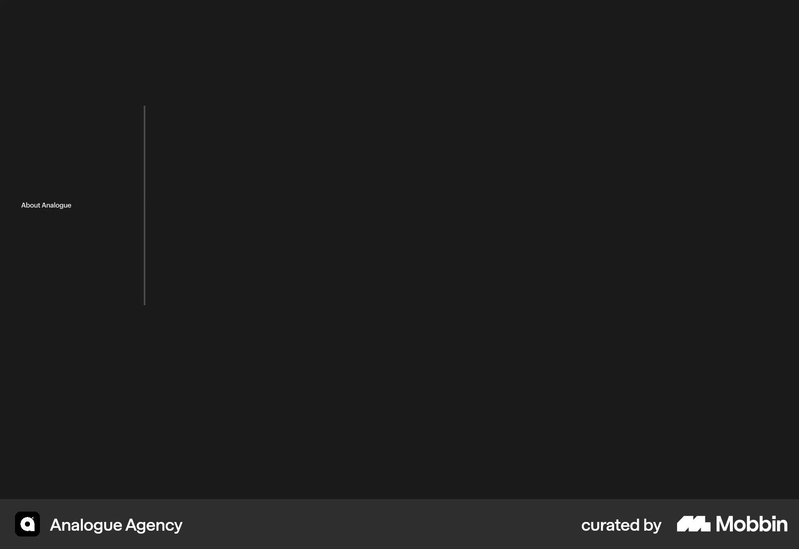
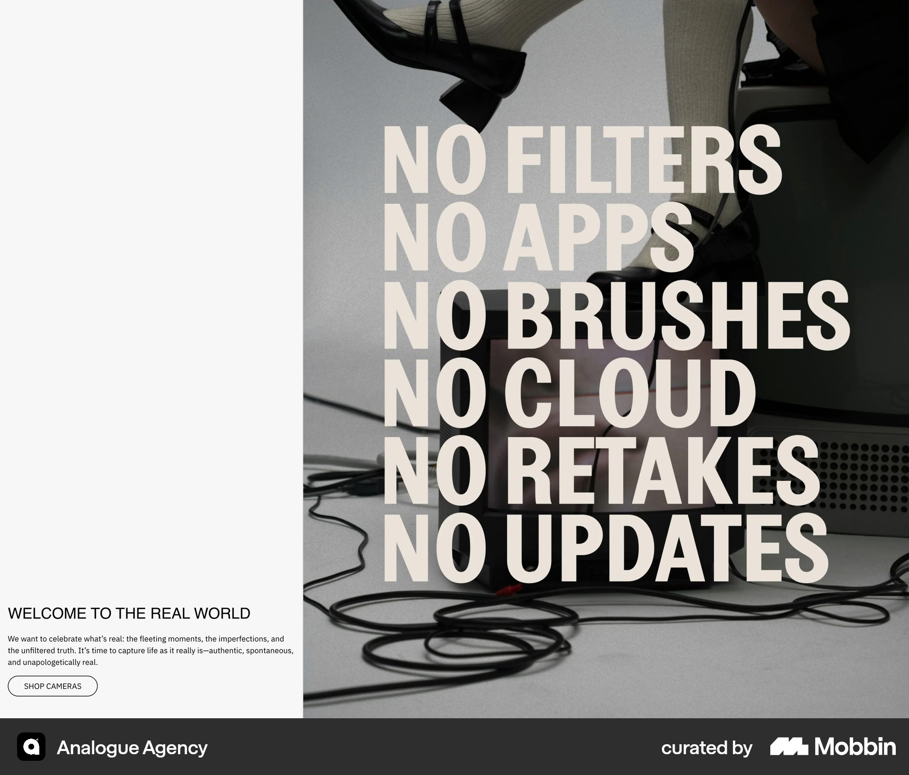
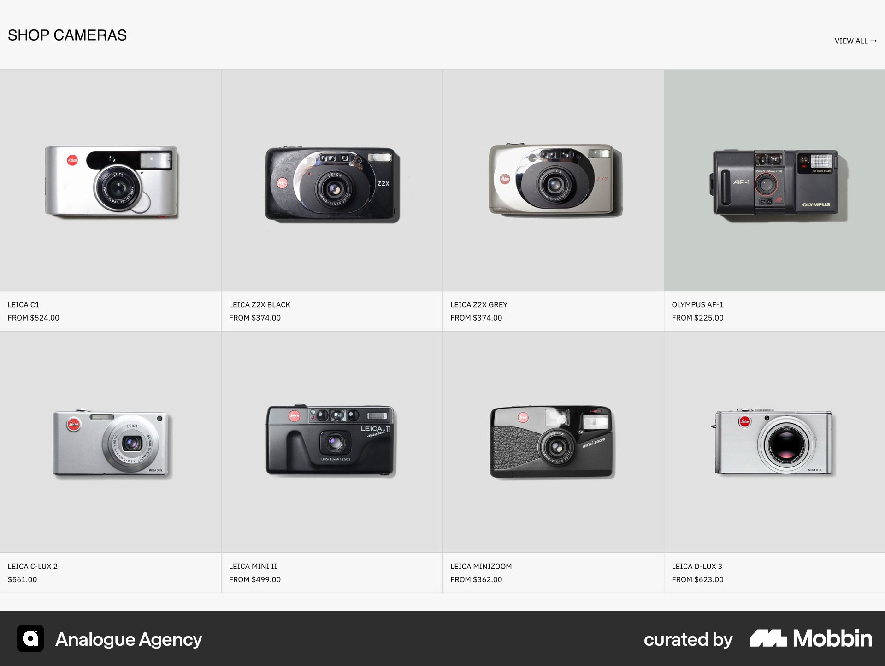

# Analogue Agency

이 문서는 수집한 화면·섹션·흐름의 구현 참고 명세다. 전체 사이트 분석을 뜻하지 않는다.

## 스튜디오 소개

- 자료 유형: section
- 출처: [Analogue Agency — Mobbin](https://mobbin.com/sites/sections/566781bb-cfb6-4b54-9360-fac8f68d4b6f)
- 확인 날짜: 2026-10-11
- 패턴: portfolio, needs-review

### 직접 관찰

- 거의 검정 바탕에 왼쪽 작은 About Analogue 텍스트와 세로 구분선만 보임. 정적 캡처 정보가 부족해 원본 미디어·동작 확인이 필요.

원본 파일: [오프라인 JPEG](../../../assets/references/566781bb-cfb6-4b54-9360-fac8f68d4b6f.jpg).

### 구현에 적용

- 위 관찰의 열 구성, 이미지 비중, 제목 위계, 색 대비를 먼저 구현한다.
- 화면에 보이는 입력·선택·필터·이동 요소를 실제 동작으로 연결한다. 정적 이미지로 확인되지 않는 동작은 구현 제안으로 기록한다.
- 해당 패턴의 [구현 플레이북](../../playbooks.md)을 읽고 완료 조건을 적용한다.
- 모바일 구성과 정확한 토큰은 이 자료만으로 확정하지 않는다. 모바일 자료를 추가 검색하고 고해상도 원본에서 측정한다.

## 흑백 큰 사진 위 반복된 굵은 대문자 선언문. 왼쪽 흰 세로 여백 아래 작은 소개·연락 링크.

- 자료 유형: section
- 출처: [Analogue Agency — Mobbin](https://mobbin.com/sites/sections/ce6ec47f-9562-4469-88db-1d1abeb05ccf)
- 확인 날짜: 2026-10-18
- 패턴: commerce-landing

### 직접 관찰

- 흑백 큰 사진 위 반복된 굵은 대문자 선언문. 왼쪽 흰 세로 여백 아래 작은 소개·연락 링크.

원본 파일: [오프라인 JPEG](../../../assets/references/ce6ec47f-9562-4469-88db-1d1abeb05ccf.jpg).

### 구현에 적용

- 위 관찰의 열 구성, 이미지 비중, 제목 위계, 색 대비를 먼저 구현한다.
- 화면에 보이는 입력·선택·필터·이동 요소를 실제 동작으로 연결한다. 정적 이미지로 확인되지 않는 동작은 구현 제안으로 기록한다.
- 해당 패턴의 [구현 플레이북](../../playbooks.md)을 읽고 완료 조건을 적용한다.
- 모바일 구성과 정확한 토큰은 이 자료만으로 확정하지 않는다. 모바일 자료를 추가 검색하고 고해상도 원본에서 측정한다.

## 흰 회색 카메라 상품 그리드 네 열. 단독 카메라 사진·작은 이름과 가격, 일부 카드 배경 강조.

- 자료 유형: section
- 출처: [Analogue Agency — Mobbin](https://mobbin.com/sites/sections/663b377d-7e4e-4515-ba06-2cc80fe557cc)
- 확인 날짜: 2026-10-18
- 패턴: commerce

### 직접 관찰

- 흰 회색 카메라 상품 그리드 네 열. 단독 카메라 사진·작은 이름과 가격, 일부 카드 배경 강조.

원본 파일: [오프라인 JPEG](../../../assets/references/663b377d-7e4e-4515-ba06-2cc80fe557cc.jpg).

### 구현에 적용

- 위 관찰의 열 구성, 이미지 비중, 제목 위계, 색 대비를 먼저 구현한다.
- 화면에 보이는 입력·선택·필터·이동 요소를 실제 동작으로 연결한다. 정적 이미지로 확인되지 않는 동작은 구현 제안으로 기록한다.
- 해당 패턴의 [구현 플레이북](../../playbooks.md)을 읽고 완료 조건을 적용한다.
- 모바일 구성과 정확한 토큰은 이 자료만으로 확정하지 않는다. 모바일 자료를 추가 검색하고 고해상도 원본에서 측정한다.
