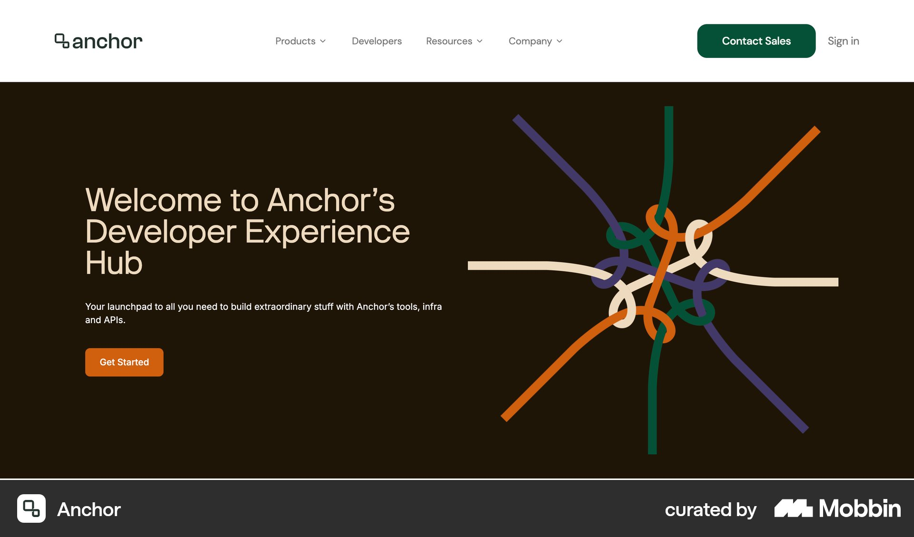
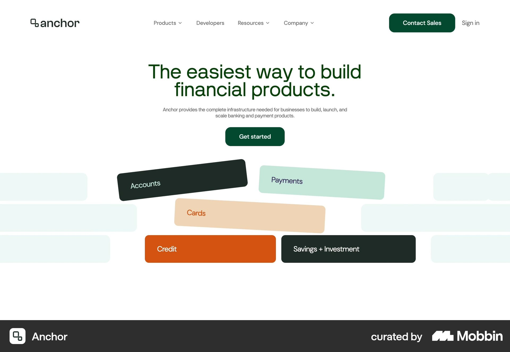

# Anchor

이 문서는 수집한 화면·섹션·흐름의 구현 참고 명세다. 전체 사이트 분석을 뜻하지 않는다.

## 개발자 플랫폼 소개

- 자료 유형: section
- 출처: [Anchor — Mobbin](https://mobbin.com/sites/sections/c9310efe-b671-4cb9-8c59-0807ff33ab22)
- 확인 날짜: 2026-10-11
- 패턴: developer-landing

### 직접 관찰

- 짙은 갈색 두 열 개발자 소개. 왼쪽 크림 제목·짧은 설명·주황 Get Started, 오른쪽 컬러 선들이 얽힌 추상 일러스트. 흰 상단 메뉴.

원본 파일: [오프라인 JPEG](../../../assets/references/c9310efe-b671-4cb9-8c59-0807ff33ab22.jpg).

### 구현에 적용

- 위 관찰의 열 구성, 이미지 비중, 제목 위계, 색 대비를 먼저 구현한다.
- 화면에 보이는 입력·선택·필터·이동 요소를 실제 동작으로 연결한다. 정적 이미지로 확인되지 않는 동작은 구현 제안으로 기록한다.
- 해당 패턴의 [구현 플레이북](../../playbooks.md)을 읽고 완료 조건을 적용한다.
- 모바일 구성과 정확한 토큰은 이 자료만으로 확정하지 않는다. 모바일 자료를 추가 검색하고 고해상도 원본에서 측정한다.

## 흰 금융 제품 히어로. 중앙 초록 제목·설명·Get started, 아래 여러 컬러 기능 알약이 층으로 쌓

- 자료 유형: section
- 출처: [Anchor — Mobbin](https://mobbin.com/sites/sections/364d08e0-4872-41a3-9f7f-8746831c4333)
- 확인 날짜: 2026-10-18
- 패턴: saas-landing

### 직접 관찰

- 흰 금융 제품 히어로. 중앙 초록 제목·설명·Get started, 아래 여러 컬러 기능 알약이 층으로 쌓임.

원본 파일: [오프라인 JPEG](../../../assets/references/364d08e0-4872-41a3-9f7f-8746831c4333.jpg).

### 구현에 적용

- 위 관찰의 열 구성, 이미지 비중, 제목 위계, 색 대비를 먼저 구현한다.
- 화면에 보이는 입력·선택·필터·이동 요소를 실제 동작으로 연결한다. 정적 이미지로 확인되지 않는 동작은 구현 제안으로 기록한다.
- 해당 패턴의 [구현 플레이북](../../playbooks.md)을 읽고 완료 조건을 적용한다.
- 모바일 구성과 정확한 토큰은 이 자료만으로 확정하지 않는다. 모바일 자료를 추가 검색하고 고해상도 원본에서 측정한다.
