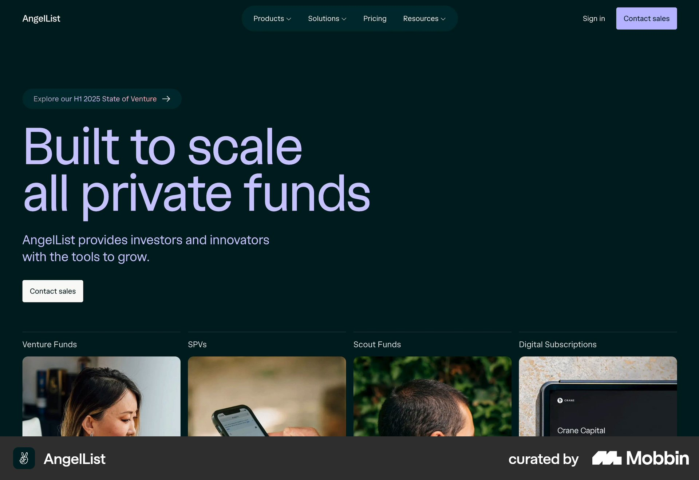

# AngelList

이 문서는 수집한 화면·섹션·흐름의 구현 참고 명세다. 전체 사이트 분석을 뜻하지 않는다.

## 짙은 청록 바탕 왼쪽 큰 연보라 제목·설명·흰 CTA. 아래 네 펀드 유형 이미지 카드. 드롭다운 열린 상태

- 자료 유형: section
- 출처: [AngelList — Mobbin](https://mobbin.com/sites/sections/df6f47be-606e-488d-b2c9-a3fe010d35b9)
- 확인 날짜: 2026-10-18
- 패턴: saas-landing

### 직접 관찰

- 짙은 청록 바탕 왼쪽 큰 연보라 제목·설명·흰 CTA. 아래 네 펀드 유형 이미지 카드. 드롭다운 열린 상태는 아님.

원본 파일: [오프라인 JPEG](../../../assets/references/df6f47be-606e-488d-b2c9-a3fe010d35b9.jpg).

### 구현에 적용

- 위 관찰의 열 구성, 이미지 비중, 제목 위계, 색 대비를 먼저 구현한다.
- 화면에 보이는 입력·선택·필터·이동 요소를 실제 동작으로 연결한다. 정적 이미지로 확인되지 않는 동작은 구현 제안으로 기록한다.
- 해당 패턴의 [구현 플레이북](../../playbooks.md)을 읽고 완료 조건을 적용한다.
- 모바일 구성과 정확한 토큰은 이 자료만으로 확정하지 않는다. 모바일 자료를 추가 검색하고 고해상도 원본에서 측정한다.

## 흰 리소스 목록 네 열 썸네일·분류·제목·한줄 설명·날짜와 읽기 시간.

- 자료 유형: section
- 출처: [AngelList — Mobbin](https://mobbin.com/sites/sections/09906617-723a-4647-be7a-e994beaebb22)
- 확인 날짜: 2026-10-18
- 패턴: editorial

### 직접 관찰

- 흰 리소스 목록 네 열 썸네일·분류·제목·한줄 설명·날짜와 읽기 시간.

원본 파일: [오프라인 JPEG](../../../assets/references/09906617-723a-4647-be7a-e994beaebb22.jpg).

### 구현에 적용

- 위 관찰의 열 구성, 이미지 비중, 제목 위계, 색 대비를 먼저 구현한다.
- 화면에 보이는 입력·선택·필터·이동 요소를 실제 동작으로 연결한다. 정적 이미지로 확인되지 않는 동작은 구현 제안으로 기록한다.
- 해당 패턴의 [구현 플레이북](../../playbooks.md)을 읽고 완료 조건을 적용한다.
- 모바일 구성과 정확한 토큰은 이 자료만으로 확정하지 않는다. 모바일 자료를 추가 검색하고 고해상도 원본에서 측정한다.
