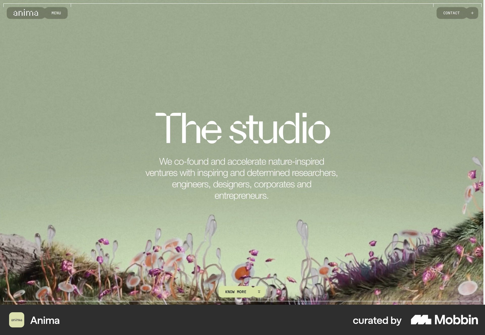
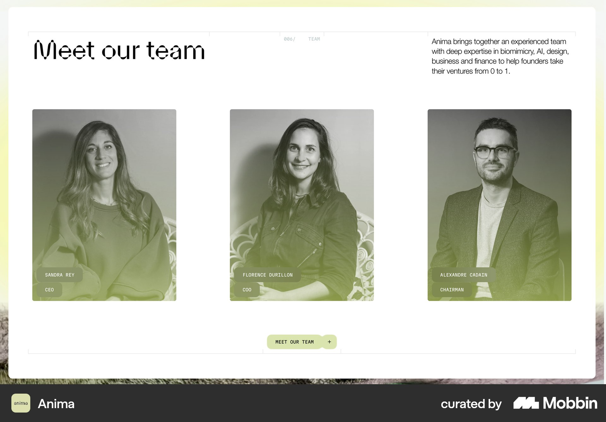

# Anima

이 문서는 수집한 화면·섹션·흐름의 구현 참고 명세다. 전체 사이트 분석을 뜻하지 않는다.

## 스튜디오 소개

- 자료 유형: section
- 출처: [Anima — Mobbin](https://mobbin.com/sites/sections/3eb3a78b-89a6-41b2-b563-fcb6fd94c2ee)
- 확인 날짜: 2026-10-11
- 패턴: portfolio

### 직접 관찰

- 연한 초록 전체 화면 장면과 아래 식물·꽃 비주얼. 중앙 큰 흰 세리프 제목 및 설명, 하단 작은 CTA. 양끝 상단 메뉴 알약.

원본 파일: [오프라인 JPEG](../../../assets/references/3eb3a78b-89a6-41b2-b563-fcb6fd94c2ee.jpg).

### 구현에 적용

- 위 관찰의 열 구성, 이미지 비중, 제목 위계, 색 대비를 먼저 구현한다.
- 화면에 보이는 입력·선택·필터·이동 요소를 실제 동작으로 연결한다. 정적 이미지로 확인되지 않는 동작은 구현 제안으로 기록한다.
- 해당 패턴의 [구현 플레이북](../../playbooks.md)을 읽고 완료 조건을 적용한다.
- 모바일 구성과 정확한 토큰은 이 자료만으로 확정하지 않는다. 모바일 자료를 추가 검색하고 고해상도 원본에서 측정한다.

## 팀 소개

- 자료 유형: section
- 출처: [Anima — Mobbin](https://mobbin.com/sites/sections/5151f1c7-7ebf-429b-97c4-299719e57b48)
- 확인 날짜: 2026-10-11
- 패턴: team-about

### 직접 관찰

- 흰 패널 상단 Meet our team 제목과 우측 짧은 소개. 세 개 흑백 인물 카드 하단에 초록 그라디언트·이름직책, 아래 작은 CTA.

원본 파일: [오프라인 JPEG](../../../assets/references/5151f1c7-7ebf-429b-97c4-299719e57b48.jpg).

### 구현에 적용

- 위 관찰의 열 구성, 이미지 비중, 제목 위계, 색 대비를 먼저 구현한다.
- 화면에 보이는 입력·선택·필터·이동 요소를 실제 동작으로 연결한다. 정적 이미지로 확인되지 않는 동작은 구현 제안으로 기록한다.
- 해당 패턴의 [구현 플레이북](../../playbooks.md)을 읽고 완료 조건을 적용한다.
- 모바일 구성과 정확한 토큰은 이 자료만으로 확정하지 않는다. 모바일 자료를 추가 검색하고 고해상도 원본에서 측정한다.
