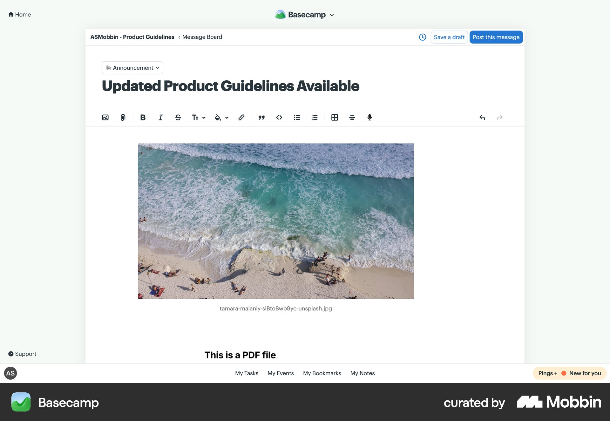
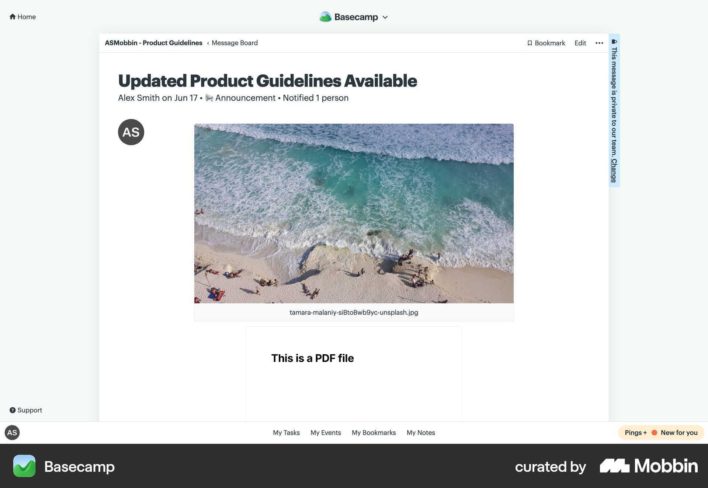

# Basecamp

이 문서는 수집한 화면·섹션·흐름의 구현 참고 명세다. 전체 사이트 분석을 뜻하지 않는다.

## 게시물 발행

- 자료 유형: flow
- 출처: [Basecamp — Mobbin](https://mobbin.com/flows/5a83ee43-c7d4-4207-879a-1e9b3bc6e942)
- 확인 날짜: 2026-10-11
- 패턴: editor, publishing

### 직접 관찰

- 단계 1: 중앙 흰 메시지 편집기. 상단 카테고리·굵은 제목·서식 도구막대·Save a draft·파란 Post this message. 본문 이미지와 첨부 콘텐츠.

- 단계 2: 게시 후 상세 화면. 같은 제목·큰 이미지·첨부, 위 작성자·날짜·알림 대상 요약. 편집 도구막대 대신 Bookmark·Edit 메뉴.

전체 2단계 중 직접 확인한 단계는 2개다. 확인하지 않은 단계의 상태·전환은 원본을 보고 확정한다.

### 전체 단계의 클라우드 파일

- 1: [로컬 원본](../../../assets/references/d2d82a47-f267-4838-94e2-9087896d1066.jpg)
- 2: [로컬 원본](../../../assets/references/59302a99-500c-4fd4-b1e7-a4bdab14d94a.jpg)

### 구현에 적용

- 위 관찰의 열 구성, 이미지 비중, 제목 위계, 색 대비를 먼저 구현한다.
- 화면에 보이는 입력·선택·필터·이동 요소를 실제 동작으로 연결한다. 정적 이미지로 확인되지 않는 동작은 구현 제안으로 기록한다.
- 해당 패턴의 [구현 플레이북](../../playbooks.md)을 읽고 완료 조건을 적용한다.
- 모바일 구성과 정확한 토큰은 이 자료만으로 확정하지 않는다. 모바일 자료를 추가 검색하고 고해상도 원본에서 측정한다.
