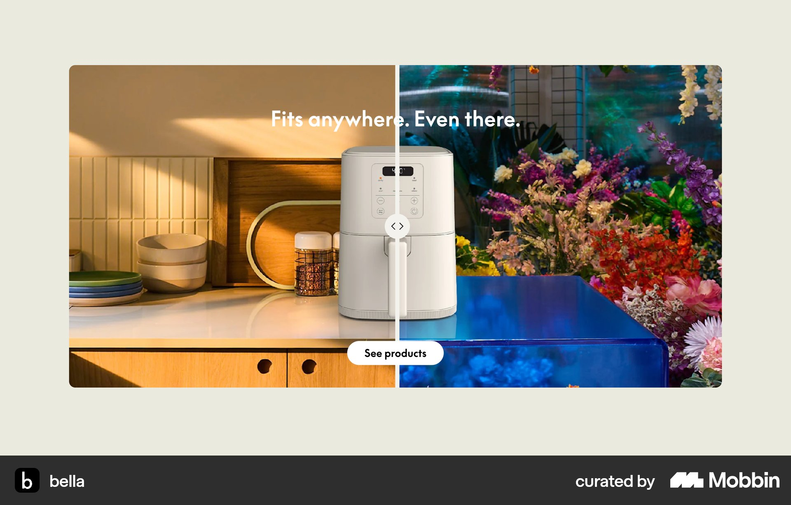
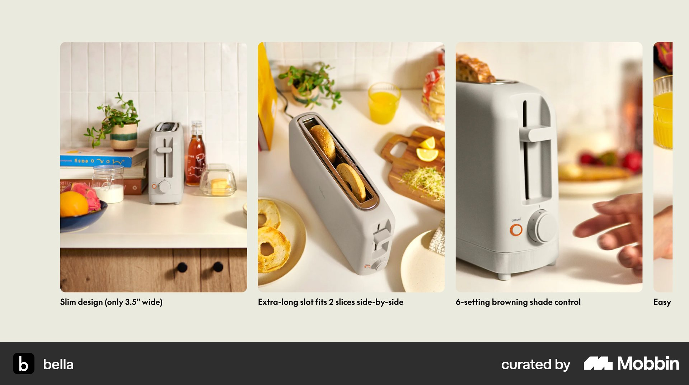
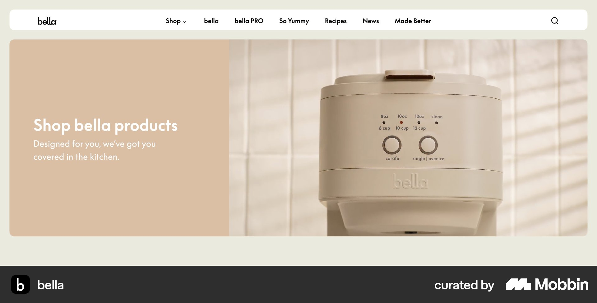
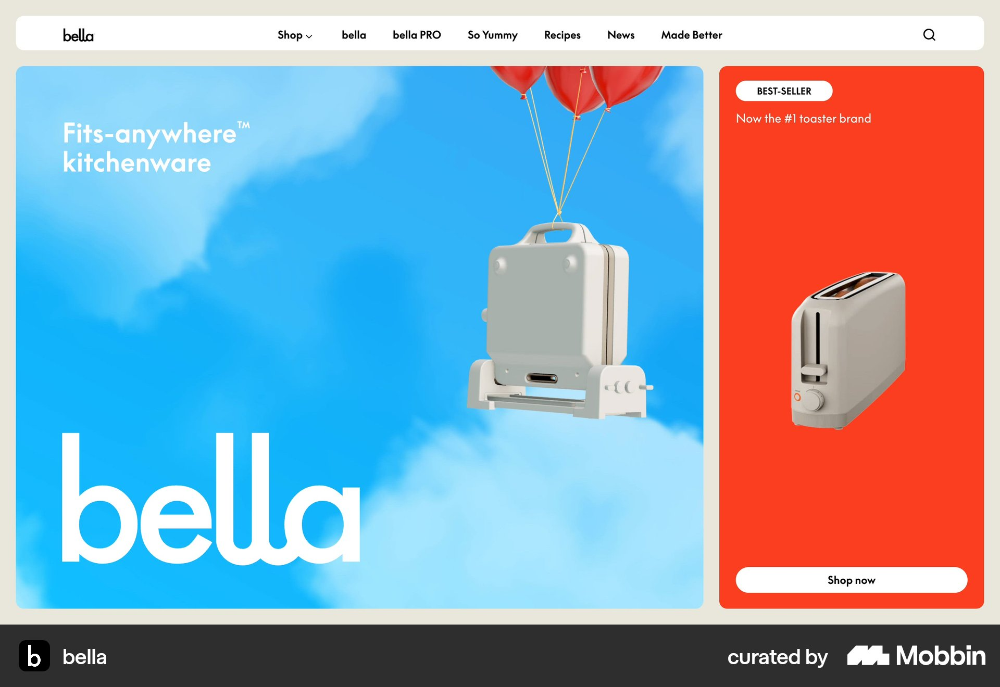

# bella

이 문서는 수집한 화면·섹션·흐름의 구현 참고 명세다. 전체 사이트 분석을 뜻하지 않는다.

## 커머스 랜딩

- 자료 유형: section
- 출처: [bella — Mobbin](https://mobbin.com/sites/sections/276ed59a-6957-45a8-8421-c85687aaa8c0)
- 확인 날짜: 2026-10-11
- 패턴: commerce-landing

### 직접 관찰

- 연한 올리브 바탕 위 둥근 사진 영역. 왼쪽 주방·오른쪽 꽃 장면 분할, 중앙 제품과 분할 핸들, 상단 흰 제목과 아래 흰 알약 CTA.

원본 파일: [오프라인 JPEG](../../../assets/references/276ed59a-6957-45a8-8421-c85687aaa8c0.jpg).

### 구현에 적용

- 위 관찰의 열 구성, 이미지 비중, 제목 위계, 색 대비를 먼저 구현한다.
- 화면에 보이는 입력·선택·필터·이동 요소를 실제 동작으로 연결한다. 정적 이미지로 확인되지 않는 동작은 구현 제안으로 기록한다.
- 해당 패턴의 [구현 플레이북](../../playbooks.md)을 읽고 완료 조건을 적용한다.
- 모바일 구성과 정확한 토큰은 이 자료만으로 확정하지 않는다. 모바일 자료를 추가 검색하고 고해상도 원본에서 측정한다.

## 크림 바탕 가로 제품 사진 카드. 토스터 사용 장면·설명 캡션과 오른쪽 다음 카드 일부.

- 자료 유형: section
- 출처: [bella — Mobbin](https://mobbin.com/sites/sections/ee1c7e61-ecd3-4865-95fa-f0641c6d5f2c)
- 확인 날짜: 2026-10-18
- 패턴: features

### 직접 관찰

- 크림 바탕 가로 제품 사진 카드. 토스터 사용 장면·설명 캡션과 오른쪽 다음 카드 일부.

원본 파일: [오프라인 JPEG](../../../assets/references/ee1c7e61-ecd3-4865-95fa-f0641c6d5f2c.jpg).

### 구현에 적용

- 위 관찰의 열 구성, 이미지 비중, 제목 위계, 색 대비를 먼저 구현한다.
- 화면에 보이는 입력·선택·필터·이동 요소를 실제 동작으로 연결한다. 정적 이미지로 확인되지 않는 동작은 구현 제안으로 기록한다.
- 해당 패턴의 [구현 플레이북](../../playbooks.md)을 읽고 완료 조건을 적용한다.
- 모바일 구성과 정확한 토큰은 이 자료만으로 확정하지 않는다. 모바일 자료를 추가 검색하고 고해상도 원본에서 측정한다.

## 크림 상단 메뉴 아래 왼쪽 모래색 제품 소개문·오른쪽 주방 제품 사진을 나눈 큰 배너.

- 자료 유형: section
- 출처: [bella — Mobbin](https://mobbin.com/sites/sections/baadd923-6b1f-4a12-9637-19612e1c36d3)
- 확인 날짜: 2026-10-18
- 패턴: commerce-landing

### 직접 관찰

- 크림 상단 메뉴 아래 왼쪽 모래색 제품 소개문·오른쪽 주방 제품 사진을 나눈 큰 배너.

원본 파일: [오프라인 JPEG](../../../assets/references/baadd923-6b1f-4a12-9637-19612e1c36d3.jpg).

### 구현에 적용

- 위 관찰의 열 구성, 이미지 비중, 제목 위계, 색 대비를 먼저 구현한다.
- 화면에 보이는 입력·선택·필터·이동 요소를 실제 동작으로 연결한다. 정적 이미지로 확인되지 않는 동작은 구현 제안으로 기록한다.
- 해당 패턴의 [구현 플레이북](../../playbooks.md)을 읽고 완료 조건을 적용한다.
- 모바일 구성과 정확한 토큰은 이 자료만으로 확정하지 않는다. 모바일 자료를 추가 검색하고 고해상도 원본에서 측정한다.

## 파란 하늘 주 배너와 빨강 사이드 패널을 나눈 커머스 히어로. 제품·큰 로고·작은 Shop now.

- 자료 유형: section
- 출처: [bella — Mobbin](https://mobbin.com/sites/sections/3270520a-f028-4fee-8af2-fafe90e7dd46)
- 확인 날짜: 2026-10-18
- 패턴: commerce-landing

### 직접 관찰

- 파란 하늘 주 배너와 빨강 사이드 패널을 나눈 커머스 히어로. 제품·큰 로고·작은 Shop now.

원본 파일: [오프라인 JPEG](../../../assets/references/3270520a-f028-4fee-8af2-fafe90e7dd46.jpg).

### 구현에 적용

- 위 관찰의 열 구성, 이미지 비중, 제목 위계, 색 대비를 먼저 구현한다.
- 화면에 보이는 입력·선택·필터·이동 요소를 실제 동작으로 연결한다. 정적 이미지로 확인되지 않는 동작은 구현 제안으로 기록한다.
- 해당 패턴의 [구현 플레이북](../../playbooks.md)을 읽고 완료 조건을 적용한다.
- 모바일 구성과 정확한 토큰은 이 자료만으로 확정하지 않는다. 모바일 자료를 추가 검색하고 고해상도 원본에서 측정한다.
