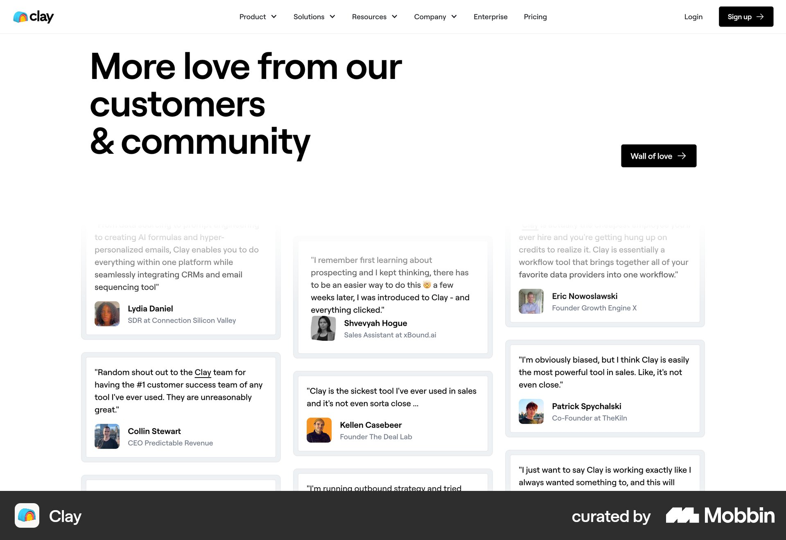
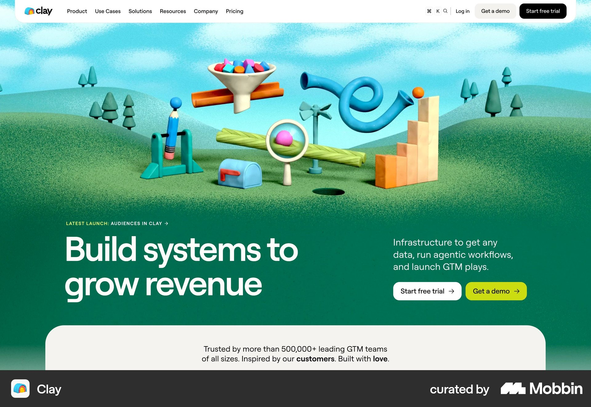

# Clay

이 문서는 수집한 화면·섹션·흐름의 구현 참고 명세다. 전체 사이트 분석을 뜻하지 않는다.

## 고객 후기

- 자료 유형: section
- 출처: [Clay — Mobbin](https://mobbin.com/sites/sections/3e4f3739-4c83-4e12-8db4-f0781f33480a)
- 확인 날짜: 2026-10-11
- 패턴: testimonials

### 직접 관찰

- 큰 왼쪽 제목과 오른쪽 검정 Wall of love 링크. 세 열 높이가 다른 흰 후기 카드와 아바타·이름·직책. 위쪽 일부 카드는 옅게 처리.

원본 파일: [오프라인 JPEG](../../../assets/references/3e4f3739-4c83-4e12-8db4-f0781f33480a.jpg).

### 구현에 적용

- 위 관찰의 열 구성, 이미지 비중, 제목 위계, 색 대비를 먼저 구현한다.
- 화면에 보이는 입력·선택·필터·이동 요소를 실제 동작으로 연결한다. 정적 이미지로 확인되지 않는 동작은 구현 제안으로 기록한다.
- 해당 패턴의 [구현 플레이북](../../playbooks.md)을 읽고 완료 조건을 적용한다.
- 모바일 구성과 정확한 토큰은 이 자료만으로 확정하지 않는다. 모바일 자료를 추가 검색하고 고해상도 원본에서 측정한다.

## 제품 랜딩

- 자료 유형: section
- 출처: [Clay — Mobbin](https://mobbin.com/sites/sections/5f21cc1b-5ed6-4e15-a51f-49b629c41c7a)
- 확인 날짜: 2026-10-11
- 패턴: saas-landing

### 직접 관찰

- 초록 3D 풍경과 컬러 추상 도구 이미지. 하단 왼쪽 큰 흰 제목, 오른쪽 설명·흰 가입·라임 데모 CTA. 아래 흰 신뢰 패널.

원본 파일: [오프라인 JPEG](../../../assets/references/5f21cc1b-5ed6-4e15-a51f-49b629c41c7a.jpg).

### 구현에 적용

- 위 관찰의 열 구성, 이미지 비중, 제목 위계, 색 대비를 먼저 구현한다.
- 화면에 보이는 입력·선택·필터·이동 요소를 실제 동작으로 연결한다. 정적 이미지로 확인되지 않는 동작은 구현 제안으로 기록한다.
- 해당 패턴의 [구현 플레이북](../../playbooks.md)을 읽고 완료 조건을 적용한다.
- 모바일 구성과 정확한 토큰은 이 자료만으로 확정하지 않는다. 모바일 자료를 추가 검색하고 고해상도 원본에서 측정한다.
