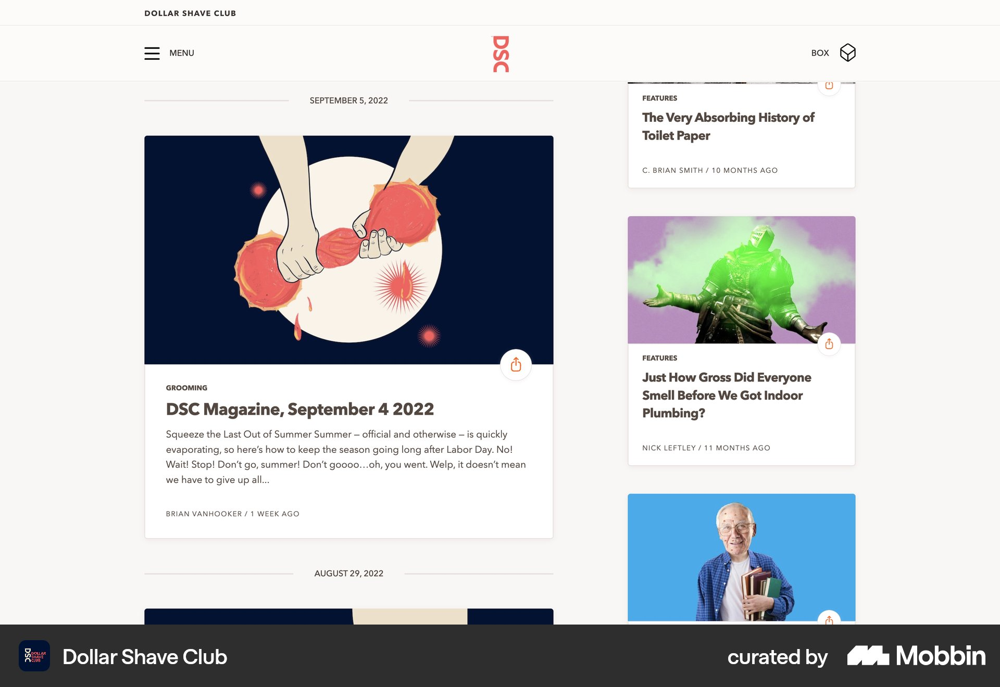
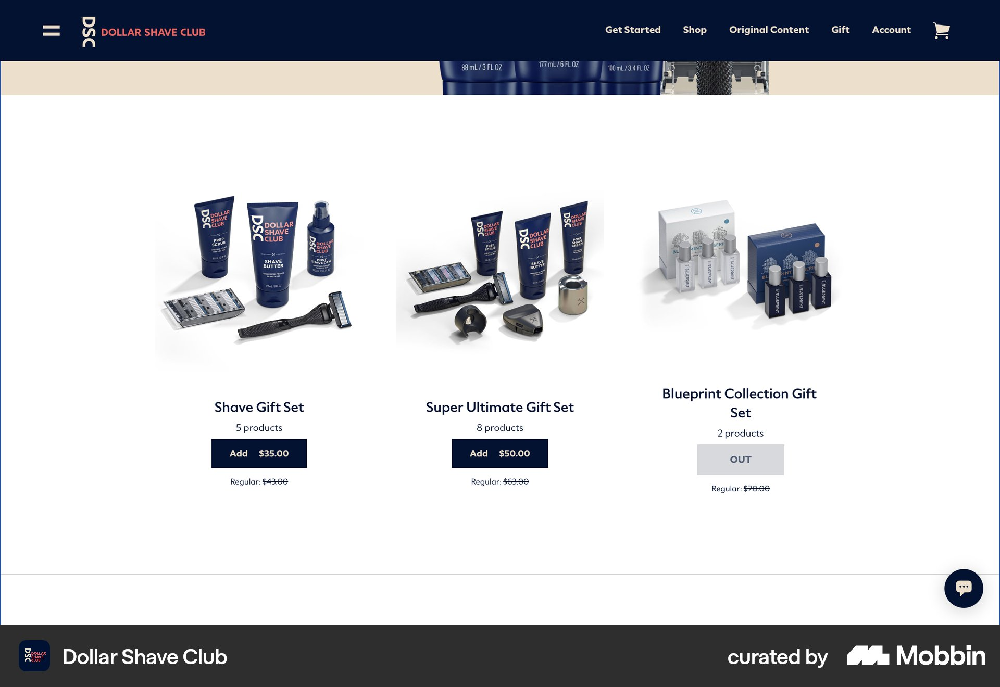

# Dollar Shave Club

이 문서는 수집한 화면·섹션·흐름의 구현 참고 명세다. 전체 사이트 분석을 뜻하지 않는다.

## 잡지형 블로그. 왼쪽 대표 기사·일러스트·요약, 오른쪽 좁은 추천 기사 세로 목록과 이미지.

- 자료 유형: section
- 출처: [Dollar Shave Club — Mobbin](https://mobbin.com/sites/sections/75df03ad-063a-4827-9eb7-b35e70033d21)
- 확인 날짜: 2026-10-18
- 패턴: editorial

### 직접 관찰

- 잡지형 블로그. 왼쪽 대표 기사·일러스트·요약, 오른쪽 좁은 추천 기사 세로 목록과 이미지.

원본 파일: [오프라인 JPEG](../../../assets/references/75df03ad-063a-4827-9eb7-b35e70033d21.jpg).

### 구현에 적용

- 위 관찰의 열 구성, 이미지 비중, 제목 위계, 색 대비를 먼저 구현한다.
- 화면에 보이는 입력·선택·필터·이동 요소를 실제 동작으로 연결한다. 정적 이미지로 확인되지 않는 동작은 구현 제안으로 기록한다.
- 해당 패턴의 [구현 플레이북](../../playbooks.md)을 읽고 완료 조건을 적용한다.
- 모바일 구성과 정확한 토큰은 이 자료만으로 확정하지 않는다. 모바일 자료를 추가 검색하고 고해상도 원본에서 측정한다.

## 흰 바탕 세 열 면도 세트 상품. 각 상품 사진·이름·상품 수·검정 담기 버튼, 남색 상단 메뉴.

- 자료 유형: section
- 출처: [Dollar Shave Club — Mobbin](https://mobbin.com/sites/sections/12c63abc-3e3a-4731-9886-e8a8d0728153)
- 확인 날짜: 2026-10-18
- 패턴: commerce

### 직접 관찰

- 흰 바탕 세 열 면도 세트 상품. 각 상품 사진·이름·상품 수·검정 담기 버튼, 남색 상단 메뉴.

원본 파일: [오프라인 JPEG](../../../assets/references/12c63abc-3e3a-4731-9886-e8a8d0728153.jpg).

### 구현에 적용

- 위 관찰의 열 구성, 이미지 비중, 제목 위계, 색 대비를 먼저 구현한다.
- 화면에 보이는 입력·선택·필터·이동 요소를 실제 동작으로 연결한다. 정적 이미지로 확인되지 않는 동작은 구현 제안으로 기록한다.
- 해당 패턴의 [구현 플레이북](../../playbooks.md)을 읽고 완료 조건을 적용한다.
- 모바일 구성과 정확한 토큰은 이 자료만으로 확정하지 않는다. 모바일 자료를 추가 검색하고 고해상도 원본에서 측정한다.
