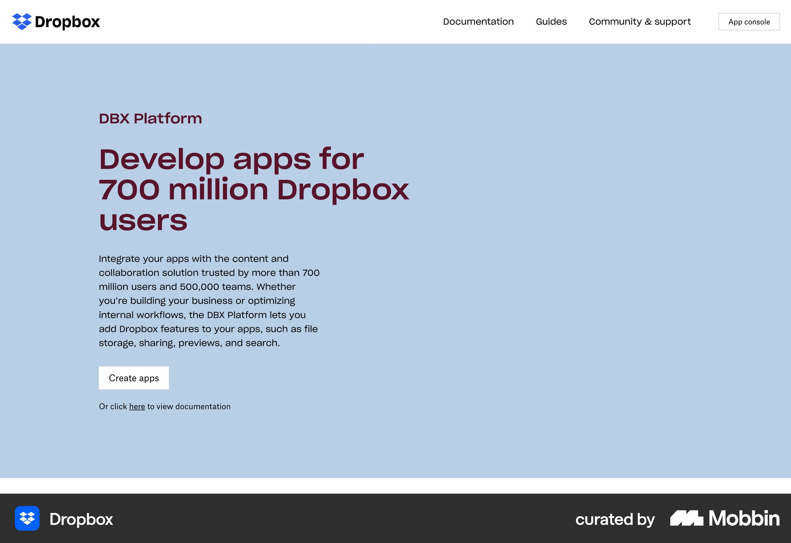
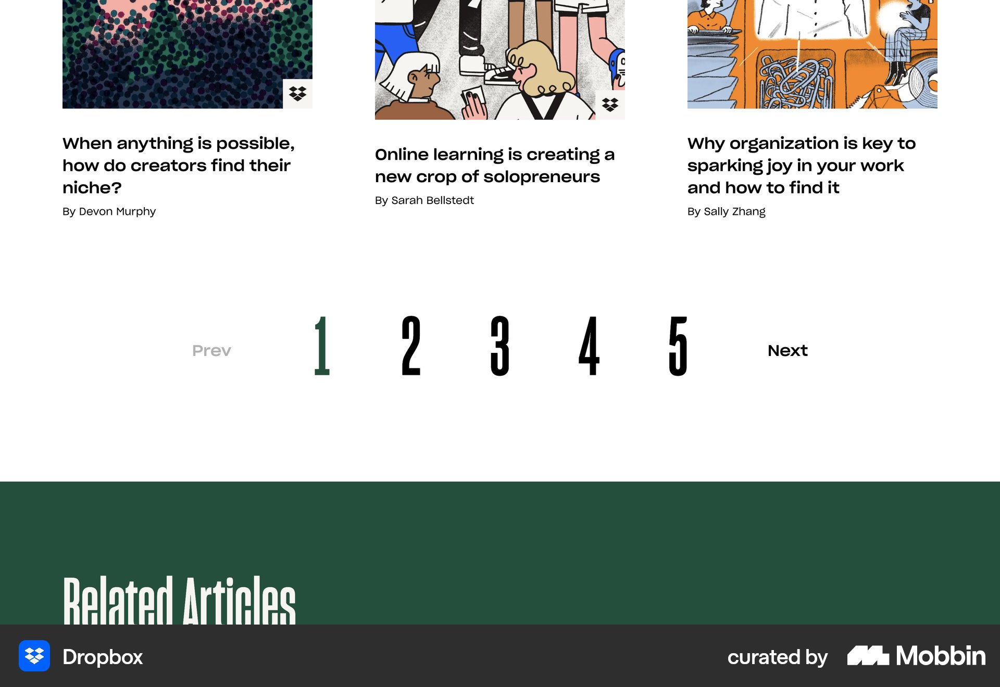
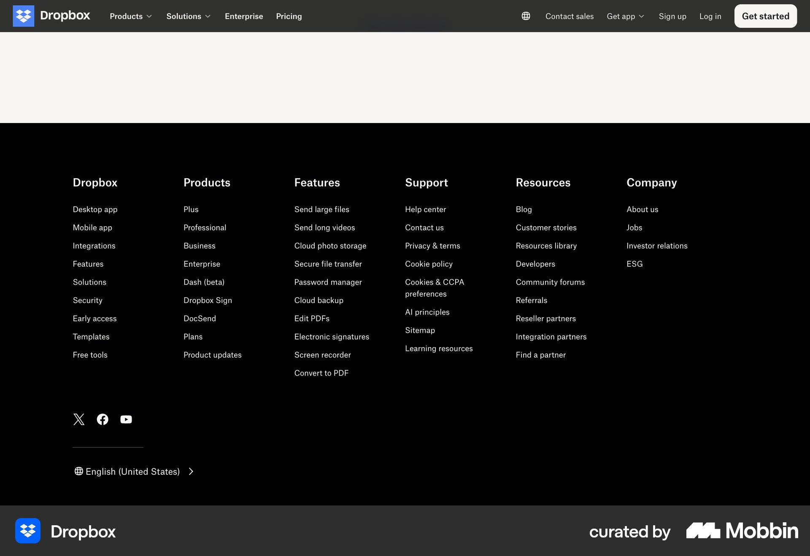

# Dropbox

이 문서는 수집한 화면·섹션·흐름의 구현 참고 명세다. 전체 사이트 분석을 뜻하지 않는다.

## 개발자 플랫폼 소개

- 자료 유형: section
- 출처: [Dropbox — Mobbin](https://mobbin.com/sites/sections/c6ac4194-8ca0-403c-9bad-9aefa858c286)
- 확인 날짜: 2026-10-11
- 패턴: developer-landing

### 직접 관찰

- 연한 파랑 개발자 플랫폼 소개. 왼쪽 짙은 자주 제목·설명·흰 Create apps 버튼·문서 링크, 오른쪽 넓은 여백. 상단 문서 메뉴.

원본 파일: [오프라인 JPEG](../../../assets/references/c6ac4194-8ca0-403c-9bad-9aefa858c286.jpg).

### 구현에 적용

- 위 관찰의 열 구성, 이미지 비중, 제목 위계, 색 대비를 먼저 구현한다.
- 화면에 보이는 입력·선택·필터·이동 요소를 실제 동작으로 연결한다. 정적 이미지로 확인되지 않는 동작은 구현 제안으로 기록한다.
- 해당 패턴의 [구현 플레이북](../../playbooks.md)을 읽고 완료 조건을 적용한다.
- 모바일 구성과 정확한 토큰은 이 자료만으로 확정하지 않는다. 모바일 자료를 추가 검색하고 고해상도 원본에서 측정한다.

## 세 열 일러스트 기사·작성자 아래 매우 큰 숫자 페이지 이동. 하단 짙은 초록 Related Articles

- 자료 유형: section
- 출처: [Dropbox — Mobbin](https://mobbin.com/sites/sections/55920644-e785-4659-a24f-0e84e20d109d)
- 확인 날짜: 2026-10-18
- 패턴: editorial

### 직접 관찰

- 세 열 일러스트 기사·작성자 아래 매우 큰 숫자 페이지 이동. 하단 짙은 초록 Related Articles.

원본 파일: [오프라인 JPEG](../../../assets/references/55920644-e785-4659-a24f-0e84e20d109d.jpg).

### 구현에 적용

- 위 관찰의 열 구성, 이미지 비중, 제목 위계, 색 대비를 먼저 구현한다.
- 화면에 보이는 입력·선택·필터·이동 요소를 실제 동작으로 연결한다. 정적 이미지로 확인되지 않는 동작은 구현 제안으로 기록한다.
- 해당 패턴의 [구현 플레이북](../../playbooks.md)을 읽고 완료 조건을 적용한다.
- 모바일 구성과 정확한 토큰은 이 자료만으로 확정하지 않는다. 모바일 자료를 추가 검색하고 고해상도 원본에서 측정한다.

## 검정 푸터형 전체 링크 영역. 다섯 열 제품·기능·지원·리소스·회사, 아래 소셜 및 언어 선택.

- 자료 유형: section
- 출처: [Dropbox — Mobbin](https://mobbin.com/sites/sections/a242fe84-08f4-4d56-91b9-a781a38dbdbb)
- 확인 날짜: 2026-10-18
- 패턴: footer

### 직접 관찰

- 검정 푸터형 전체 링크 영역. 다섯 열 제품·기능·지원·리소스·회사, 아래 소셜 및 언어 선택.

원본 파일: [오프라인 JPEG](../../../assets/references/a242fe84-08f4-4d56-91b9-a781a38dbdbb.jpg).

### 구현에 적용

- 위 관찰의 열 구성, 이미지 비중, 제목 위계, 색 대비를 먼저 구현한다.
- 화면에 보이는 입력·선택·필터·이동 요소를 실제 동작으로 연결한다. 정적 이미지로 확인되지 않는 동작은 구현 제안으로 기록한다.
- 해당 패턴의 [구현 플레이북](../../playbooks.md)을 읽고 완료 조건을 적용한다.
- 모바일 구성과 정확한 토큰은 이 자료만으로 확정하지 않는다. 모바일 자료를 추가 검색하고 고해상도 원본에서 측정한다.
