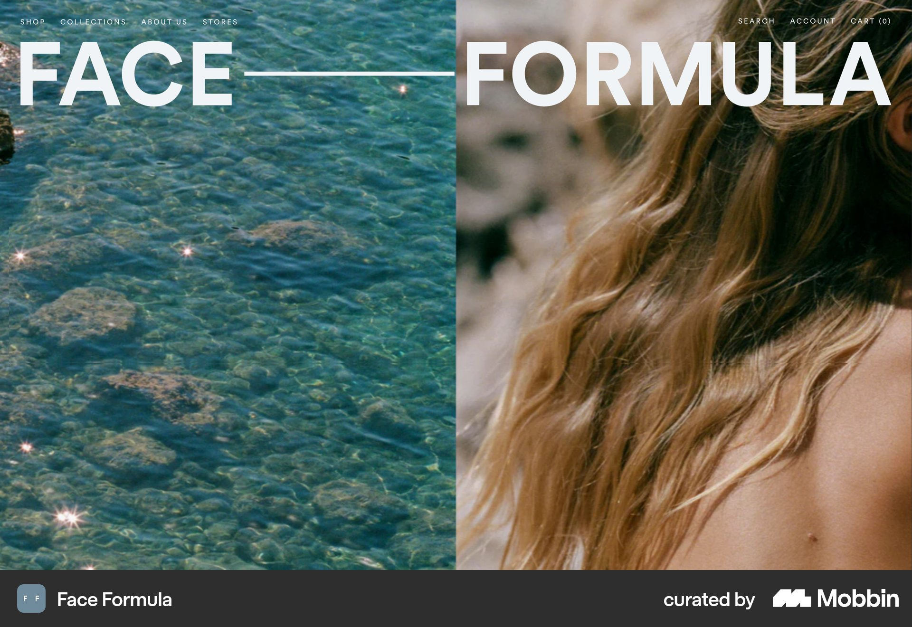

# Face Formula

이 문서는 수집한 화면·섹션·흐름의 구현 참고 명세다. 전체 사이트 분석을 뜻하지 않는다.

## 밝은 파랑 세로 상품 편집 그리드. 인물 사진과 작은 제품 컷을 서로 다른 크기로 혼합.

- 자료 유형: section
- 출처: [Face Formula — Mobbin](https://mobbin.com/sites/sections/9bceb928-2678-4766-b31d-6788ed5031c4)
- 확인 날짜: 2026-10-18
- 패턴: commerce

### 직접 관찰

- 밝은 파랑 세로 상품 편집 그리드. 인물 사진과 작은 제품 컷을 서로 다른 크기로 혼합.

원본 파일: [오프라인 JPEG](../../../assets/references/9bceb928-2678-4766-b31d-6788ed5031c4.jpg).

### 구현에 적용

- 위 관찰의 열 구성, 이미지 비중, 제목 위계, 색 대비를 먼저 구현한다.
- 화면에 보이는 입력·선택·필터·이동 요소를 실제 동작으로 연결한다. 정적 이미지로 확인되지 않는 동작은 구현 제안으로 기록한다.
- 해당 패턴의 [구현 플레이북](../../playbooks.md)을 읽고 완료 조건을 적용한다.
- 모바일 구성과 정확한 토큰은 이 자료만으로 확정하지 않는다. 모바일 자료를 추가 검색하고 고해상도 원본에서 측정한다.

## 밝은 파랑 All products. 작은 세리프 중앙 제목·네 제품 이미지와 하단 넓은 브랜드 영상·뉴스레터

- 자료 유형: section
- 출처: [Face Formula — Mobbin](https://mobbin.com/sites/sections/2c42876f-e42f-49dc-ba18-b6acc4bdf204)
- 확인 날짜: 2026-10-18
- 패턴: commerce

### 직접 관찰

- 밝은 파랑 All products. 작은 세리프 중앙 제목·네 제품 이미지와 하단 넓은 브랜드 영상·뉴스레터 입력.

원본 파일: [오프라인 JPEG](../../../assets/references/2c42876f-e42f-49dc-ba18-b6acc4bdf204.jpg).

### 구현에 적용

- 위 관찰의 열 구성, 이미지 비중, 제목 위계, 색 대비를 먼저 구현한다.
- 화면에 보이는 입력·선택·필터·이동 요소를 실제 동작으로 연결한다. 정적 이미지로 확인되지 않는 동작은 구현 제안으로 기록한다.
- 해당 패턴의 [구현 플레이북](../../playbooks.md)을 읽고 완료 조건을 적용한다.
- 모바일 구성과 정확한 토큰은 이 자료만으로 확정하지 않는다. 모바일 자료를 추가 검색하고 고해상도 원본에서 측정한다.

## 물결 사진·인물 머리카락 사진 두 열 위에 각각 FACE·FORMULA 큰 흰 글자. 작은 상단 메뉴.

- 자료 유형: section
- 출처: [Face Formula — Mobbin](https://mobbin.com/sites/sections/b266b4bd-2c02-4ac4-afb3-9b9efea2c39d)
- 확인 날짜: 2026-10-18
- 패턴: commerce-landing

### 직접 관찰

- 물결 사진·인물 머리카락 사진 두 열 위에 각각 FACE·FORMULA 큰 흰 글자. 작은 상단 메뉴.

원본 파일: [오프라인 JPEG](../../../assets/references/b266b4bd-2c02-4ac4-afb3-9b9efea2c39d.jpg).

### 구현에 적용

- 위 관찰의 열 구성, 이미지 비중, 제목 위계, 색 대비를 먼저 구현한다.
- 화면에 보이는 입력·선택·필터·이동 요소를 실제 동작으로 연결한다. 정적 이미지로 확인되지 않는 동작은 구현 제안으로 기록한다.
- 해당 패턴의 [구현 플레이북](../../playbooks.md)을 읽고 완료 조건을 적용한다.
- 모바일 구성과 정확한 토큰은 이 자료만으로 확정하지 않는다. 모바일 자료를 추가 검색하고 고해상도 원본에서 측정한다.
