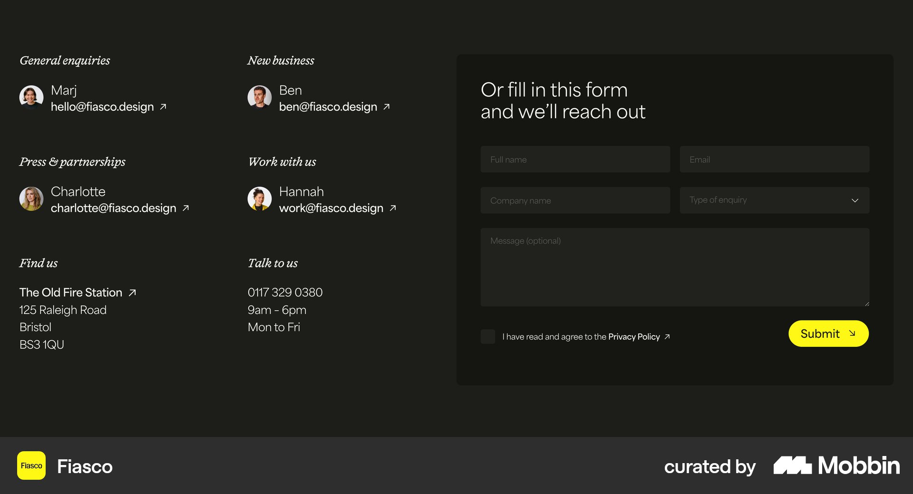
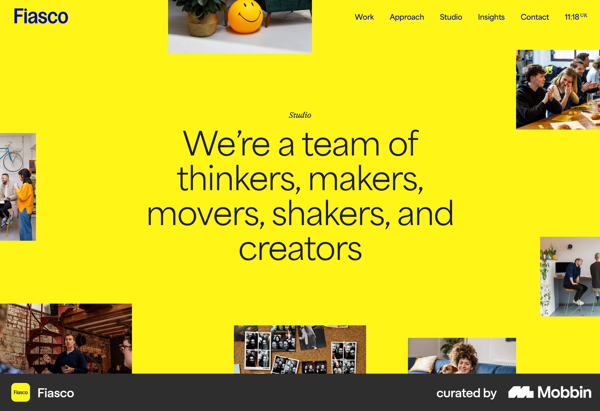

# Fiasco

이 문서는 수집한 화면·섹션·흐름의 구현 참고 명세다. 전체 사이트 분석을 뜻하지 않는다.

## 문의

- 자료 유형: section
- 출처: [Fiasco — Mobbin](https://mobbin.com/sites/sections/95a27e82-73ff-4704-b843-682d1281753b)
- 확인 날짜: 2026-10-11
- 패턴: contact-form

### 직접 관찰

- 짙은 올리브 배경. 왼쪽 두 열 담당자·아바타·연락처와 주소, 오른쪽 더 어두운 문의 폼. 두 열 입력·메시지·동의·노란 Submit.

원본 파일: [오프라인 JPEG](../../../assets/references/95a27e82-73ff-4704-b843-682d1281753b.jpg).

### 구현에 적용

- 위 관찰의 열 구성, 이미지 비중, 제목 위계, 색 대비를 먼저 구현한다.
- 화면에 보이는 입력·선택·필터·이동 요소를 실제 동작으로 연결한다. 정적 이미지로 확인되지 않는 동작은 구현 제안으로 기록한다.
- 해당 패턴의 [구현 플레이북](../../playbooks.md)을 읽고 완료 조건을 적용한다.
- 모바일 구성과 정확한 토큰은 이 자료만으로 확정하지 않는다. 모바일 자료를 추가 검색하고 고해상도 원본에서 측정한다.

## 스튜디오 소개

- 자료 유형: section
- 출처: [Fiasco — Mobbin](https://mobbin.com/sites/sections/51d590fd-8f49-4763-98a3-06392c4f7df8)
- 확인 날짜: 2026-10-11
- 패턴: portfolio

### 직접 관찰

- 선명한 노란 전체 화면. 중앙 가는 큰 소개문, 화면 가장자리 여러 작업·팀 사진 콜라주. 파란 로고와 작은 상단 메뉴.

원본 파일: [오프라인 JPEG](../../../assets/references/51d590fd-8f49-4763-98a3-06392c4f7df8.jpg).

### 구현에 적용

- 위 관찰의 열 구성, 이미지 비중, 제목 위계, 색 대비를 먼저 구현한다.
- 화면에 보이는 입력·선택·필터·이동 요소를 실제 동작으로 연결한다. 정적 이미지로 확인되지 않는 동작은 구현 제안으로 기록한다.
- 해당 패턴의 [구현 플레이북](../../playbooks.md)을 읽고 완료 조건을 적용한다.
- 모바일 구성과 정확한 토큰은 이 자료만으로 확정하지 않는다. 모바일 자료를 추가 검색하고 고해상도 원본에서 측정한다.

## 크림 배경 네 작업을 두 열 사진·이름·설명으로 배치. 위 중앙 짧은 스튜디오 소개.

- 자료 유형: section
- 출처: [Fiasco — Mobbin](https://mobbin.com/sites/sections/4ed7c118-a866-41fa-824c-32a24323c927)
- 확인 날짜: 2026-10-18
- 패턴: portfolio

### 직접 관찰

- 크림 배경 네 작업을 두 열 사진·이름·설명으로 배치. 위 중앙 짧은 스튜디오 소개.

원본 파일: [오프라인 JPEG](../../../assets/references/4ed7c118-a866-41fa-824c-32a24323c927.jpg).

### 구현에 적용

- 위 관찰의 열 구성, 이미지 비중, 제목 위계, 색 대비를 먼저 구현한다.
- 화면에 보이는 입력·선택·필터·이동 요소를 실제 동작으로 연결한다. 정적 이미지로 확인되지 않는 동작은 구현 제안으로 기록한다.
- 해당 패턴의 [구현 플레이북](../../playbooks.md)을 읽고 완료 조건을 적용한다.
- 모바일 구성과 정확한 토큰은 이 자료만으로 확정하지 않는다. 모바일 자료를 추가 검색하고 고해상도 원본에서 측정한다.
