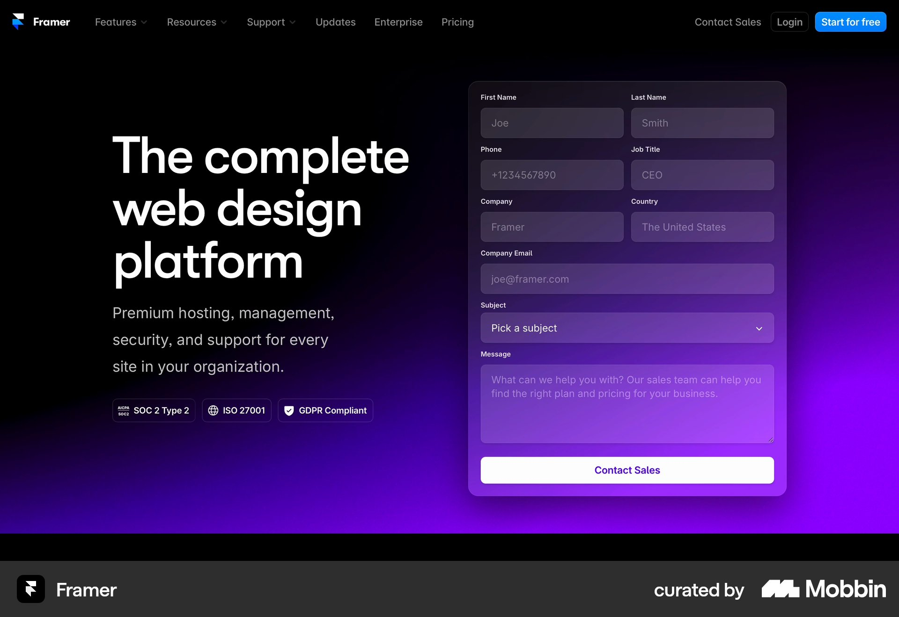
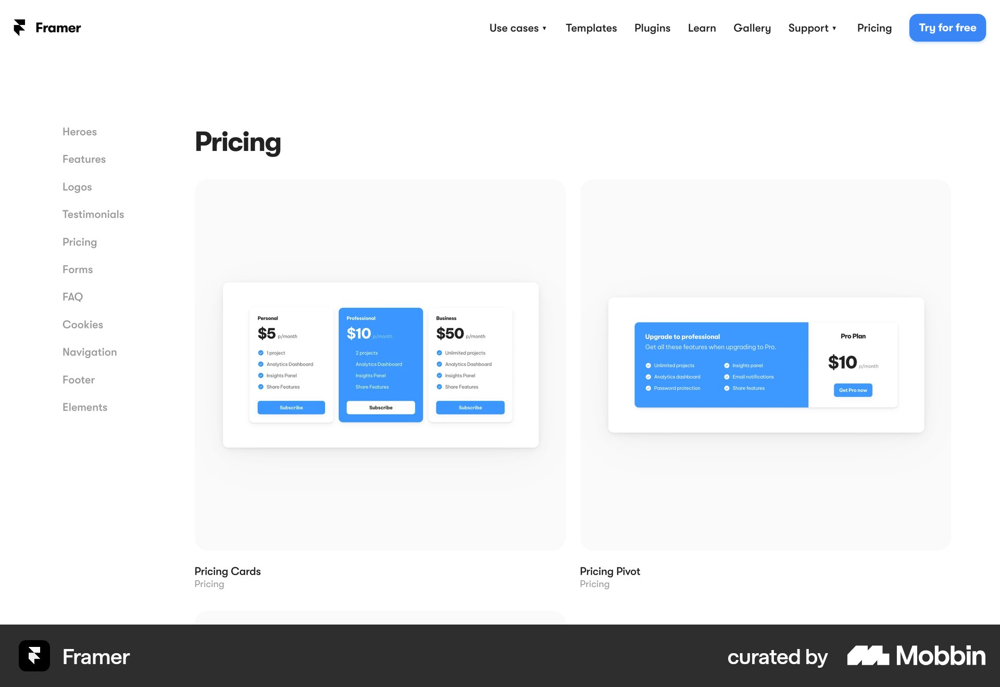
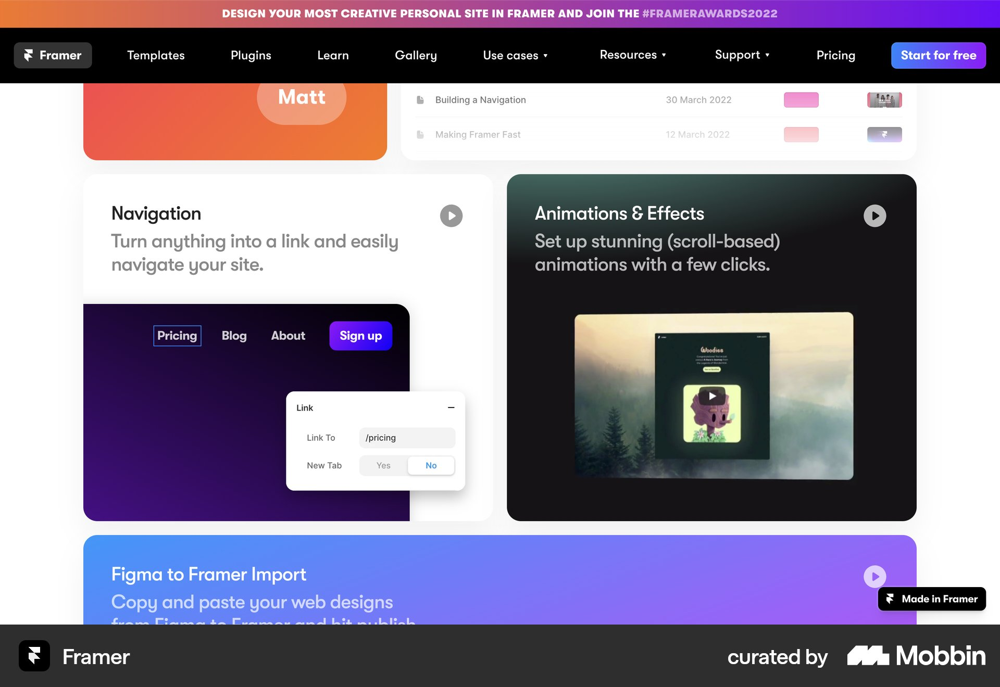

# Framer

이 문서는 수집한 화면·섹션·흐름의 구현 참고 명세다. 전체 사이트 분석을 뜻하지 않는다.

## 문의

- 자료 유형: section
- 출처: [Framer — Mobbin](https://mobbin.com/sites/sections/914df681-c24d-4800-bd11-9c144d0175fb)
- 확인 날짜: 2026-10-11
- 패턴: contact-form

### 직접 관찰

- 검정-보라 그라디언트 배경. 왼쪽 큰 세 줄 제목·설명·보안 배지, 오른쪽 반투명 문의 카드에 두 열 입력·subject·message·흰 CTA.

원본 파일: [오프라인 JPEG](../../../assets/references/914df681-c24d-4800-bd11-9c144d0175fb.jpg).

### 구현에 적용

- 위 관찰의 열 구성, 이미지 비중, 제목 위계, 색 대비를 먼저 구현한다.
- 화면에 보이는 입력·선택·필터·이동 요소를 실제 동작으로 연결한다. 정적 이미지로 확인되지 않는 동작은 구현 제안으로 기록한다.
- 해당 패턴의 [구현 플레이북](../../playbooks.md)을 읽고 완료 조건을 적용한다.
- 모바일 구성과 정확한 토큰은 이 자료만으로 확정하지 않는다. 모바일 자료를 추가 검색하고 고해상도 원본에서 측정한다.

## Framer: 요금제 컴포넌트 갤러리

- 자료 유형: section
- 출처: [Framer — Mobbin](https://mobbin.com/sites/sections/8405825f-eb49-4f96-ac65-26cb3410f7de)
- 확인 날짜: 2026-10-11
- 패턴: pricing, pattern-gallery

### 직접 관찰

- 검색 결과는 실제 구독 요금 페이지가 아니라 Pricing Cards와 Pricing Pivot 예시를 보여주는 패턴 갤러리다. 왼쪽 섹션 목록, 상단 메뉴, 두 개의 큰 연회색 데모 타일이 있다. 타일 안에 파란 강조 요금 카드 예시가 보인다.

원본 파일: [오프라인 JPEG](../../../assets/references/8405825f-eb49-4f96-ac65-26cb3410f7de.jpg).

### 구현에 적용

- 위 관찰의 열 구성, 이미지 비중, 제목 위계, 색 대비를 먼저 구현한다.
- 화면에 보이는 입력·선택·필터·이동 요소를 실제 동작으로 연결한다. 정적 이미지로 확인되지 않는 동작은 구현 제안으로 기록한다.
- 해당 패턴의 [구현 플레이북](../../playbooks.md)을 읽고 완료 조건을 적용한다.
- 모바일 구성과 정확한 토큰은 이 자료만으로 확정하지 않는다. 모바일 자료를 추가 검색하고 고해상도 원본에서 측정한다.

## 크림·검정·보라 벤토 기능 카드. 내비게이션·애니메이션·가져오기 등 각 기능의 UI 예시와 제목.

- 자료 유형: section
- 출처: [Framer — Mobbin](https://mobbin.com/sites/sections/16fc8417-50fc-445e-8cca-e87fc08073ce)
- 확인 날짜: 2026-10-18
- 패턴: features

### 직접 관찰

- 크림·검정·보라 벤토 기능 카드. 내비게이션·애니메이션·가져오기 등 각 기능의 UI 예시와 제목.

원본 파일: [오프라인 JPEG](../../../assets/references/16fc8417-50fc-445e-8cca-e87fc08073ce.jpg).

### 구현에 적용

- 위 관찰의 열 구성, 이미지 비중, 제목 위계, 색 대비를 먼저 구현한다.
- 화면에 보이는 입력·선택·필터·이동 요소를 실제 동작으로 연결한다. 정적 이미지로 확인되지 않는 동작은 구현 제안으로 기록한다.
- 해당 패턴의 [구현 플레이북](../../playbooks.md)을 읽고 완료 조건을 적용한다.
- 모바일 구성과 정확한 토큰은 이 자료만으로 확정하지 않는다. 모바일 자료를 추가 검색하고 고해상도 원본에서 측정한다.
