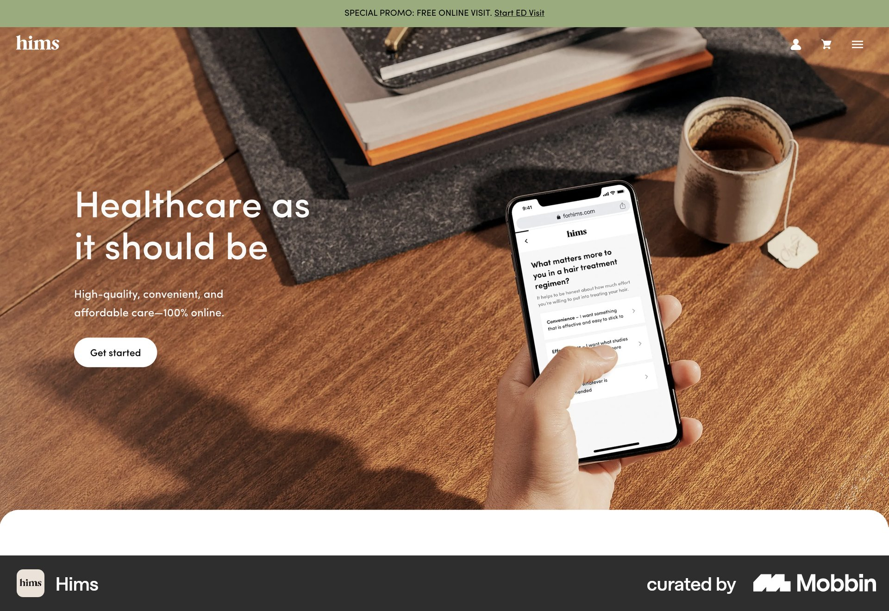
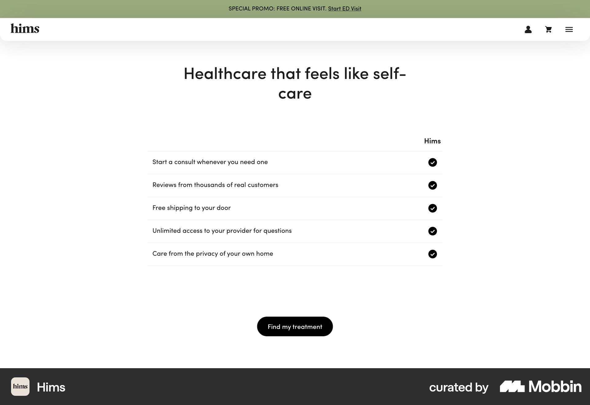

# Hims

이 문서는 수집한 화면·섹션·흐름의 구현 참고 명세다. 전체 사이트 분석을 뜻하지 않는다.

## 의료 서비스 소개

- 자료 유형: section
- 출처: [Hims — Mobbin](https://mobbin.com/sites/sections/2aac84d2-0606-4ed6-a558-71871c6ee181)
- 확인 날짜: 2026-10-11
- 패턴: healthcare-landing

### 직접 관찰

- 전체 폭 따뜻한 책상·휴대폰 사진. 왼쪽 흰 두 줄 의료 소개·설명·흰 Get started, 상단 올리브 프로모션 줄과 흰 내비 아이콘.

원본 파일: [오프라인 JPEG](../../../assets/references/2aac84d2-0606-4ed6-a558-71871c6ee181.jpg).

### 구현에 적용

- 위 관찰의 열 구성, 이미지 비중, 제목 위계, 색 대비를 먼저 구현한다.
- 화면에 보이는 입력·선택·필터·이동 요소를 실제 동작으로 연결한다. 정적 이미지로 확인되지 않는 동작은 구현 제안으로 기록한다.
- 해당 패턴의 [구현 플레이북](../../playbooks.md)을 읽고 완료 조건을 적용한다.
- 모바일 구성과 정확한 토큰은 이 자료만으로 확정하지 않는다. 모바일 자료를 추가 검색하고 고해상도 원본에서 측정한다.

## 의료 혜택 목록

- 자료 유형: section
- 출처: [Hims — Mobbin](https://mobbin.com/sites/sections/76f06a79-1c36-4ef1-a3b7-a4c02c16618e)
- 확인 날짜: 2026-10-11
- 패턴: features, healthcare-landing

### 직접 관찰

- 중앙 의료 혜택 제목, 아래 다섯 행 설명과 오른쪽 검정 체크. 하단 검정 Find my treatment 알약. 실제 예약 폼은 없음.

원본 파일: [오프라인 JPEG](../../../assets/references/76f06a79-1c36-4ef1-a3b7-a4c02c16618e.jpg).

### 구현에 적용

- 위 관찰의 열 구성, 이미지 비중, 제목 위계, 색 대비를 먼저 구현한다.
- 화면에 보이는 입력·선택·필터·이동 요소를 실제 동작으로 연결한다. 정적 이미지로 확인되지 않는 동작은 구현 제안으로 기록한다.
- 해당 패턴의 [구현 플레이북](../../playbooks.md)을 읽고 완료 조건을 적용한다.
- 모바일 구성과 정확한 토큰은 이 자료만으로 확정하지 않는다. 모바일 자료를 추가 검색하고 고해상도 원본에서 측정한다.

## 크림 뉴스 세 열. 둥근 이미지·날짜·짧은 굵은 제목·READ MORE, 아래 외곽선 전체 뉴스 버튼.

- 자료 유형: section
- 출처: [Hims — Mobbin](https://mobbin.com/sites/sections/95308873-d6d2-4f0f-94f2-4ce9756fe584)
- 확인 날짜: 2026-10-18
- 패턴: editorial

### 직접 관찰

- 크림 뉴스 세 열. 둥근 이미지·날짜·짧은 굵은 제목·READ MORE, 아래 외곽선 전체 뉴스 버튼.

원본 파일: [오프라인 JPEG](../../../assets/references/95308873-d6d2-4f0f-94f2-4ce9756fe584.jpg).

### 구현에 적용

- 위 관찰의 열 구성, 이미지 비중, 제목 위계, 색 대비를 먼저 구현한다.
- 화면에 보이는 입력·선택·필터·이동 요소를 실제 동작으로 연결한다. 정적 이미지로 확인되지 않는 동작은 구현 제안으로 기록한다.
- 해당 패턴의 [구현 플레이북](../../playbooks.md)을 읽고 완료 조건을 적용한다.
- 모바일 구성과 정확한 토큰은 이 자료만으로 확정하지 않는다. 모바일 자료를 추가 검색하고 고해상도 원본에서 측정한다.
