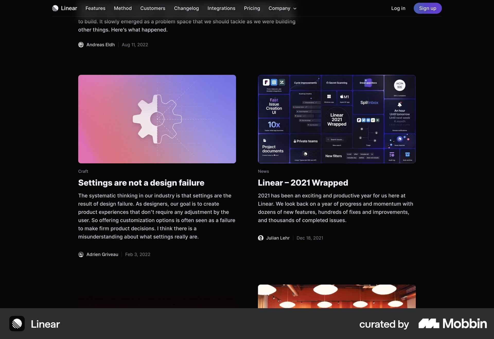
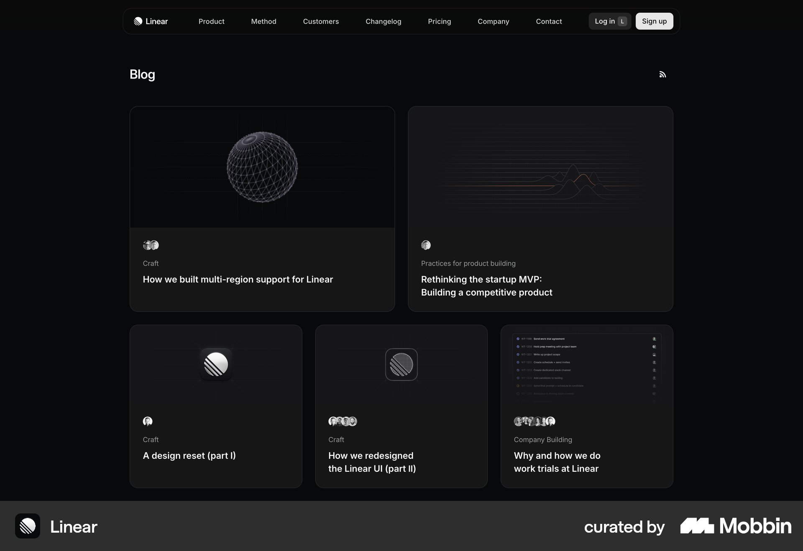

# Linear

이 문서는 수집한 화면·섹션·흐름의 구현 참고 명세다. 전체 사이트 분석을 뜻하지 않는다.

## 편집형 콘텐츠

- 자료 유형: section
- 출처: [Linear — Mobbin](https://mobbin.com/sites/sections/0d6a0e55-42ab-47b0-aee5-daea2bda8768)
- 확인 날짜: 2026-10-11
- 패턴: editorial

### 직접 관찰

- 검정 바탕 두 열 기사 카드. 큰 컬러 썸네일 아래 카테고리·흰 굵은 제목·회색 요약·작성자·날짜. 카드 테두리 없음.

원본 파일: [오프라인 JPEG](../../../assets/references/0d6a0e55-42ab-47b0-aee5-daea2bda8768.jpg).

### 구현에 적용

- 위 관찰의 열 구성, 이미지 비중, 제목 위계, 색 대비를 먼저 구현한다.
- 화면에 보이는 입력·선택·필터·이동 요소를 실제 동작으로 연결한다. 정적 이미지로 확인되지 않는 동작은 구현 제안으로 기록한다.
- 해당 패턴의 [구현 플레이북](../../playbooks.md)을 읽고 완료 조건을 적용한다.
- 모바일 구성과 정확한 토큰은 이 자료만으로 확정하지 않는다. 모바일 자료를 추가 검색하고 고해상도 원본에서 측정한다.

## 편집형 콘텐츠

- 자료 유형: section
- 출처: [Linear — Mobbin](https://mobbin.com/sites/sections/8f66f05e-fefb-42aa-9e46-cfda664d0af1)
- 확인 날짜: 2026-10-11
- 패턴: editorial

### 직접 관찰

- 검정 블로그, 중앙 좁은 콘텐츠 폭. 위 두 큰 카드와 아래 세 작은 카드. 아주 어두운 썸네일·흰 제목·작성자 아바타, 얇은 테두리와 둥근 모서리.

원본 파일: [오프라인 JPEG](../../../assets/references/8f66f05e-fefb-42aa-9e46-cfda664d0af1.jpg).

### 구현에 적용

- 위 관찰의 열 구성, 이미지 비중, 제목 위계, 색 대비를 먼저 구현한다.
- 화면에 보이는 입력·선택·필터·이동 요소를 실제 동작으로 연결한다. 정적 이미지로 확인되지 않는 동작은 구현 제안으로 기록한다.
- 해당 패턴의 [구현 플레이북](../../playbooks.md)을 읽고 완료 조건을 적용한다.
- 모바일 구성과 정확한 토큰은 이 자료만으로 확정하지 않는다. 모바일 자료를 추가 검색하고 고해상도 원본에서 측정한다.

## 짙은 남색 가격 페이지. 중앙 제목과 세 개 테두리 카드, 중간 플랜 상단 강조 및 월연 알약.

- 자료 유형: section
- 출처: [Linear — Mobbin](https://mobbin.com/sites/sections/be148265-d2a2-4e94-82dc-15ecf2b44896)
- 확인 날짜: 2026-10-18
- 패턴: pricing

### 직접 관찰

- 짙은 남색 가격 페이지. 중앙 제목과 세 개 테두리 카드, 중간 플랜 상단 강조 및 월연 알약.

원본 파일: [오프라인 JPEG](../../../assets/references/be148265-d2a2-4e94-82dc-15ecf2b44896.jpg).

### 구현에 적용

- 위 관찰의 열 구성, 이미지 비중, 제목 위계, 색 대비를 먼저 구현한다.
- 화면에 보이는 입력·선택·필터·이동 요소를 실제 동작으로 연결한다. 정적 이미지로 확인되지 않는 동작은 구현 제안으로 기록한다.
- 해당 패턴의 [구현 플레이북](../../playbooks.md)을 읽고 완료 조건을 적용한다.
- 모바일 구성과 정확한 토큰은 이 자료만으로 확정하지 않는다. 모바일 자료를 추가 검색하고 고해상도 원본에서 측정한다.
