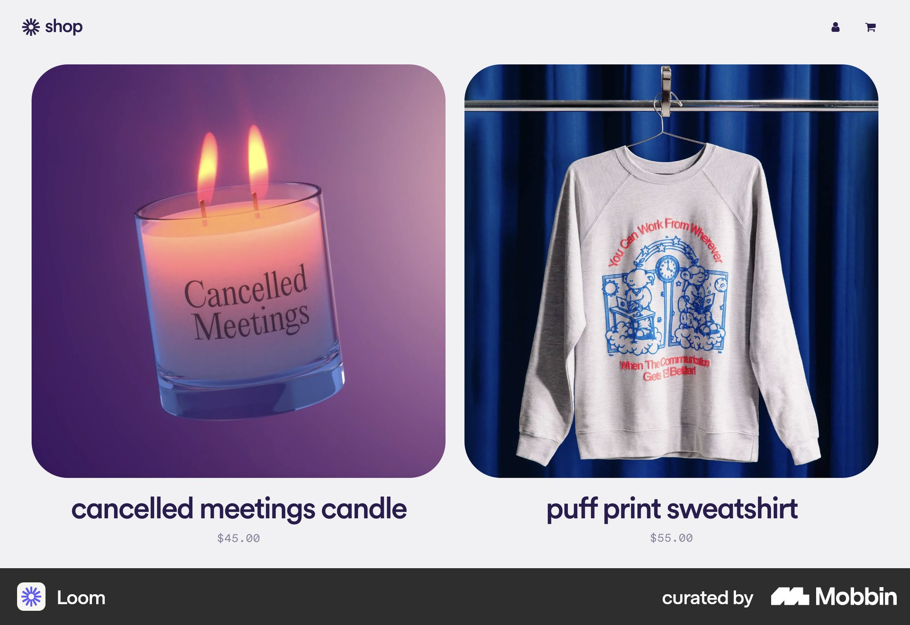

# Loom

이 문서는 수집한 화면·섹션·흐름의 구현 참고 명세다. 전체 사이트 분석을 뜻하지 않는다.

## 편집형 콘텐츠

- 자료 유형: section
- 출처: [Loom — Mobbin](https://mobbin.com/sites/sections/06da0f90-5321-45f9-8e21-5cfa8adc005e)
- 확인 날짜: 2026-10-11
- 패턴: editorial

### 직접 관찰

- 크림 편집형 기사 영역에 두 열 일러스트·제목·요약·작성자. 가는 선과 외곽 프레임, 아래 보라 See all Articles 버튼.

원본 파일: [오프라인 JPEG](../../../assets/references/06da0f90-5321-45f9-8e21-5cfa8adc005e.jpg).

### 구현에 적용

- 위 관찰의 열 구성, 이미지 비중, 제목 위계, 색 대비를 먼저 구현한다.
- 화면에 보이는 입력·선택·필터·이동 요소를 실제 동작으로 연결한다. 정적 이미지로 확인되지 않는 동작은 구현 제안으로 기록한다.
- 해당 패턴의 [구현 플레이북](../../playbooks.md)을 읽고 완료 조건을 적용한다.
- 모바일 구성과 정확한 토큰은 이 자료만으로 확정하지 않는다. 모바일 자료를 추가 검색하고 고해상도 원본에서 측정한다.

## 커머스 랜딩

- 자료 유형: section
- 출처: [Loom — Mobbin](https://mobbin.com/sites/sections/095d014e-3d91-4684-b137-1c26ac79b120)
- 확인 날짜: 2026-10-11
- 패턴: commerce-landing

### 직접 관찰

- 영상 SaaS가 아닌 Loom 굿즈 스토어. 연회색 바탕 큰 남색 소개문과 아래 두 열 둥근 상품 사진. 상단 단순 shop 로고·계정·카트.

원본 파일: [오프라인 JPEG](../../../assets/references/095d014e-3d91-4684-b137-1c26ac79b120.jpg).

### 구현에 적용

- 위 관찰의 열 구성, 이미지 비중, 제목 위계, 색 대비를 먼저 구현한다.
- 화면에 보이는 입력·선택·필터·이동 요소를 실제 동작으로 연결한다. 정적 이미지로 확인되지 않는 동작은 구현 제안으로 기록한다.
- 해당 패턴의 [구현 플레이북](../../playbooks.md)을 읽고 완료 조건을 적용한다.
- 모바일 구성과 정확한 토큰은 이 자료만으로 확정하지 않는다. 모바일 자료를 추가 검색하고 고해상도 원본에서 측정한다.

## 보라·파랑 상품 사진 두 열에 큰 둥근 모서리. 아래 굵은 상품명·작은 가격, 매우 단순한 shop 내비게이

- 자료 유형: section
- 출처: [Loom — Mobbin](https://mobbin.com/sites/sections/3aa38b85-c07b-46b3-8998-1f91d8d898a5)
- 확인 날짜: 2026-10-18
- 패턴: commerce

### 직접 관찰

- 보라·파랑 상품 사진 두 열에 큰 둥근 모서리. 아래 굵은 상품명·작은 가격, 매우 단순한 shop 내비게이션.

원본 파일: [오프라인 JPEG](../../../assets/references/3aa38b85-c07b-46b3-8998-1f91d8d898a5.jpg).

### 구현에 적용

- 위 관찰의 열 구성, 이미지 비중, 제목 위계, 색 대비를 먼저 구현한다.
- 화면에 보이는 입력·선택·필터·이동 요소를 실제 동작으로 연결한다. 정적 이미지로 확인되지 않는 동작은 구현 제안으로 기록한다.
- 해당 패턴의 [구현 플레이북](../../playbooks.md)을 읽고 완료 조건을 적용한다.
- 모바일 구성과 정확한 토큰은 이 자료만으로 확정하지 않는다. 모바일 자료를 추가 검색하고 고해상도 원본에서 측정한다.
