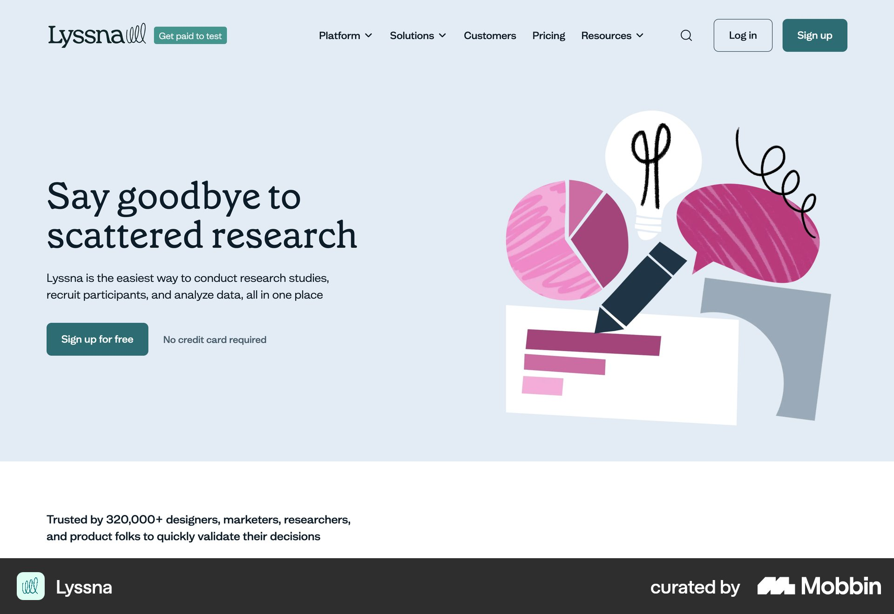
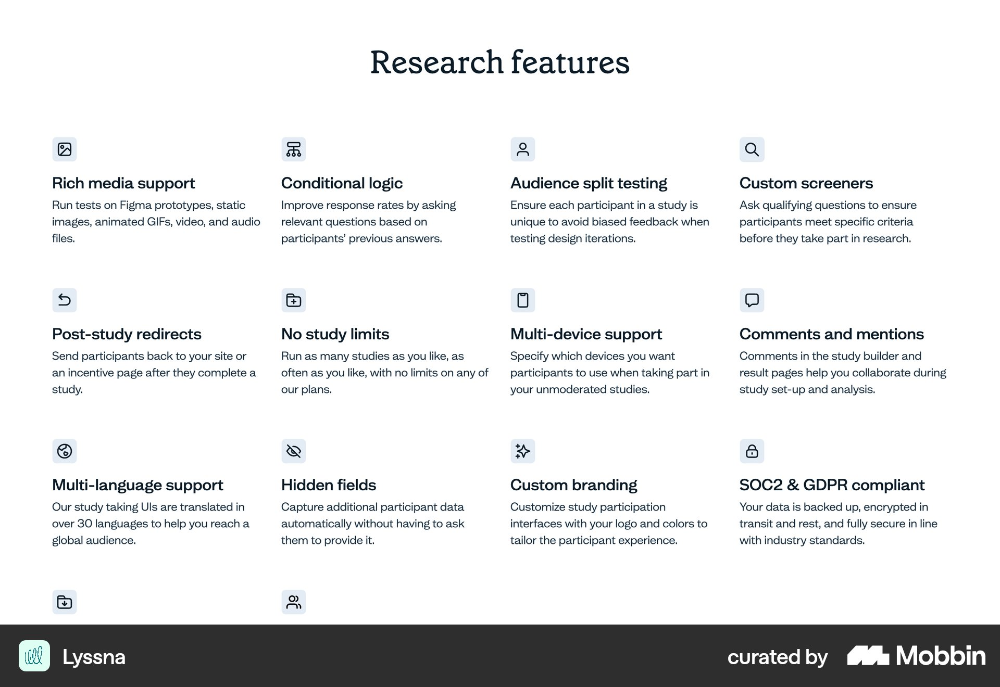

# Lyssna

이 문서는 수집한 화면·섹션·흐름의 구현 참고 명세다. 전체 사이트 분석을 뜻하지 않는다.

## 제품 랜딩

- 자료 유형: section
- 출처: [Lyssna — Mobbin](https://mobbin.com/sites/sections/c237a96b-d808-4ad7-bf78-d32e4f6425cd)
- 확인 날짜: 2026-10-11
- 패턴: saas-landing

### 직접 관찰

- 연한 파랑 배경. 왼쪽 세리프 제목·설명·짙은 청록 CTA, 오른쪽 분홍 차트·전구·연필 일러스트. 아래 신뢰 문구.

원본 파일: [오프라인 JPEG](../../../assets/references/c237a96b-d808-4ad7-bf78-d32e4f6425cd.jpg).

### 구현에 적용

- 위 관찰의 열 구성, 이미지 비중, 제목 위계, 색 대비를 먼저 구현한다.
- 화면에 보이는 입력·선택·필터·이동 요소를 실제 동작으로 연결한다. 정적 이미지로 확인되지 않는 동작은 구현 제안으로 기록한다.
- 해당 패턴의 [구현 플레이북](../../playbooks.md)을 읽고 완료 조건을 적용한다.
- 모바일 구성과 정확한 토큰은 이 자료만으로 확정하지 않는다. 모바일 자료를 추가 검색하고 고해상도 원본에서 측정한다.

## 흰 Research features 목록. 네 열 텍스트 격자에 작은 선 아이콘·굵은 제목·짧은 설명.

- 자료 유형: section
- 출처: [Lyssna — Mobbin](https://mobbin.com/sites/sections/e41a562c-9a93-44bd-a790-70a96cd2f31b)
- 확인 날짜: 2026-10-18
- 패턴: features

### 직접 관찰

- 흰 Research features 목록. 네 열 텍스트 격자에 작은 선 아이콘·굵은 제목·짧은 설명.

원본 파일: [오프라인 JPEG](../../../assets/references/e41a562c-9a93-44bd-a790-70a96cd2f31b.jpg).

### 구현에 적용

- 위 관찰의 열 구성, 이미지 비중, 제목 위계, 색 대비를 먼저 구현한다.
- 화면에 보이는 입력·선택·필터·이동 요소를 실제 동작으로 연결한다. 정적 이미지로 확인되지 않는 동작은 구현 제안으로 기록한다.
- 해당 패턴의 [구현 플레이북](../../playbooks.md)을 읽고 완료 조건을 적용한다.
- 모바일 구성과 정확한 토큰은 이 자료만으로 확정하지 않는다. 모바일 자료를 추가 검색하고 고해상도 원본에서 측정한다.
