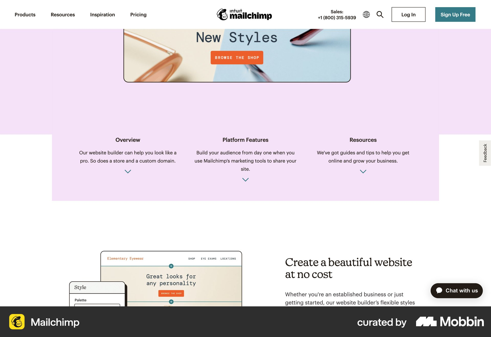
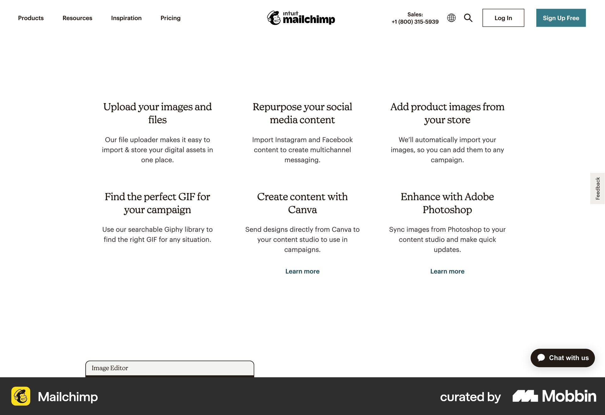

# Mailchimp

이 문서는 수집한 화면·섹션·흐름의 구현 참고 명세다. 전체 사이트 분석을 뜻하지 않는다.

## 웹사이트 제작 기능 소개

- 자료 유형: section
- 출처: [Mailchimp — Mobbin](https://mobbin.com/sites/sections/406a32a0-f61e-4f4c-b976-63e4a99fccdd)
- 확인 날짜: 2026-10-11
- 패턴: features

### 직접 관찰

- 검색어와 달리 웹사이트 제작 기능 설명 섹션. 연보라 바탕의 Overview·Platform Features·Resources 세 열, 아래 제품 캡처와 설명.

원본 파일: [오프라인 JPEG](../../../assets/references/406a32a0-f61e-4f4c-b976-63e4a99fccdd.jpg).

### 구현에 적용

- 위 관찰의 열 구성, 이미지 비중, 제목 위계, 색 대비를 먼저 구현한다.
- 화면에 보이는 입력·선택·필터·이동 요소를 실제 동작으로 연결한다. 정적 이미지로 확인되지 않는 동작은 구현 제안으로 기록한다.
- 해당 패턴의 [구현 플레이북](../../playbooks.md)을 읽고 완료 조건을 적용한다.
- 모바일 구성과 정확한 토큰은 이 자료만으로 확정하지 않는다. 모바일 자료를 추가 검색하고 고해상도 원본에서 측정한다.

## 흰 바탕 여섯 텍스트 기능을 세 열 두 행으로 배치. 일부 하단 Learn more, 이미지 없이 넓은 여백

- 자료 유형: section
- 출처: [Mailchimp — Mobbin](https://mobbin.com/sites/sections/6fc048c1-c7bd-45da-a726-b9b71c65736d)
- 확인 날짜: 2026-10-18
- 패턴: features

### 직접 관찰

- 흰 바탕 여섯 텍스트 기능을 세 열 두 행으로 배치. 일부 하단 Learn more, 이미지 없이 넓은 여백.

원본 파일: [오프라인 JPEG](../../../assets/references/6fc048c1-c7bd-45da-a726-b9b71c65736d.jpg).

### 구현에 적용

- 위 관찰의 열 구성, 이미지 비중, 제목 위계, 색 대비를 먼저 구현한다.
- 화면에 보이는 입력·선택·필터·이동 요소를 실제 동작으로 연결한다. 정적 이미지로 확인되지 않는 동작은 구현 제안으로 기록한다.
- 해당 패턴의 [구현 플레이북](../../playbooks.md)을 읽고 완료 조건을 적용한다.
- 모바일 구성과 정확한 토큰은 이 자료만으로 확정하지 않는다. 모바일 자료를 추가 검색하고 고해상도 원본에서 측정한다.

## 연초록 바탕 중앙 겹친 데스크톱·모바일 스토어 UI. 아래 작은 네 열 기능 설명.

- 자료 유형: section
- 출처: [Mailchimp — Mobbin](https://mobbin.com/sites/sections/ba54da5f-d283-42e5-acbe-6ff10aa3d402)
- 확인 날짜: 2026-10-18
- 패턴: commerce-landing

### 직접 관찰

- 연초록 바탕 중앙 겹친 데스크톱·모바일 스토어 UI. 아래 작은 네 열 기능 설명.

원본 파일: [오프라인 JPEG](../../../assets/references/ba54da5f-d283-42e5-acbe-6ff10aa3d402.jpg).

### 구현에 적용

- 위 관찰의 열 구성, 이미지 비중, 제목 위계, 색 대비를 먼저 구현한다.
- 화면에 보이는 입력·선택·필터·이동 요소를 실제 동작으로 연결한다. 정적 이미지로 확인되지 않는 동작은 구현 제안으로 기록한다.
- 해당 패턴의 [구현 플레이북](../../playbooks.md)을 읽고 완료 조건을 적용한다.
- 모바일 구성과 정확한 토큰은 이 자료만으로 확정하지 않는다. 모바일 자료를 추가 검색하고 고해상도 원본에서 측정한다.
