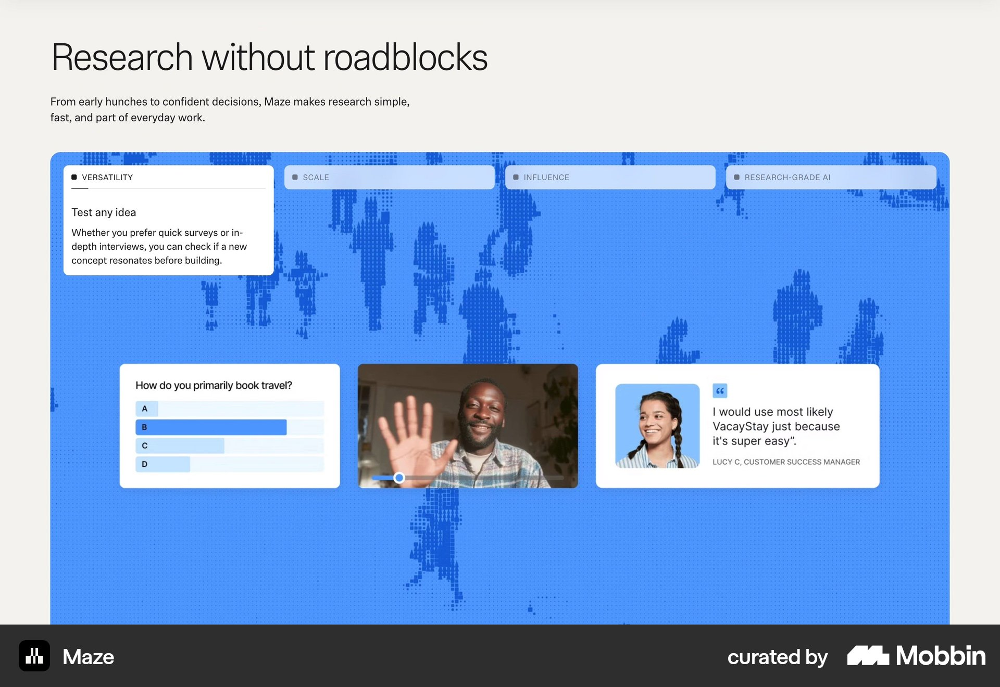
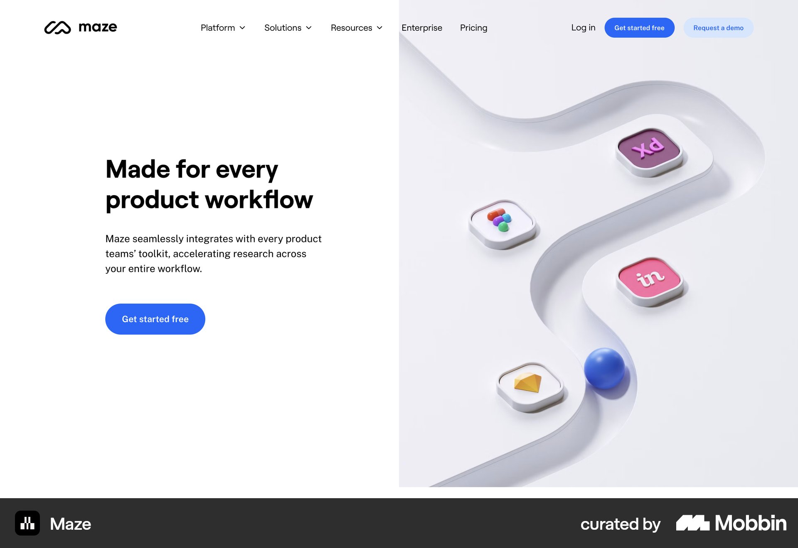
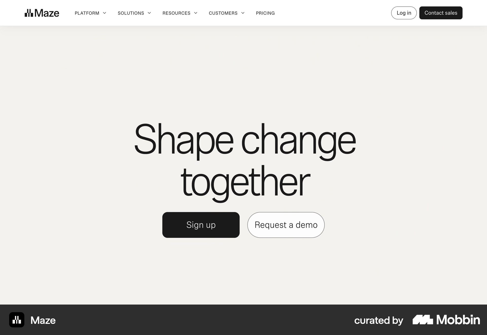
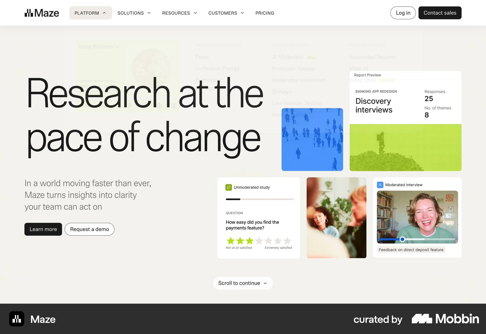
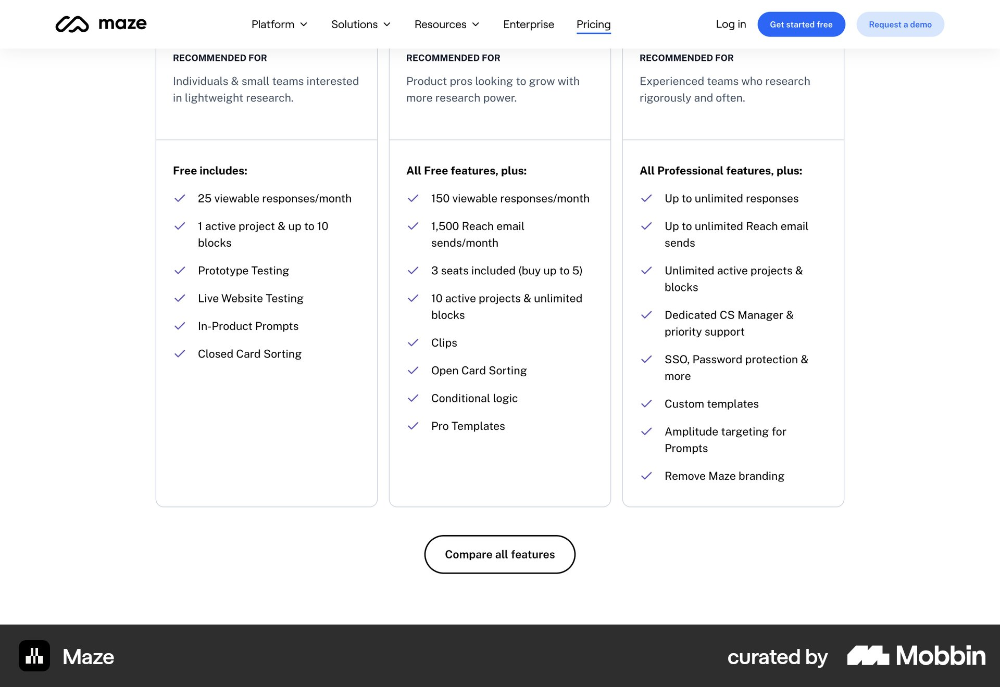

# Maze

이 문서는 수집한 화면·섹션·흐름의 구현 참고 명세다. 전체 사이트 분석을 뜻하지 않는다.

## 연회색 바탕 제목 아래 큰 파란 제품 영역. 지도 모양 배경과 설문·화상 인터뷰·추천 카드가 떠 있음.

- 자료 유형: section
- 출처: [Maze — Mobbin](https://mobbin.com/sites/sections/2aab052c-921a-421b-a4a0-5aa155ebe09c)
- 확인 날짜: 2026-10-18
- 패턴: features

### 직접 관찰

- 연회색 바탕 제목 아래 큰 파란 제품 영역. 지도 모양 배경과 설문·화상 인터뷰·추천 카드가 떠 있음.

원본 파일: [오프라인 JPEG](../../../assets/references/2aab052c-921a-421b-a4a0-5aa155ebe09c.jpg).

### 구현에 적용

- 위 관찰의 열 구성, 이미지 비중, 제목 위계, 색 대비를 먼저 구현한다.
- 화면에 보이는 입력·선택·필터·이동 요소를 실제 동작으로 연결한다. 정적 이미지로 확인되지 않는 동작은 구현 제안으로 기록한다.
- 해당 패턴의 [구현 플레이북](../../playbooks.md)을 읽고 완료 조건을 적용한다.
- 모바일 구성과 정확한 토큰은 이 자료만으로 확정하지 않는다. 모바일 자료를 추가 검색하고 고해상도 원본에서 측정한다.

## 흰 두 열 히어로. 왼쪽 짧은 제목·설명·파란 CTA, 오른쪽 3D 흰 경로 위 컬러 앱 아이콘.

- 자료 유형: section
- 출처: [Maze — Mobbin](https://mobbin.com/sites/sections/efd123f4-8694-4da2-ad1e-7382fef9d90d)
- 확인 날짜: 2026-10-18
- 패턴: saas-landing

### 직접 관찰

- 흰 두 열 히어로. 왼쪽 짧은 제목·설명·파란 CTA, 오른쪽 3D 흰 경로 위 컬러 앱 아이콘.

원본 파일: [오프라인 JPEG](../../../assets/references/efd123f4-8694-4da2-ad1e-7382fef9d90d.jpg).

### 구현에 적용

- 위 관찰의 열 구성, 이미지 비중, 제목 위계, 색 대비를 먼저 구현한다.
- 화면에 보이는 입력·선택·필터·이동 요소를 실제 동작으로 연결한다. 정적 이미지로 확인되지 않는 동작은 구현 제안으로 기록한다.
- 해당 패턴의 [구현 플레이북](../../playbooks.md)을 읽고 완료 조건을 적용한다.
- 모바일 구성과 정확한 토큰은 이 자료만으로 확정하지 않는다. 모바일 자료를 추가 검색하고 고해상도 원본에서 측정한다.

## 크림 바탕 중앙 가는 두 줄 제목. 검정 Sign up과 외곽선 Request a demo, 매우 넓은 여백

- 자료 유형: section
- 출처: [Maze — Mobbin](https://mobbin.com/sites/sections/26e3e993-5f8b-43a3-82a3-92893f3150b4)
- 확인 날짜: 2026-10-18
- 패턴: saas-landing

### 직접 관찰

- 크림 바탕 중앙 가는 두 줄 제목. 검정 Sign up과 외곽선 Request a demo, 매우 넓은 여백.

원본 파일: [오프라인 JPEG](../../../assets/references/26e3e993-5f8b-43a3-82a3-92893f3150b4.jpg).

### 구현에 적용

- 위 관찰의 열 구성, 이미지 비중, 제목 위계, 색 대비를 먼저 구현한다.
- 화면에 보이는 입력·선택·필터·이동 요소를 실제 동작으로 연결한다. 정적 이미지로 확인되지 않는 동작은 구현 제안으로 기록한다.
- 해당 패턴의 [구현 플레이북](../../playbooks.md)을 읽고 완료 조건을 적용한다.
- 모바일 구성과 정확한 토큰은 이 자료만으로 확정하지 않는다. 모바일 자료를 추가 검색하고 고해상도 원본에서 측정한다.

## 크림 바탕 왼쪽 큰 가는 제목·설명·두 CTA, 오른쪽 여러 리서치 UI 카드 콜라주.

- 자료 유형: section
- 출처: [Maze — Mobbin](https://mobbin.com/sites/sections/0422d28b-b36f-4def-8590-f57fc5812131)
- 확인 날짜: 2026-10-18
- 패턴: saas-landing

### 직접 관찰

- 크림 바탕 왼쪽 큰 가는 제목·설명·두 CTA, 오른쪽 여러 리서치 UI 카드 콜라주.

원본 파일: [오프라인 JPEG](../../../assets/references/0422d28b-b36f-4def-8590-f57fc5812131.jpg).

### 구현에 적용

- 위 관찰의 열 구성, 이미지 비중, 제목 위계, 색 대비를 먼저 구현한다.
- 화면에 보이는 입력·선택·필터·이동 요소를 실제 동작으로 연결한다. 정적 이미지로 확인되지 않는 동작은 구현 제안으로 기록한다.
- 해당 패턴의 [구현 플레이북](../../playbooks.md)을 읽고 완료 조건을 적용한다.
- 모바일 구성과 정확한 토큰은 이 자료만으로 확정하지 않는다. 모바일 자료를 추가 검색하고 고해상도 원본에서 측정한다.

## 흰 가격 비교 세 열 긴 기능 목록. 상단 작은 추천 대상·아래 Compare all features 버튼.

- 자료 유형: section
- 출처: [Maze — Mobbin](https://mobbin.com/sites/sections/1c1738fa-6ce1-47e6-b749-8d52442dba8d)
- 확인 날짜: 2026-10-18
- 패턴: pricing

### 직접 관찰

- 흰 가격 비교 세 열 긴 기능 목록. 상단 작은 추천 대상·아래 Compare all features 버튼.

원본 파일: [오프라인 JPEG](../../../assets/references/1c1738fa-6ce1-47e6-b749-8d52442dba8d.jpg).

### 구현에 적용

- 위 관찰의 열 구성, 이미지 비중, 제목 위계, 색 대비를 먼저 구현한다.
- 화면에 보이는 입력·선택·필터·이동 요소를 실제 동작으로 연결한다. 정적 이미지로 확인되지 않는 동작은 구현 제안으로 기록한다.
- 해당 패턴의 [구현 플레이북](../../playbooks.md)을 읽고 완료 조건을 적용한다.
- 모바일 구성과 정확한 토큰은 이 자료만으로 확정하지 않는다. 모바일 자료를 추가 검색하고 고해상도 원본에서 측정한다.
