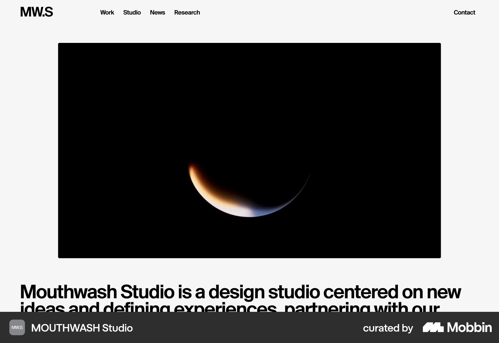
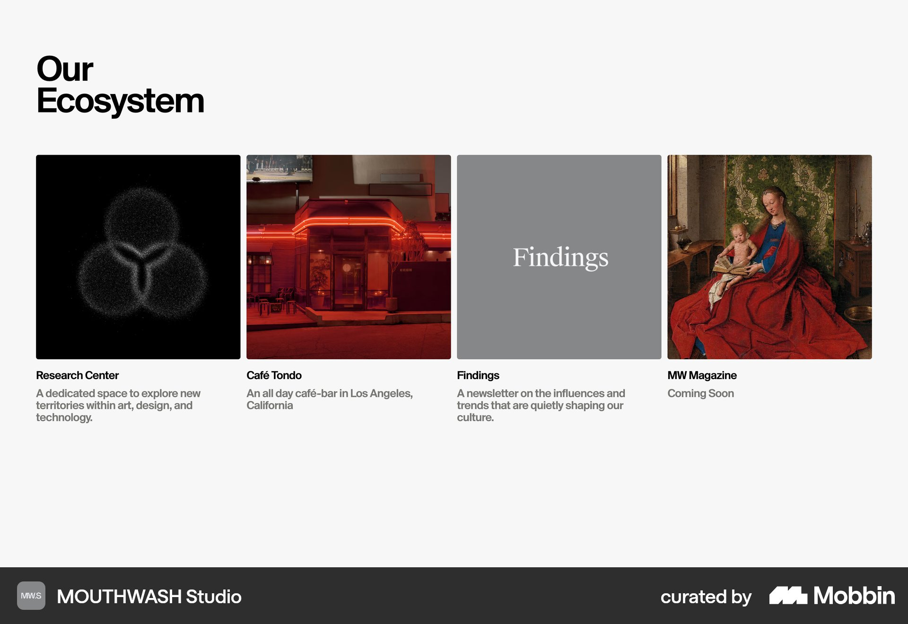
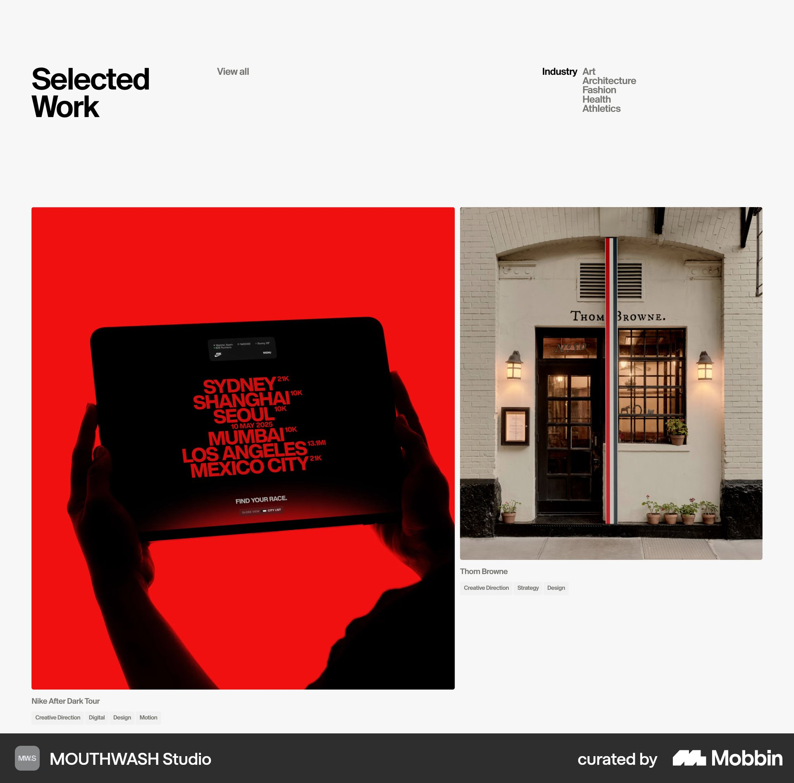

# MOUTHWASH Studio

이 문서는 수집한 화면·섹션·흐름의 구현 참고 명세다. 전체 사이트 분석을 뜻하지 않는다.

## 스튜디오 소개

- 자료 유형: section
- 출처: [MOUTHWASH Studio — Mobbin](https://mobbin.com/sites/sections/0e035b6e-f0ab-416e-9ade-af96d4542658)
- 확인 날짜: 2026-10-11
- 패턴: portfolio

### 직접 관찰

- 흰 바탕 상단 단순 내비게이션. 중앙 큰 검정 프로젝트 이미지, 아래 굵고 큰 스튜디오 소개문. 미디어 위 텍스트 오버레이 없음.

원본 파일: [오프라인 JPEG](../../../assets/references/0e035b6e-f0ab-416e-9ade-af96d4542658.jpg).

### 구현에 적용

- 위 관찰의 열 구성, 이미지 비중, 제목 위계, 색 대비를 먼저 구현한다.
- 화면에 보이는 입력·선택·필터·이동 요소를 실제 동작으로 연결한다. 정적 이미지로 확인되지 않는 동작은 구현 제안으로 기록한다.
- 해당 패턴의 [구현 플레이북](../../playbooks.md)을 읽고 완료 조건을 적용한다.
- 모바일 구성과 정확한 토큰은 이 자료만으로 확정하지 않는다. 모바일 자료를 추가 검색하고 고해상도 원본에서 측정한다.

## 스튜디오 생태계

- 자료 유형: section
- 출처: [MOUTHWASH Studio — Mobbin](https://mobbin.com/sites/sections/364878c8-261d-4943-81e9-d2b944b82247)
- 확인 날짜: 2026-10-11
- 패턴: portfolio, project-library

### 직접 관찰

- Our Ecosystem 제목 아래 네 열 정사각 이미지·프로젝트명·짧은 설명. 갤러리형 작업 및 연구 목록이며 건축 매물 페이지가 아님.

원본 파일: [오프라인 JPEG](../../../assets/references/364878c8-261d-4943-81e9-d2b944b82247.jpg).

### 구현에 적용

- 위 관찰의 열 구성, 이미지 비중, 제목 위계, 색 대비를 먼저 구현한다.
- 화면에 보이는 입력·선택·필터·이동 요소를 실제 동작으로 연결한다. 정적 이미지로 확인되지 않는 동작은 구현 제안으로 기록한다.
- 해당 패턴의 [구현 플레이북](../../playbooks.md)을 읽고 완료 조건을 적용한다.
- 모바일 구성과 정확한 토큰은 이 자료만으로 확정하지 않는다. 모바일 자료를 추가 검색하고 고해상도 원본에서 측정한다.

## 흰 Selected Work. 크기가 다른 두 열 프로젝트 이미지와 작은 이름·분류, 최소한의 장식.

- 자료 유형: section
- 출처: [MOUTHWASH Studio — Mobbin](https://mobbin.com/sites/sections/e2bc218a-3568-43c0-a95e-b95b0d829e6c)
- 확인 날짜: 2026-10-18
- 패턴: portfolio

### 직접 관찰

- 흰 Selected Work. 크기가 다른 두 열 프로젝트 이미지와 작은 이름·분류, 최소한의 장식.

원본 파일: [오프라인 JPEG](../../../assets/references/e2bc218a-3568-43c0-a95e-b95b0d829e6c.jpg).

### 구현에 적용

- 위 관찰의 열 구성, 이미지 비중, 제목 위계, 색 대비를 먼저 구현한다.
- 화면에 보이는 입력·선택·필터·이동 요소를 실제 동작으로 연결한다. 정적 이미지로 확인되지 않는 동작은 구현 제안으로 기록한다.
- 해당 패턴의 [구현 플레이북](../../playbooks.md)을 읽고 완료 조건을 적용한다.
- 모바일 구성과 정확한 토큰은 이 자료만으로 확정하지 않는다. 모바일 자료를 추가 검색하고 고해상도 원본에서 측정한다.
