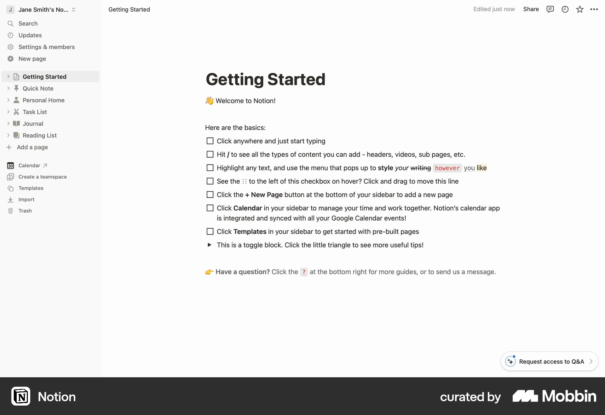
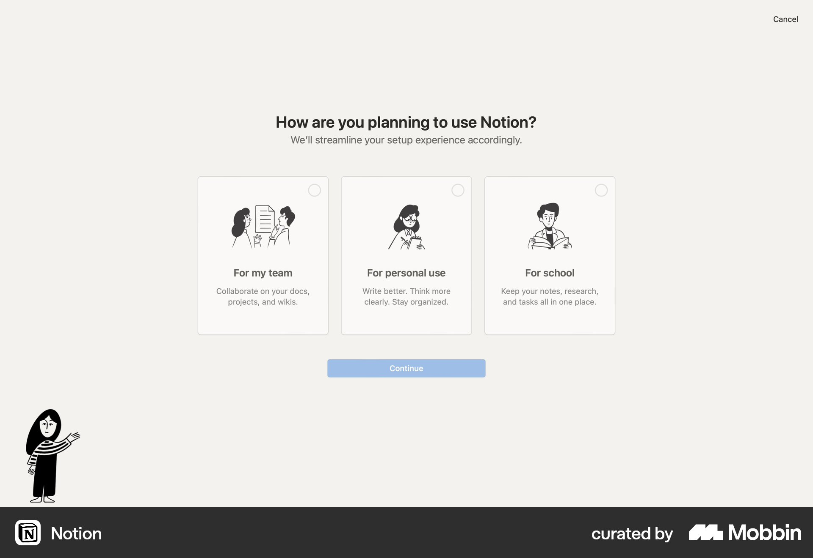
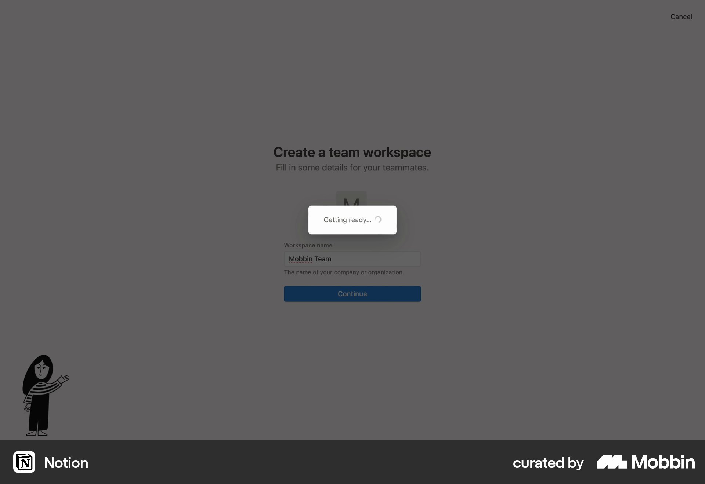
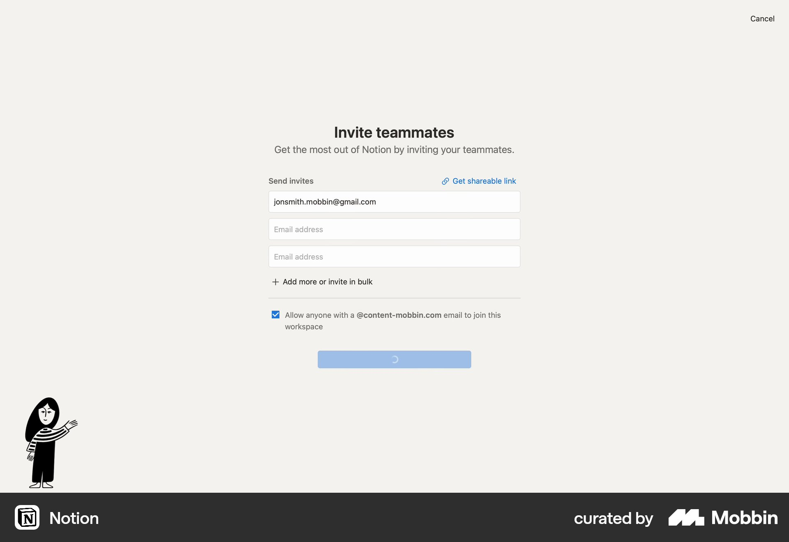
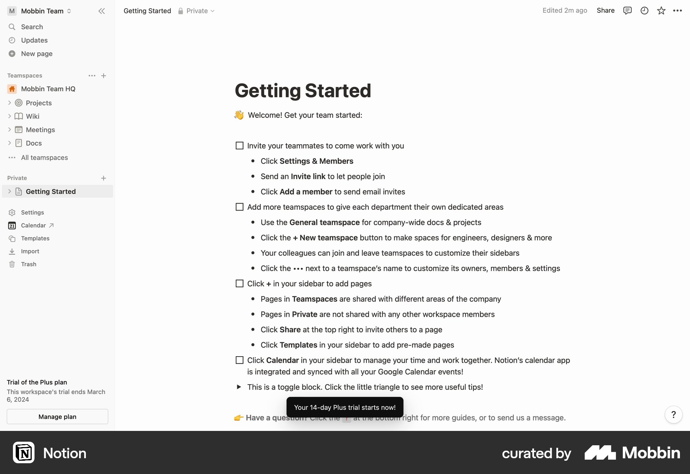

# Notion

이 문서는 수집한 화면·섹션·흐름의 구현 참고 명세다. 전체 사이트 분석을 뜻하지 않는다.

## 워크스페이스 생성

- 자료 유형: flow
- 출처: [Notion — Mobbin](https://mobbin.com/flows/757b6888-6eaa-498d-9b18-c013c9a2ef4a)
- 확인 날짜: 2026-10-11
- 패턴: onboarding, workspace

### 직접 관찰

- 단계 1: 사이드바와 Getting Started 문서 및 체크리스트.

- 단계 4: 팀·개인·학교 용도 선택 카드와 Continue.

- 단계 8: 워크스페이스 생성 폼 위 Getting ready 로딩 오버레이.

- 단계 11: 이메일 초대 폼·공유 링크·도메인 허용 체크박스.

- 단계 14: 생성된 팀 워크스페이스의 Getting Started 문서와 사이드바.

전체 14단계 중 직접 확인한 단계는 5개다. 확인하지 않은 단계의 상태·전환은 원본을 보고 확정한다.

### 전체 단계의 클라우드 파일

- 1: [로컬 원본](../../../assets/references/a3c0ef5e-3fbb-42da-bf54-cb022b030f69.jpg)
- 2: [로컬 원본](../../../assets/references/bdcaeba0-defc-4abf-837a-7b0b3bfbb24c.jpg)
- 3: [로컬 원본](../../../assets/references/6cd8e30a-84d0-4a04-8137-584ac6a0ecb9.jpg)
- 4: [로컬 원본](../../../assets/references/d4eda6ca-b6e9-44d4-8c77-f3c91e97b55d.jpg)
- 5: [로컬 원본](../../../assets/references/ad74a5b4-deed-40de-b010-1f88afd817a7.jpg)
- 6: [로컬 원본](../../../assets/references/aafe4d3c-b61b-482f-8a3d-8e9485e284fe.jpg)
- 7: [로컬 원본](../../../assets/references/9f844152-5450-405f-8454-a1708ff89580.jpg)
- 8: [로컬 원본](../../../assets/references/97f5505f-120b-49e8-a6a0-b48be692a3d0.jpg)
- 9: [로컬 원본](../../../assets/references/7293aa16-d6b2-4611-958e-9f1c7a24a11d.jpg)
- 10: [로컬 원본](../../../assets/references/cf470771-b938-4a47-b25e-a332339db93c.jpg)
- 11: [로컬 원본](../../../assets/references/a1c40848-1b14-46fe-83ad-e48660fe1dbb.jpg)
- 12: [로컬 원본](../../../assets/references/26f5a317-de54-445e-9aba-8058041fcdab.jpg)
- 13: [로컬 원본](../../../assets/references/f0053c4d-b614-401d-ac06-44c0b97dcdff.jpg)
- 14: [로컬 원본](../../../assets/references/2641304f-d69f-4644-bccc-bc2577f00dc3.jpg)

### 구현에 적용

- 위 관찰의 열 구성, 이미지 비중, 제목 위계, 색 대비를 먼저 구현한다.
- 화면에 보이는 입력·선택·필터·이동 요소를 실제 동작으로 연결한다. 정적 이미지로 확인되지 않는 동작은 구현 제안으로 기록한다.
- 해당 패턴의 [구현 플레이북](../../playbooks.md)을 읽고 완료 조건을 적용한다.
- 모바일 구성과 정확한 토큰은 이 자료만으로 확정하지 않는다. 모바일 자료를 추가 검색하고 고해상도 원본에서 측정한다.
