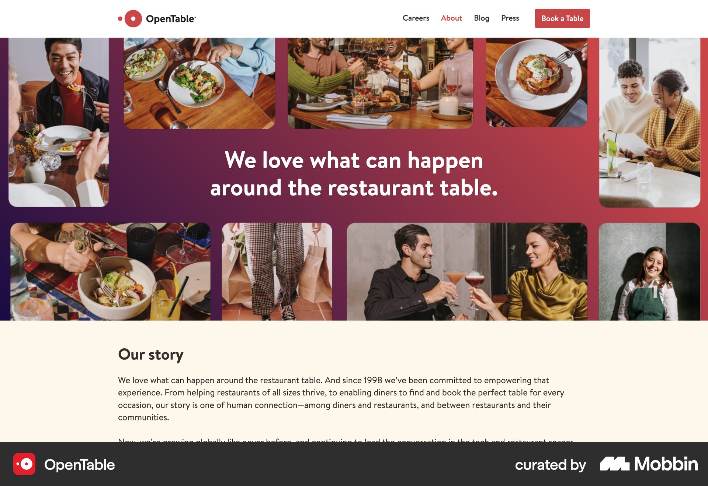
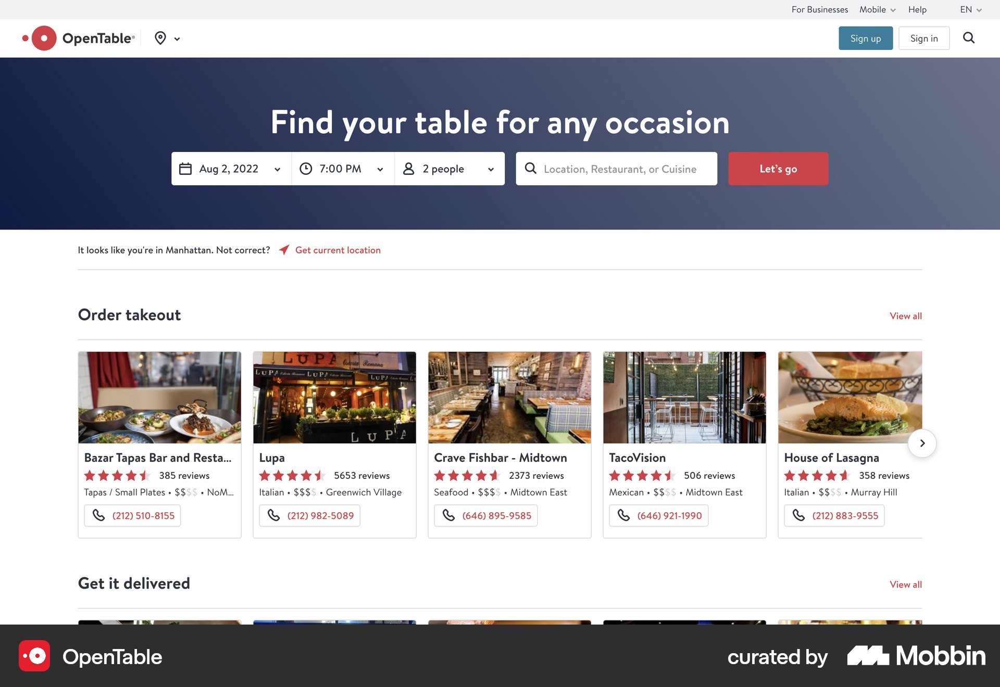
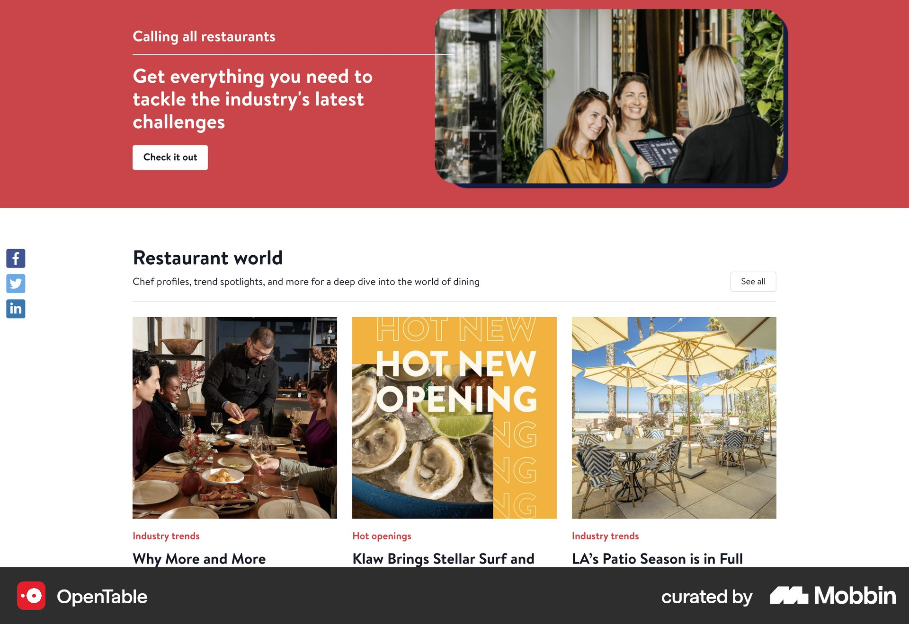
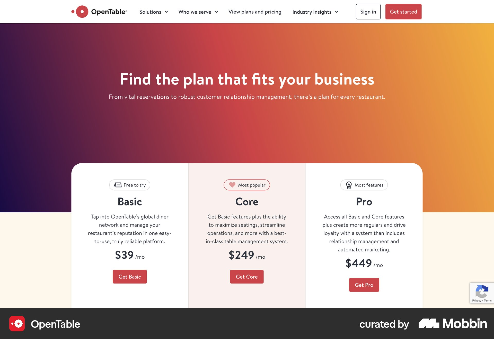

# OpenTable

이 문서는 수집한 화면·섹션·흐름의 구현 참고 명세다. 전체 사이트 분석을 뜻하지 않는다.

## 음식점 소개

- 자료 유형: section
- 출처: [OpenTable — Mobbin](https://mobbin.com/sites/sections/816e816c-912a-4fa9-9673-00d7200ec4c3)
- 확인 날짜: 2026-10-11
- 패턴: restaurant-brand

### 직접 관찰

- 분홍자주 배경 중앙 흰 소개문을 여러 식사 사진이 둘러싼 콜라주. 아래 크림 Our story 설명. 상단 Book a Table.

원본 파일: [오프라인 JPEG](../../../assets/references/816e816c-912a-4fa9-9673-00d7200ec4c3.jpg).

### 구현에 적용

- 위 관찰의 열 구성, 이미지 비중, 제목 위계, 색 대비를 먼저 구현한다.
- 화면에 보이는 입력·선택·필터·이동 요소를 실제 동작으로 연결한다. 정적 이미지로 확인되지 않는 동작은 구현 제안으로 기록한다.
- 해당 패턴의 [구현 플레이북](../../playbooks.md)을 읽고 완료 조건을 적용한다.
- 모바일 구성과 정확한 토큰은 이 자료만으로 확정하지 않는다. 모바일 자료를 추가 검색하고 고해상도 원본에서 측정한다.

## 식당 예약 검색

- 자료 유형: section
- 출처: [OpenTable — Mobbin](https://mobbin.com/sites/sections/65d3c9ef-1e92-487a-a7c5-48c166bd63c0)
- 확인 날짜: 2026-10-11
- 패턴: booking, restaurant-search

### 직접 관찰

- 남색 히어로 중앙 제목과 날짜·시간·인원·지역 검색·빨간 Let's go. 아래 다섯 열 음식점 카드에 사진·별점·리뷰·유형·전화.

원본 파일: [오프라인 JPEG](../../../assets/references/65d3c9ef-1e92-487a-a7c5-48c166bd63c0.jpg).

### 구현에 적용

- 위 관찰의 열 구성, 이미지 비중, 제목 위계, 색 대비를 먼저 구현한다.
- 화면에 보이는 입력·선택·필터·이동 요소를 실제 동작으로 연결한다. 정적 이미지로 확인되지 않는 동작은 구현 제안으로 기록한다.
- 해당 패턴의 [구현 플레이북](../../playbooks.md)을 읽고 완료 조건을 적용한다.
- 모바일 구성과 정확한 토큰은 이 자료만으로 확정하지 않는다. 모바일 자료를 추가 검색하고 고해상도 원본에서 측정한다.

## 식당 업계 콘텐츠

- 자료 유형: section
- 출처: [OpenTable — Mobbin](https://mobbin.com/sites/sections/0bbf06c3-d818-4e3e-a9e0-01eac36c2ce9)
- 확인 날짜: 2026-10-11
- 패턴: editorial

### 직접 관찰

- 식당 업계 콘텐츠. 상단 빨간 소개배너·흰 CTA·인물 사진, 아래 Restaurant world 세 열 기사 이미지와 분류·제목. 왼쪽 소셜 공유 아이콘.

원본 파일: [오프라인 JPEG](../../../assets/references/0bbf06c3-d818-4e3e-a9e0-01eac36c2ce9.jpg).

### 구현에 적용

- 위 관찰의 열 구성, 이미지 비중, 제목 위계, 색 대비를 먼저 구현한다.
- 화면에 보이는 입력·선택·필터·이동 요소를 실제 동작으로 연결한다. 정적 이미지로 확인되지 않는 동작은 구현 제안으로 기록한다.
- 해당 패턴의 [구현 플레이북](../../playbooks.md)을 읽고 완료 조건을 적용한다.
- 모바일 구성과 정확한 토큰은 이 자료만으로 확정하지 않는다. 모바일 자료를 추가 검색하고 고해상도 원본에서 측정한다.

## 보라-주황 가격 히어로 아래 겹친 흰 요금 패널. Basic·Core·Pro 세 열과 빨간 CTA.

- 자료 유형: section
- 출처: [OpenTable — Mobbin](https://mobbin.com/sites/sections/0c81e36a-14f6-471d-9ce7-8930b284a9f2)
- 확인 날짜: 2026-10-18
- 패턴: pricing

### 직접 관찰

- 보라-주황 가격 히어로 아래 겹친 흰 요금 패널. Basic·Core·Pro 세 열과 빨간 CTA.

원본 파일: [오프라인 JPEG](../../../assets/references/0c81e36a-14f6-471d-9ce7-8930b284a9f2.jpg).

### 구현에 적용

- 위 관찰의 열 구성, 이미지 비중, 제목 위계, 색 대비를 먼저 구현한다.
- 화면에 보이는 입력·선택·필터·이동 요소를 실제 동작으로 연결한다. 정적 이미지로 확인되지 않는 동작은 구현 제안으로 기록한다.
- 해당 패턴의 [구현 플레이북](../../playbooks.md)을 읽고 완료 조건을 적용한다.
- 모바일 구성과 정확한 토큰은 이 자료만으로 확정하지 않는다. 모바일 자료를 추가 검색하고 고해상도 원본에서 측정한다.
