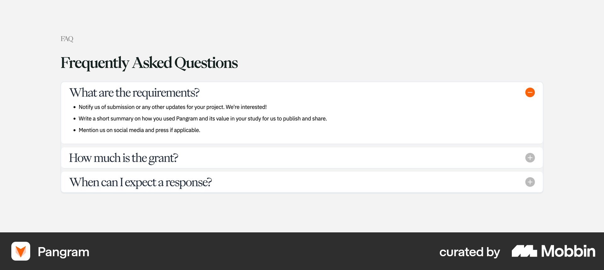

# Pangram

이 문서는 수집한 화면·섹션·흐름의 구현 참고 명세다. 전체 사이트 분석을 뜻하지 않는다.

## FAQ

- 자료 유형: section
- 출처: [Pangram — Mobbin](https://mobbin.com/sites/sections/962b30a4-f4ca-49c0-8ee7-4047b75170b1)
- 확인 날짜: 2026-10-11
- 패턴: faq

### 직접 관찰

- 연회색 배경 왼쪽 정렬 세리프 제목. 세 개 흰 질문 행, 첫 답변은 글머리표로 펼쳐짐. 주황 활성 minus와 회색 plus.

원본 파일: [오프라인 JPEG](../../../assets/references/962b30a4-f4ca-49c0-8ee7-4047b75170b1.jpg).

### 구현에 적용

- 위 관찰의 열 구성, 이미지 비중, 제목 위계, 색 대비를 먼저 구현한다.
- 화면에 보이는 입력·선택·필터·이동 요소를 실제 동작으로 연결한다. 정적 이미지로 확인되지 않는 동작은 구현 제안으로 기록한다.
- 해당 패턴의 [구현 플레이북](../../playbooks.md)을 읽고 완료 조건을 적용한다.
- 모바일 구성과 정확한 토큰은 이 자료만으로 확정하지 않는다. 모바일 자료를 추가 검색하고 고해상도 원본에서 측정한다.
