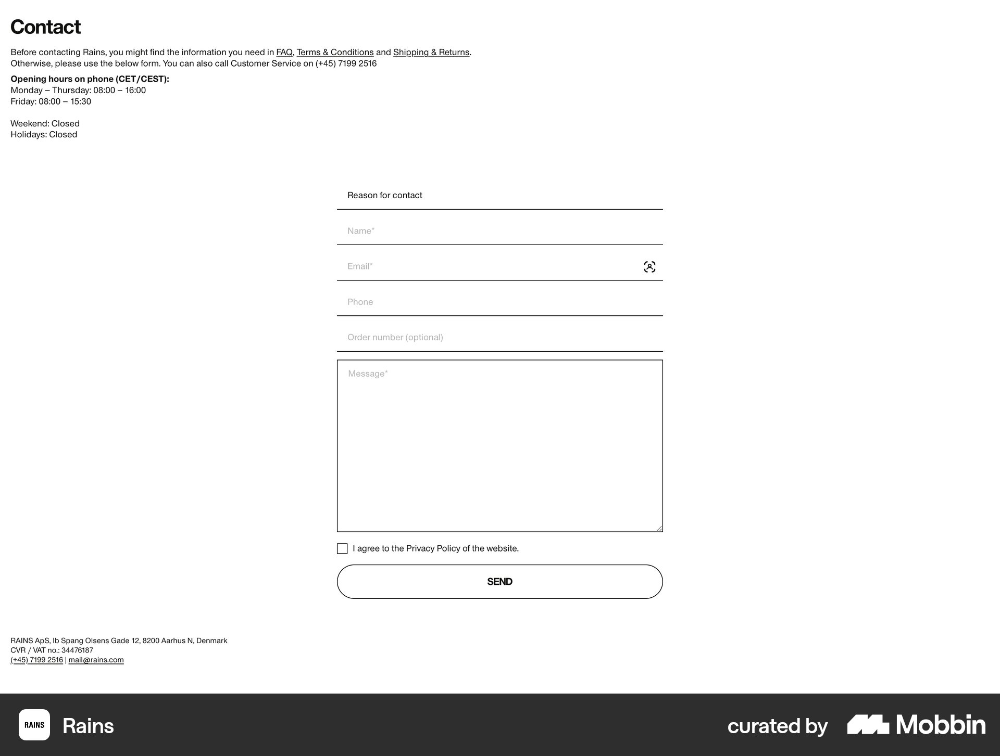
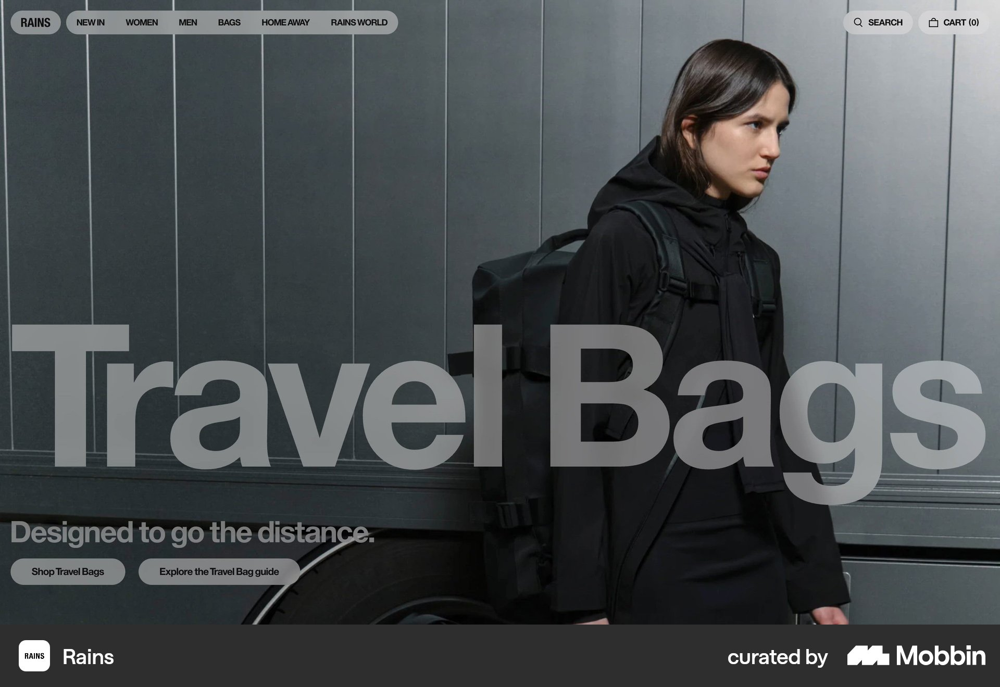

# Rains

이 문서는 수집한 화면·섹션·흐름의 구현 참고 명세다. 전체 사이트 분석을 뜻하지 않는다.

## 문의

- 자료 유형: section
- 출처: [Rains — Mobbin](https://mobbin.com/sites/sections/82ce6566-c33e-4b16-8750-670aa04be011)
- 확인 날짜: 2026-10-11
- 패턴: contact-form

### 직접 관찰

- 흰 바탕 좌상단 연락 안내·영업시간. 중앙 좁은 밑줄 폼·메시지 사각칸·동의 체크박스·외곽선 Send 알약, 하단 작은 회사 정보.

원본 파일: [오프라인 JPEG](../../../assets/references/82ce6566-c33e-4b16-8750-670aa04be011.jpg).

### 구현에 적용

- 위 관찰의 열 구성, 이미지 비중, 제목 위계, 색 대비를 먼저 구현한다.
- 화면에 보이는 입력·선택·필터·이동 요소를 실제 동작으로 연결한다. 정적 이미지로 확인되지 않는 동작은 구현 제안으로 기록한다.
- 해당 패턴의 [구현 플레이북](../../playbooks.md)을 읽고 완료 조건을 적용한다.
- 모바일 구성과 정확한 토큰은 이 자료만으로 확정하지 않는다. 모바일 자료를 추가 검색하고 고해상도 원본에서 측정한다.

## 차가운 회색 패션 사진 위 거대한 Travel Bags 타이포와 작은 쇼핑 버튼 두 개. 상단 압축 메뉴.

- 자료 유형: section
- 출처: [Rains — Mobbin](https://mobbin.com/sites/sections/06ace72d-6feb-4f02-be09-5fd9ca6bb689)
- 확인 날짜: 2026-10-18
- 패턴: commerce-landing

### 직접 관찰

- 차가운 회색 패션 사진 위 거대한 Travel Bags 타이포와 작은 쇼핑 버튼 두 개. 상단 압축 메뉴.

원본 파일: [오프라인 JPEG](../../../assets/references/06ace72d-6feb-4f02-be09-5fd9ca6bb689.jpg).

### 구현에 적용

- 위 관찰의 열 구성, 이미지 비중, 제목 위계, 색 대비를 먼저 구현한다.
- 화면에 보이는 입력·선택·필터·이동 요소를 실제 동작으로 연결한다. 정적 이미지로 확인되지 않는 동작은 구현 제안으로 기록한다.
- 해당 패턴의 [구현 플레이북](../../playbooks.md)을 읽고 완료 조건을 적용한다.
- 모바일 구성과 정확한 토큰은 이 자료만으로 확정하지 않는다. 모바일 자료를 추가 검색하고 고해상도 원본에서 측정한다.
