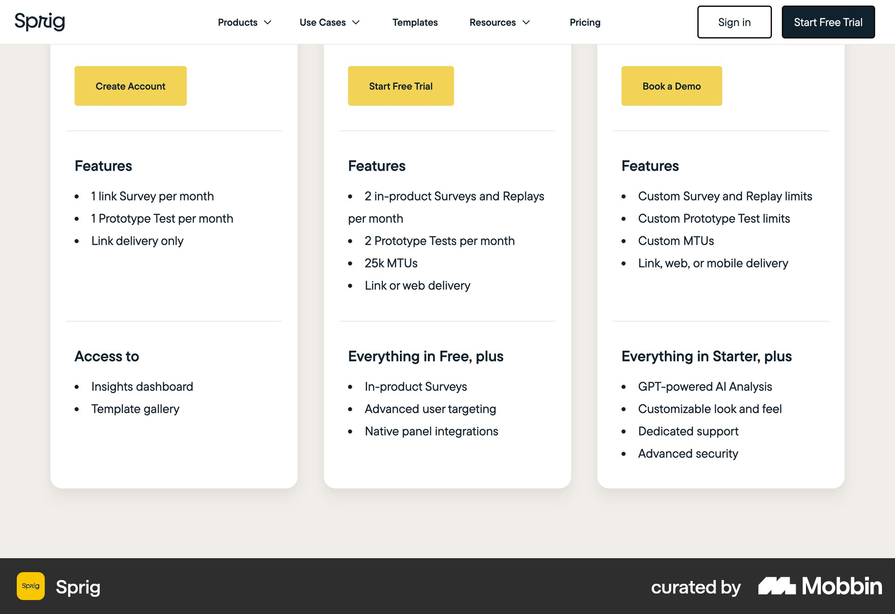
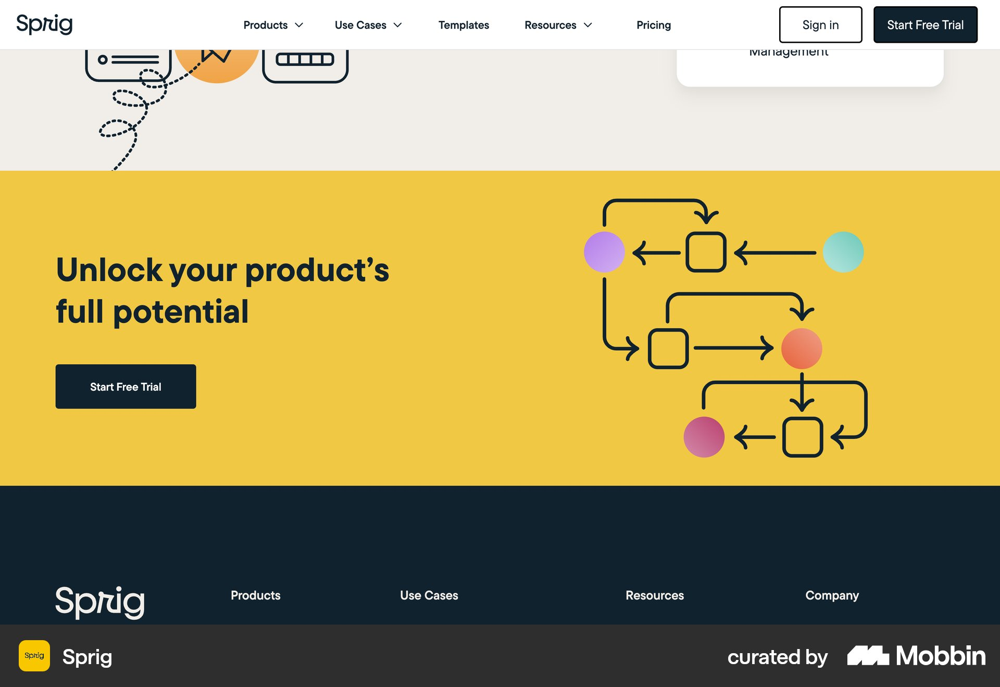

# Sprig

이 문서는 수집한 화면·섹션·흐름의 구현 참고 명세다. 전체 사이트 분석을 뜻하지 않는다.

## 크림 배경 세 흰 가격 카드. 노란 CTA와 Features·Access 소제목의 긴 기능 목록.

- 자료 유형: section
- 출처: [Sprig — Mobbin](https://mobbin.com/sites/sections/13aa6320-cc57-4952-916c-95b0a74300c0)
- 확인 날짜: 2026-10-18
- 패턴: pricing

### 직접 관찰

- 크림 배경 세 흰 가격 카드. 노란 CTA와 Features·Access 소제목의 긴 기능 목록.

원본 파일: [오프라인 JPEG](../../../assets/references/13aa6320-cc57-4952-916c-95b0a74300c0.jpg).

### 구현에 적용

- 위 관찰의 열 구성, 이미지 비중, 제목 위계, 색 대비를 먼저 구현한다.
- 화면에 보이는 입력·선택·필터·이동 요소를 실제 동작으로 연결한다. 정적 이미지로 확인되지 않는 동작은 구현 제안으로 기록한다.
- 해당 패턴의 [구현 플레이북](../../playbooks.md)을 읽고 완료 조건을 적용한다.
- 모바일 구성과 정확한 토큰은 이 자료만으로 확정하지 않는다. 모바일 자료를 추가 검색하고 고해상도 원본에서 측정한다.

## 노란 하단 CTA 영역 왼쪽 제목·검정 버튼, 오른쪽 컬러 노드의 흐름도. 아래 짙은 남색 푸터.

- 자료 유형: section
- 출처: [Sprig — Mobbin](https://mobbin.com/sites/sections/8fb268f0-0ec6-452f-b29a-6a64166b0a8d)
- 확인 날짜: 2026-10-18
- 패턴: conversion-cta

### 직접 관찰

- 노란 하단 CTA 영역 왼쪽 제목·검정 버튼, 오른쪽 컬러 노드의 흐름도. 아래 짙은 남색 푸터.

원본 파일: [오프라인 JPEG](../../../assets/references/8fb268f0-0ec6-452f-b29a-6a64166b0a8d.jpg).

### 구현에 적용

- 위 관찰의 열 구성, 이미지 비중, 제목 위계, 색 대비를 먼저 구현한다.
- 화면에 보이는 입력·선택·필터·이동 요소를 실제 동작으로 연결한다. 정적 이미지로 확인되지 않는 동작은 구현 제안으로 기록한다.
- 해당 패턴의 [구현 플레이북](../../playbooks.md)을 읽고 완료 조건을 적용한다.
- 모바일 구성과 정확한 토큰은 이 자료만으로 확정하지 않는다. 모바일 자료를 추가 검색하고 고해상도 원본에서 측정한다.
