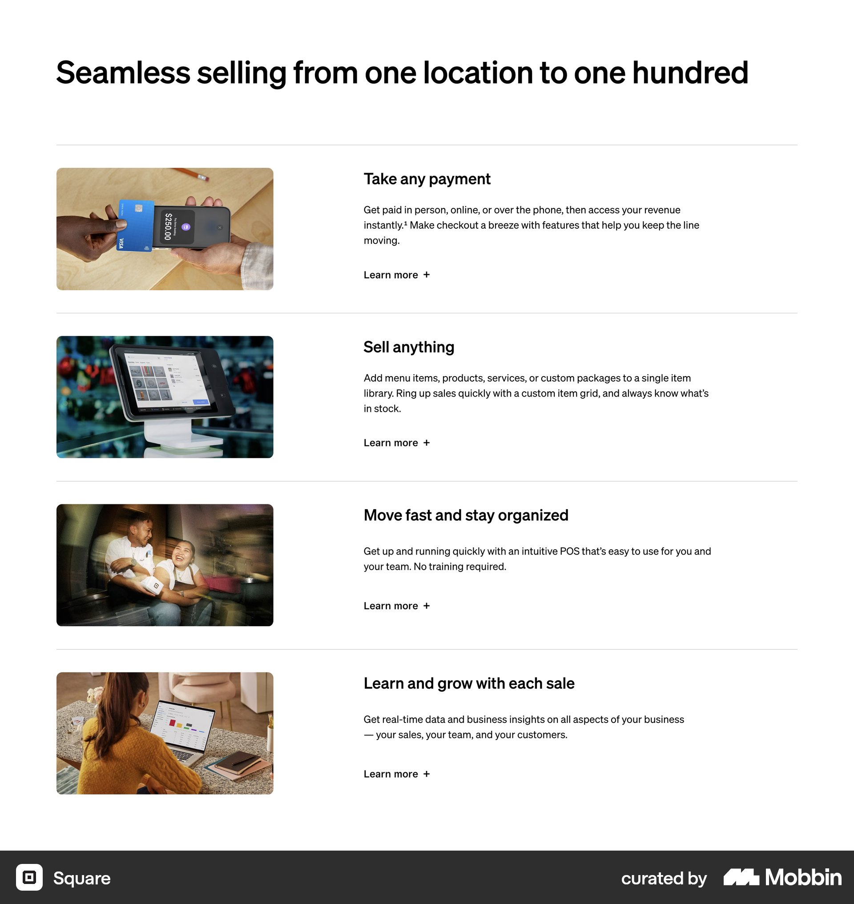
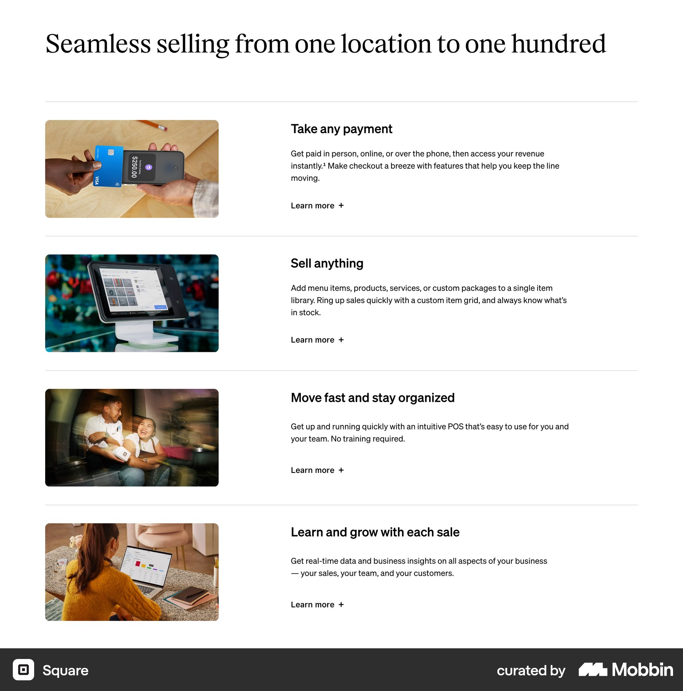
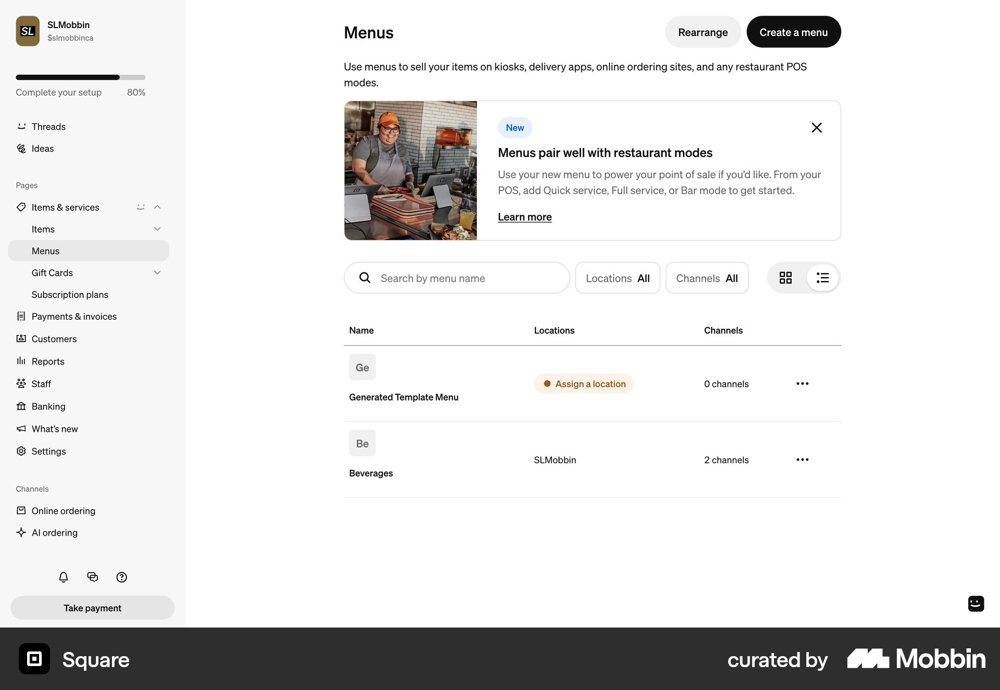
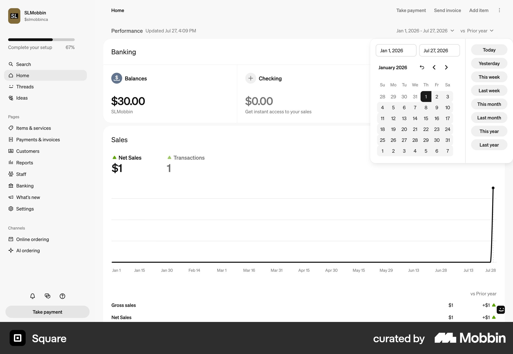
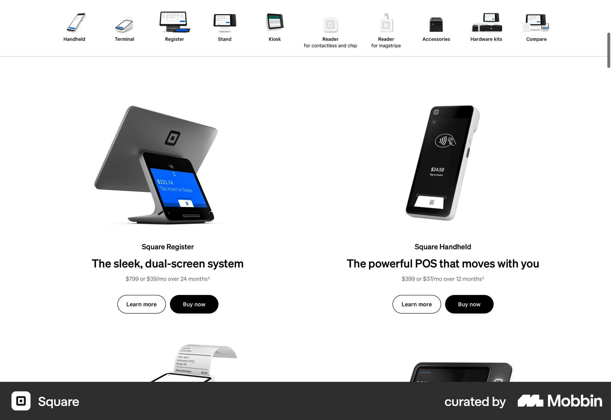
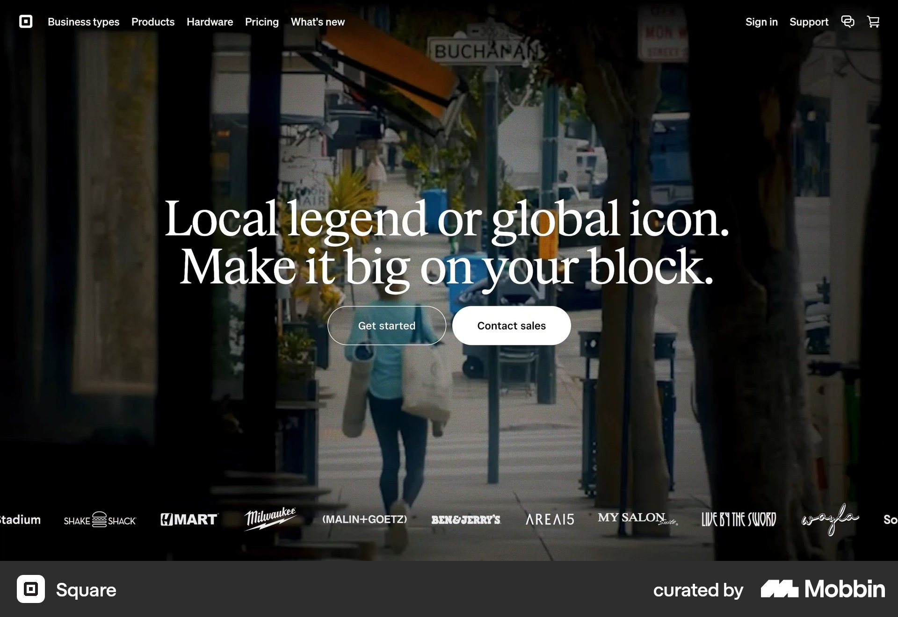

# Square

이 문서는 수집한 화면·섹션·흐름의 구현 참고 명세다. 전체 사이트 분석을 뜻하지 않는다.

## 기능 소개

- 자료 유형: section
- 출처: [Square — Mobbin](https://mobbin.com/sites/sections/54ba196c-c979-4564-a54a-c02a23e8e8f7)
- 확인 날짜: 2026-10-11
- 패턴: features

### 직접 관찰

- 흰 바탕, 큰 산세리프 제목 아래 네 개 가로 구분 행. 행마다 왼쪽 작은 사진과 오른쪽 소제목·설명·Learn more 링크.

원본 파일: [오프라인 JPEG](../../../assets/references/54ba196c-c979-4564-a54a-c02a23e8e8f7.jpg).

### 구현에 적용

- 위 관찰의 열 구성, 이미지 비중, 제목 위계, 색 대비를 먼저 구현한다.
- 화면에 보이는 입력·선택·필터·이동 요소를 실제 동작으로 연결한다. 정적 이미지로 확인되지 않는 동작은 구현 제안으로 기록한다.
- 해당 패턴의 [구현 플레이북](../../playbooks.md)을 읽고 완료 조건을 적용한다.
- 모바일 구성과 정확한 토큰은 이 자료만으로 확정하지 않는다. 모바일 자료를 추가 검색하고 고해상도 원본에서 측정한다.

## 기능 소개

- 자료 유형: section
- 출처: [Square — Mobbin](https://mobbin.com/sites/sections/39d72df8-07a4-4434-bb5e-cc0dd73d4f8b)
- 확인 날짜: 2026-10-11
- 패턴: features

### 직접 관찰

- Square의 같은 네 행 기능 구조를 세리프 제목으로 보여주는 변형. 왼쪽 사진·오른쪽 설명·구분선을 유지하며 타이포그래피가 달라짐.

원본 파일: [오프라인 JPEG](../../../assets/references/39d72df8-07a4-4434-bb5e-cc0dd73d4f8b.jpg).

### 구현에 적용

- 위 관찰의 열 구성, 이미지 비중, 제목 위계, 색 대비를 먼저 구현한다.
- 화면에 보이는 입력·선택·필터·이동 요소를 실제 동작으로 연결한다. 정적 이미지로 확인되지 않는 동작은 구현 제안으로 기록한다.
- 해당 패턴의 [구현 플레이북](../../playbooks.md)을 읽고 완료 조건을 적용한다.
- 모바일 구성과 정확한 토큰은 이 자료만으로 확정하지 않는다. 모바일 자료를 추가 검색하고 고해상도 원본에서 측정한다.

## 식당 관리

- 자료 유형: screen
- 출처: [Square — Mobbin](https://mobbin.com/screens/0e4db54a-37c7-4719-bd02-3b7b5b994d11)
- 확인 날짜: 2026-10-11
- 패턴: restaurant-admin

### 직접 관찰

- 메뉴 관리 화면. 왼쪽 관리 사이드바, 가운데 Menus 제목과 사진 포함 안내 배너, 검색·위치·채널 필터, 메뉴 목록과 Create a menu 버튼.

원본 파일: [오프라인 JPEG](../../../assets/references/0e4db54a-37c7-4719-bd02-3b7b5b994d11.jpg).

### 구현에 적용

- 위 관찰의 열 구성, 이미지 비중, 제목 위계, 색 대비를 먼저 구현한다.
- 화면에 보이는 입력·선택·필터·이동 요소를 실제 동작으로 연결한다. 정적 이미지로 확인되지 않는 동작은 구현 제안으로 기록한다.
- 해당 패턴의 [구현 플레이북](../../playbooks.md)을 읽고 완료 조건을 적용한다.
- 모바일 구성과 정확한 토큰은 이 자료만으로 확정하지 않는다. 모바일 자료를 추가 검색하고 고해상도 원본에서 측정한다.

## 금융·거래 관리

- 자료 유형: screen
- 출처: [Square — Mobbin](https://mobbin.com/screens/73e78acc-e251-4502-b653-28e14fb40ccb)
- 확인 날짜: 2026-10-11
- 패턴: finance, dashboard

### 직접 관찰

- 상인 금융 개요. 왼쪽 사이드바, Banking 잔액 두 카드와 Sales 수치·선 그래프. 우상단 날짜 범위 팝오버에 달력과 기간 빠른 선택.

원본 파일: [오프라인 JPEG](../../../assets/references/73e78acc-e251-4502-b653-28e14fb40ccb.jpg).

### 구현에 적용

- 위 관찰의 열 구성, 이미지 비중, 제목 위계, 색 대비를 먼저 구현한다.
- 화면에 보이는 입력·선택·필터·이동 요소를 실제 동작으로 연결한다. 정적 이미지로 확인되지 않는 동작은 구현 제안으로 기록한다.
- 해당 패턴의 [구현 플레이북](../../playbooks.md)을 읽고 완료 조건을 적용한다.
- 모바일 구성과 정확한 토큰은 이 자료만으로 확정하지 않는다. 모바일 자료를 추가 검색하고 고해상도 원본에서 측정한다.

## 흰 하드웨어 카탈로그. 위 아이콘 제품군 탭, 아래 두 열 큰 단말 사진·굵은 설명·Learn more와 B

- 자료 유형: section
- 출처: [Square — Mobbin](https://mobbin.com/sites/sections/15dd1e4f-b78a-462e-b314-ba3a9fd949a6)
- 확인 날짜: 2026-10-18
- 패턴: commerce

### 직접 관찰

- 흰 하드웨어 카탈로그. 위 아이콘 제품군 탭, 아래 두 열 큰 단말 사진·굵은 설명·Learn more와 Buy now.

원본 파일: [오프라인 JPEG](../../../assets/references/15dd1e4f-b78a-462e-b314-ba3a9fd949a6.jpg).

### 구현에 적용

- 위 관찰의 열 구성, 이미지 비중, 제목 위계, 색 대비를 먼저 구현한다.
- 화면에 보이는 입력·선택·필터·이동 요소를 실제 동작으로 연결한다. 정적 이미지로 확인되지 않는 동작은 구현 제안으로 기록한다.
- 해당 패턴의 [구현 플레이북](../../playbooks.md)을 읽고 완료 조건을 적용한다.
- 모바일 구성과 정확한 토큰은 이 자료만으로 확정하지 않는다. 모바일 자료를 추가 검색하고 고해상도 원본에서 측정한다.

## 어두운 상점 배경 사진 위 중앙 세리프 제목·작은 두 CTA. 하단 여러 고객 로고, 검정 메뉴.

- 자료 유형: section
- 출처: [Square — Mobbin](https://mobbin.com/sites/sections/28c2f772-c177-4a07-82f5-96b0aefca614)
- 확인 날짜: 2026-10-18
- 패턴: saas-landing

### 직접 관찰

- 어두운 상점 배경 사진 위 중앙 세리프 제목·작은 두 CTA. 하단 여러 고객 로고, 검정 메뉴.

원본 파일: [오프라인 JPEG](../../../assets/references/28c2f772-c177-4a07-82f5-96b0aefca614.jpg).

### 구현에 적용

- 위 관찰의 열 구성, 이미지 비중, 제목 위계, 색 대비를 먼저 구현한다.
- 화면에 보이는 입력·선택·필터·이동 요소를 실제 동작으로 연결한다. 정적 이미지로 확인되지 않는 동작은 구현 제안으로 기록한다.
- 해당 패턴의 [구현 플레이북](../../playbooks.md)을 읽고 완료 조건을 적용한다.
- 모바일 구성과 정확한 토큰은 이 자료만으로 확정하지 않는다. 모바일 자료를 추가 검색하고 고해상도 원본에서 측정한다.
