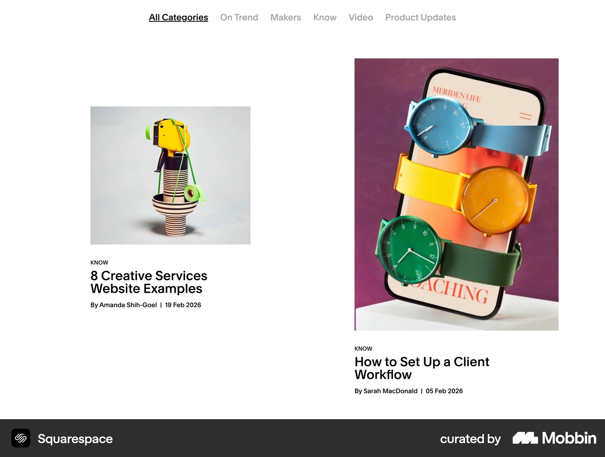
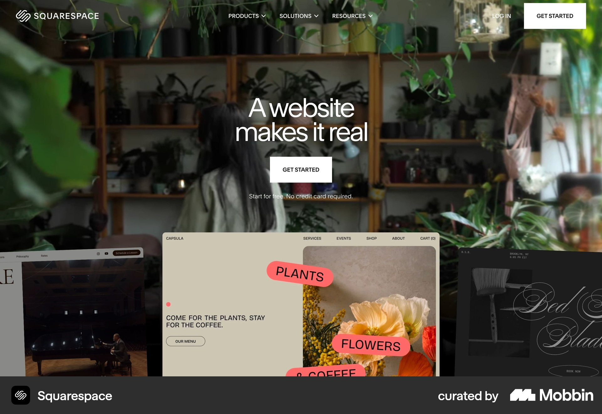

# Squarespace

이 문서는 수집한 화면·섹션·흐름의 구현 참고 명세다. 전체 사이트 분석을 뜻하지 않는다.

## 흰 편집형 블로그. 상단 카테고리 탭, 서로 다른 높이의 큰 사진 두 열과 작은 분류·굵은 제목.

- 자료 유형: section
- 출처: [Squarespace — Mobbin](https://mobbin.com/sites/sections/b9c9a69c-c445-4890-862e-6dcbfa342ba0)
- 확인 날짜: 2026-10-18
- 패턴: editorial

### 직접 관찰

- 흰 편집형 블로그. 상단 카테고리 탭, 서로 다른 높이의 큰 사진 두 열과 작은 분류·굵은 제목.

원본 파일: [오프라인 JPEG](../../../assets/references/b9c9a69c-c445-4890-862e-6dcbfa342ba0.jpg).

### 구현에 적용

- 위 관찰의 열 구성, 이미지 비중, 제목 위계, 색 대비를 먼저 구현한다.
- 화면에 보이는 입력·선택·필터·이동 요소를 실제 동작으로 연결한다. 정적 이미지로 확인되지 않는 동작은 구현 제안으로 기록한다.
- 해당 패턴의 [구현 플레이북](../../playbooks.md)을 읽고 완료 조건을 적용한다.
- 모바일 구성과 정확한 토큰은 이 자료만으로 확정하지 않는다. 모바일 자료를 추가 검색하고 고해상도 원본에서 측정한다.

## 전체 폭 식물 사진 위 중앙 흰 제목·시작 CTA, 아래 겹친 웹사이트 예시 세 장. 상단 작은 메뉴.

- 자료 유형: section
- 출처: [Squarespace — Mobbin](https://mobbin.com/sites/sections/1b4d74a4-5597-473a-89fc-cc391e18a5d3)
- 확인 날짜: 2026-10-18
- 패턴: saas-landing

### 직접 관찰

- 전체 폭 식물 사진 위 중앙 흰 제목·시작 CTA, 아래 겹친 웹사이트 예시 세 장. 상단 작은 메뉴.

원본 파일: [오프라인 JPEG](../../../assets/references/1b4d74a4-5597-473a-89fc-cc391e18a5d3.jpg).

### 구현에 적용

- 위 관찰의 열 구성, 이미지 비중, 제목 위계, 색 대비를 먼저 구현한다.
- 화면에 보이는 입력·선택·필터·이동 요소를 실제 동작으로 연결한다. 정적 이미지로 확인되지 않는 동작은 구현 제안으로 기록한다.
- 해당 패턴의 [구현 플레이북](../../playbooks.md)을 읽고 완료 조건을 적용한다.
- 모바일 구성과 정확한 토큰은 이 자료만으로 확정하지 않는다. 모바일 자료를 추가 검색하고 고해상도 원본에서 측정한다.
