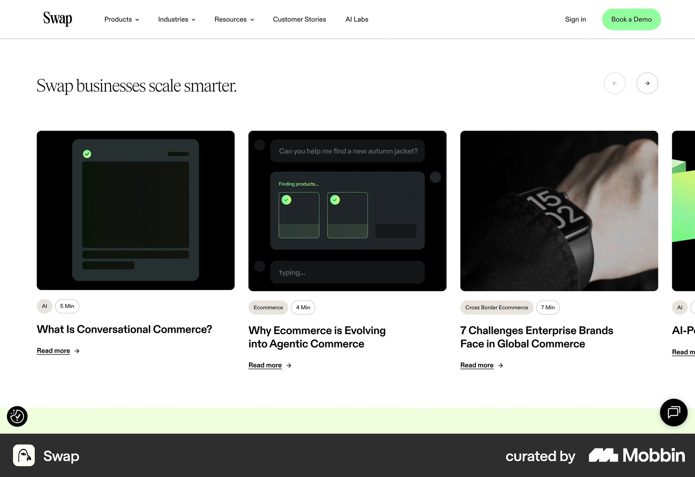
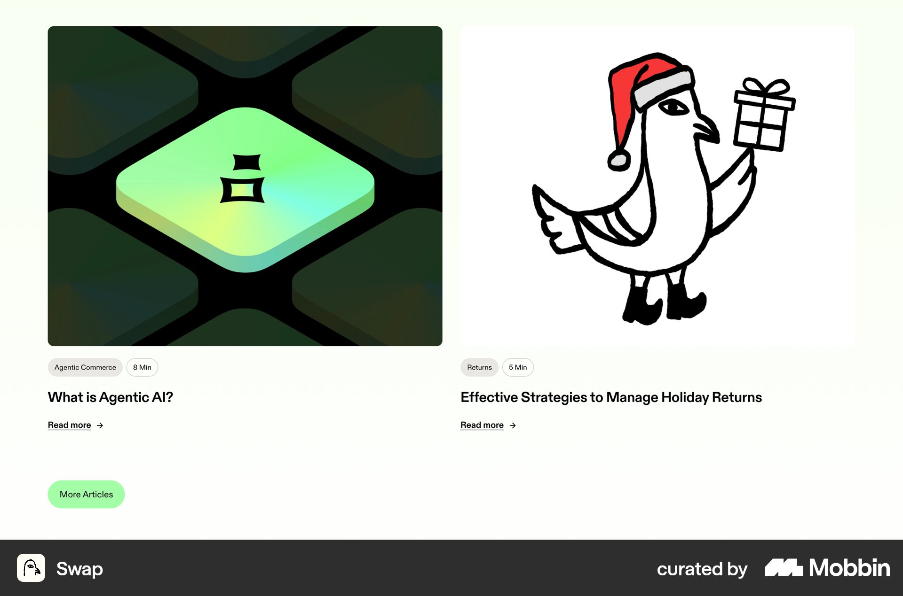

# Swap

이 문서는 수집한 화면·섹션·흐름의 구현 참고 명세다. 전체 사이트 분석을 뜻하지 않는다.

## 편집형 콘텐츠

- 자료 유형: section
- 출처: [Swap — Mobbin](https://mobbin.com/sites/sections/569d23da-a6b2-418b-9bd2-4c9a8084a217)
- 확인 날짜: 2026-10-11
- 패턴: editorial

### 직접 관찰

- 세리프 섹션 제목과 오른쪽 이전다음. 가로 기사 카드에 어두운 이미지·유형과 읽기 시간 알약·굵은 제목·Read more. 오른쪽 다음 카드 일부.

원본 파일: [오프라인 JPEG](../../../assets/references/569d23da-a6b2-418b-9bd2-4c9a8084a217.jpg).

### 구현에 적용

- 위 관찰의 열 구성, 이미지 비중, 제목 위계, 색 대비를 먼저 구현한다.
- 화면에 보이는 입력·선택·필터·이동 요소를 실제 동작으로 연결한다. 정적 이미지로 확인되지 않는 동작은 구현 제안으로 기록한다.
- 해당 패턴의 [구현 플레이북](../../playbooks.md)을 읽고 완료 조건을 적용한다.
- 모바일 구성과 정확한 토큰은 이 자료만으로 확정하지 않는다. 모바일 자료를 추가 검색하고 고해상도 원본에서 측정한다.

## 연초록 블로그 두 열 대형 이미지·유형시간 칩·제목·Read more. 아래 작은 More Articles 

- 자료 유형: section
- 출처: [Swap — Mobbin](https://mobbin.com/sites/sections/9544fc30-9a5f-4e94-bd3d-2c7d40fc9d15)
- 확인 날짜: 2026-10-18
- 패턴: editorial

### 직접 관찰

- 연초록 블로그 두 열 대형 이미지·유형시간 칩·제목·Read more. 아래 작은 More Articles 알약.

원본 파일: [오프라인 JPEG](../../../assets/references/9544fc30-9a5f-4e94-bd3d-2c7d40fc9d15.jpg).

### 구현에 적용

- 위 관찰의 열 구성, 이미지 비중, 제목 위계, 색 대비를 먼저 구현한다.
- 화면에 보이는 입력·선택·필터·이동 요소를 실제 동작으로 연결한다. 정적 이미지로 확인되지 않는 동작은 구현 제안으로 기록한다.
- 해당 패턴의 [구현 플레이북](../../playbooks.md)을 읽고 완료 조건을 적용한다.
- 모바일 구성과 정확한 토큰은 이 자료만으로 확정하지 않는다. 모바일 자료를 추가 검색하고 고해상도 원본에서 측정한다.
