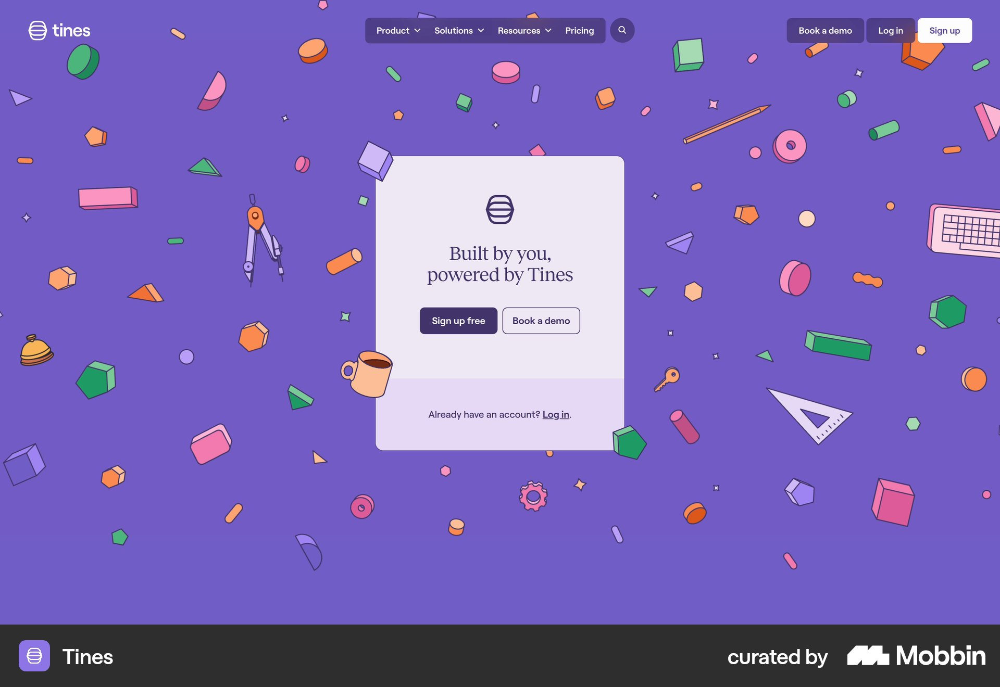
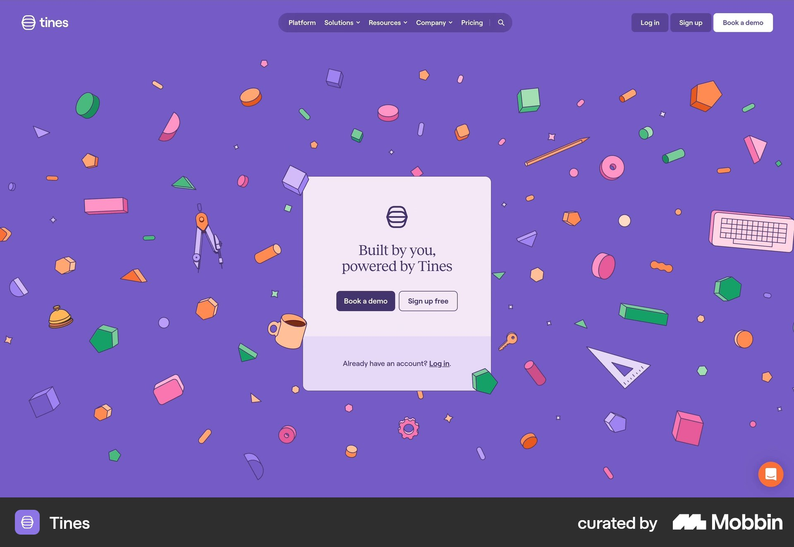
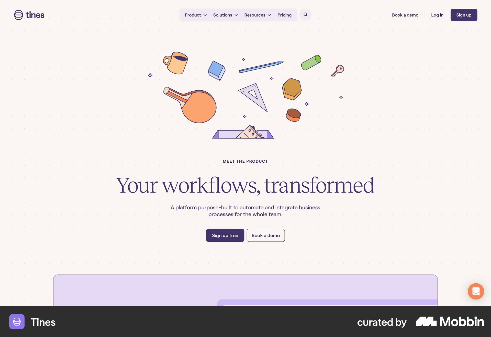
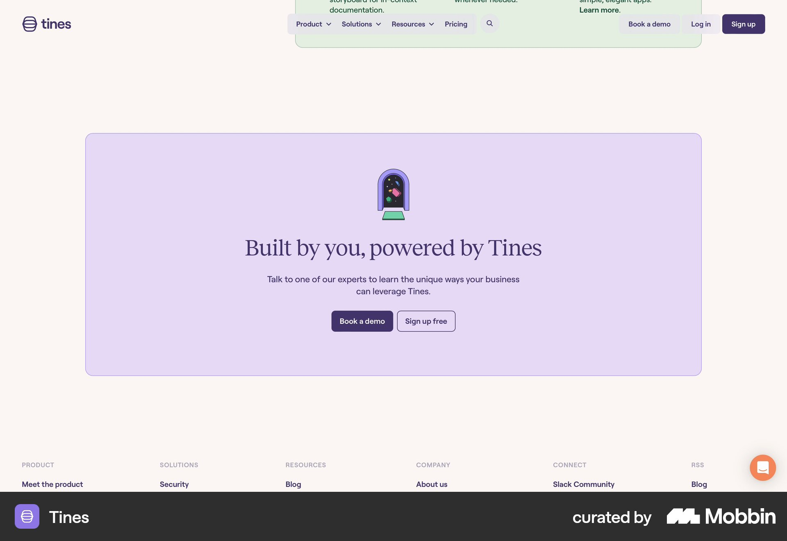

# Tines

이 문서는 수집한 화면·섹션·흐름의 구현 참고 명세다. 전체 사이트 분석을 뜻하지 않는다.

## 보라 전체 화면에 작은 컬러 물체가 흩어짐. 중앙 옅은 카드의 로고·소개·가입·데모 CTA.

- 자료 유형: section
- 출처: [Tines — Mobbin](https://mobbin.com/sites/sections/2b05eff8-4978-4c72-b9e6-0b1935bd7b5e)
- 확인 날짜: 2026-10-18
- 패턴: saas-landing

### 직접 관찰

- 보라 전체 화면에 작은 컬러 물체가 흩어짐. 중앙 옅은 카드의 로고·소개·가입·데모 CTA.

원본 파일: [오프라인 JPEG](../../../assets/references/2b05eff8-4978-4c72-b9e6-0b1935bd7b5e.jpg).

### 구현에 적용

- 위 관찰의 열 구성, 이미지 비중, 제목 위계, 색 대비를 먼저 구현한다.
- 화면에 보이는 입력·선택·필터·이동 요소를 실제 동작으로 연결한다. 정적 이미지로 확인되지 않는 동작은 구현 제안으로 기록한다.
- 해당 패턴의 [구현 플레이북](../../playbooks.md)을 읽고 완료 조건을 적용한다.
- 모바일 구성과 정확한 토큰은 이 자료만으로 확정하지 않는다. 모바일 자료를 추가 검색하고 고해상도 원본에서 측정한다.

## 보라 기하 오브젝트 배경 중앙 흰 카드·작은 로고·가입 및 데모 버튼. 상단 작은 메뉴.

- 자료 유형: section
- 출처: [Tines — Mobbin](https://mobbin.com/sites/sections/8ecbe226-92d2-42ab-bf23-a8bf9e1d930a)
- 확인 날짜: 2026-10-18
- 패턴: saas-landing

### 직접 관찰

- 보라 기하 오브젝트 배경 중앙 흰 카드·작은 로고·가입 및 데모 버튼. 상단 작은 메뉴.

원본 파일: [오프라인 JPEG](../../../assets/references/8ecbe226-92d2-42ab-bf23-a8bf9e1d930a.jpg).

### 구현에 적용

- 위 관찰의 열 구성, 이미지 비중, 제목 위계, 색 대비를 먼저 구현한다.
- 화면에 보이는 입력·선택·필터·이동 요소를 실제 동작으로 연결한다. 정적 이미지로 확인되지 않는 동작은 구현 제안으로 기록한다.
- 해당 패턴의 [구현 플레이북](../../playbooks.md)을 읽고 완료 조건을 적용한다.
- 모바일 구성과 정확한 토큰은 이 자료만으로 확정하지 않는다. 모바일 자료를 추가 검색하고 고해상도 원본에서 측정한다.

## 크림 랜딩 중앙 세리프 제목과 두 CTA. 위 여러 컬러 일상 오브젝트 일러스트, 아래 연보라 영역.

- 자료 유형: section
- 출처: [Tines — Mobbin](https://mobbin.com/sites/sections/a23ddb7e-db20-4b56-ae4b-9cad5af9ecff)
- 확인 날짜: 2026-10-18
- 패턴: saas-landing

### 직접 관찰

- 크림 랜딩 중앙 세리프 제목과 두 CTA. 위 여러 컬러 일상 오브젝트 일러스트, 아래 연보라 영역.

원본 파일: [오프라인 JPEG](../../../assets/references/a23ddb7e-db20-4b56-ae4b-9cad5af9ecff.jpg).

### 구현에 적용

- 위 관찰의 열 구성, 이미지 비중, 제목 위계, 색 대비를 먼저 구현한다.
- 화면에 보이는 입력·선택·필터·이동 요소를 실제 동작으로 연결한다. 정적 이미지로 확인되지 않는 동작은 구현 제안으로 기록한다.
- 해당 패턴의 [구현 플레이북](../../playbooks.md)을 읽고 완료 조건을 적용한다.
- 모바일 구성과 정확한 토큰은 이 자료만으로 확정하지 않는다. 모바일 자료를 추가 검색하고 고해상도 원본에서 측정한다.

## 크림 하단 CTA에 둥근 연보라 패널·작은 캐릭터·세리프 제목·데모와 가입. 아래 푸터 링크.

- 자료 유형: section
- 출처: [Tines — Mobbin](https://mobbin.com/sites/sections/64a851c5-402d-4421-a751-786ff3427a18)
- 확인 날짜: 2026-10-18
- 패턴: conversion-cta

### 직접 관찰

- 크림 하단 CTA에 둥근 연보라 패널·작은 캐릭터·세리프 제목·데모와 가입. 아래 푸터 링크.

원본 파일: [오프라인 JPEG](../../../assets/references/64a851c5-402d-4421-a751-786ff3427a18.jpg).

### 구현에 적용

- 위 관찰의 열 구성, 이미지 비중, 제목 위계, 색 대비를 먼저 구현한다.
- 화면에 보이는 입력·선택·필터·이동 요소를 실제 동작으로 연결한다. 정적 이미지로 확인되지 않는 동작은 구현 제안으로 기록한다.
- 해당 패턴의 [구현 플레이북](../../playbooks.md)을 읽고 완료 조건을 적용한다.
- 모바일 구성과 정확한 토큰은 이 자료만으로 확정하지 않는다. 모바일 자료를 추가 검색하고 고해상도 원본에서 측정한다.
