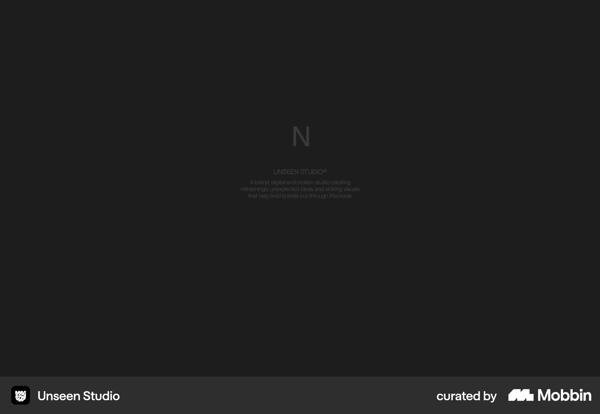

# Unseen Studio

이 문서는 수집한 화면·섹션·흐름의 구현 참고 명세다. 전체 사이트 분석을 뜻하지 않는다.

## 스튜디오 소개

- 자료 유형: section
- 출처: [Unseen Studio — Mobbin](https://mobbin.com/sites/sections/975a7e67-2632-40cb-ab2b-4a9b1a2fc84f)
- 확인 날짜: 2026-10-11
- 패턴: portfolio, needs-review

### 직접 관찰

- 어두운 캡처 중앙 작은 N과 스튜디오 소개만 보임. 로딩 또는 미디어 전환 여부는 확인되지 않았으므로 구현 근거로는 정보 부족.

원본 파일: [오프라인 JPEG](../../../assets/references/975a7e67-2632-40cb-ab2b-4a9b1a2fc84f.jpg).

### 구현에 적용

- 위 관찰의 열 구성, 이미지 비중, 제목 위계, 색 대비를 먼저 구현한다.
- 화면에 보이는 입력·선택·필터·이동 요소를 실제 동작으로 연결한다. 정적 이미지로 확인되지 않는 동작은 구현 제안으로 기록한다.
- 해당 패턴의 [구현 플레이북](../../playbooks.md)을 읽고 완료 조건을 적용한다.
- 모바일 구성과 정확한 토큰은 이 자료만으로 확정하지 않는다. 모바일 자료를 추가 검색하고 고해상도 원본에서 측정한다.

## 스튜디오 소개

- 자료 유형: section
- 출처: [Unseen Studio — Mobbin](https://mobbin.com/sites/sections/1bdc4e01-2f7e-4e09-9aa1-27f02c13bcbe)
- 확인 날짜: 2026-10-11
- 패턴: portfolio

### 직접 관찰

- 분홍 건축과 물의 반사 장면을 전체 화면 배경으로 사용. 중앙 세리프·산세리프 혼합 제목과 View our work 알약. 상단 작은 메뉴·하단 부가 아이콘.

원본 파일: [오프라인 JPEG](../../../assets/references/1bdc4e01-2f7e-4e09-9aa1-27f02c13bcbe.jpg).

### 구현에 적용

- 위 관찰의 열 구성, 이미지 비중, 제목 위계, 색 대비를 먼저 구현한다.
- 화면에 보이는 입력·선택·필터·이동 요소를 실제 동작으로 연결한다. 정적 이미지로 확인되지 않는 동작은 구현 제안으로 기록한다.
- 해당 패턴의 [구현 플레이북](../../playbooks.md)을 읽고 완료 조건을 적용한다.
- 모바일 구성과 정확한 토큰은 이 자료만으로 확정하지 않는다. 모바일 자료를 추가 검색하고 고해상도 원본에서 측정한다.

## 회백색 3D 공간 배경 Selected Projects. 위 작은 필터 알약, 두 프로젝트 이미지와 짧은 유

- 자료 유형: section
- 출처: [Unseen Studio — Mobbin](https://mobbin.com/sites/sections/797682f6-c85e-4eea-82f1-c62de43abc94)
- 확인 날짜: 2026-10-18
- 패턴: portfolio

### 직접 관찰

- 회백색 3D 공간 배경 Selected Projects. 위 작은 필터 알약, 두 프로젝트 이미지와 짧은 유형 설명.

원본 파일: [오프라인 JPEG](../../../assets/references/797682f6-c85e-4eea-82f1-c62de43abc94.jpg).

### 구현에 적용

- 위 관찰의 열 구성, 이미지 비중, 제목 위계, 색 대비를 먼저 구현한다.
- 화면에 보이는 입력·선택·필터·이동 요소를 실제 동작으로 연결한다. 정적 이미지로 확인되지 않는 동작은 구현 제안으로 기록한다.
- 해당 패턴의 [구현 플레이북](../../playbooks.md)을 읽고 완료 조건을 적용한다.
- 모바일 구성과 정확한 토큰은 이 자료만으로 확정하지 않는다. 모바일 자료를 추가 검색하고 고해상도 원본에서 측정한다.

## 회백색 3D 배경 위 두 열 프로젝트 카드. 큰 썸네일·짧은 캡션·필터 메뉴.

- 자료 유형: section
- 출처: [Unseen Studio — Mobbin](https://mobbin.com/sites/sections/79d328bc-800b-4830-9de1-7ef8fd2dd00f)
- 확인 날짜: 2026-10-18
- 패턴: portfolio

### 직접 관찰

- 회백색 3D 배경 위 두 열 프로젝트 카드. 큰 썸네일·짧은 캡션·필터 메뉴.

원본 파일: [오프라인 JPEG](../../../assets/references/79d328bc-800b-4830-9de1-7ef8fd2dd00f.jpg).

### 구현에 적용

- 위 관찰의 열 구성, 이미지 비중, 제목 위계, 색 대비를 먼저 구현한다.
- 화면에 보이는 입력·선택·필터·이동 요소를 실제 동작으로 연결한다. 정적 이미지로 확인되지 않는 동작은 구현 제안으로 기록한다.
- 해당 패턴의 [구현 플레이북](../../playbooks.md)을 읽고 완료 조건을 적용한다.
- 모바일 구성과 정확한 토큰은 이 자료만으로 확정하지 않는다. 모바일 자료를 추가 검색하고 고해상도 원본에서 측정한다.
