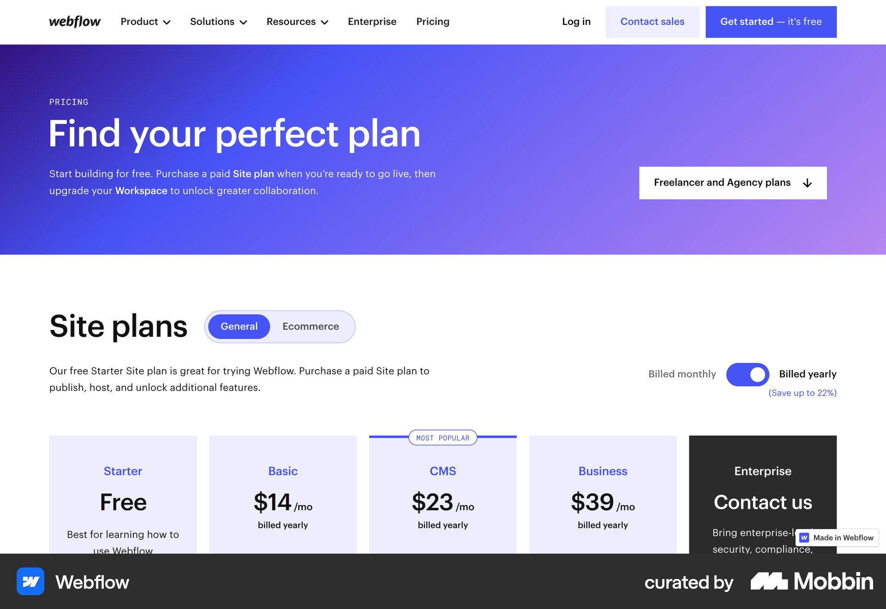
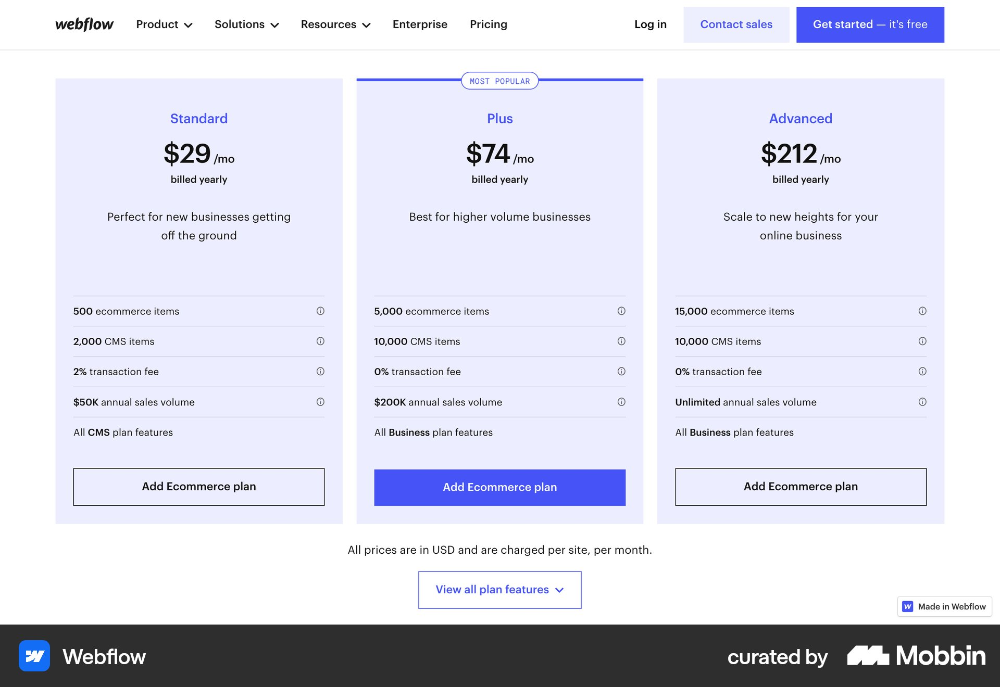
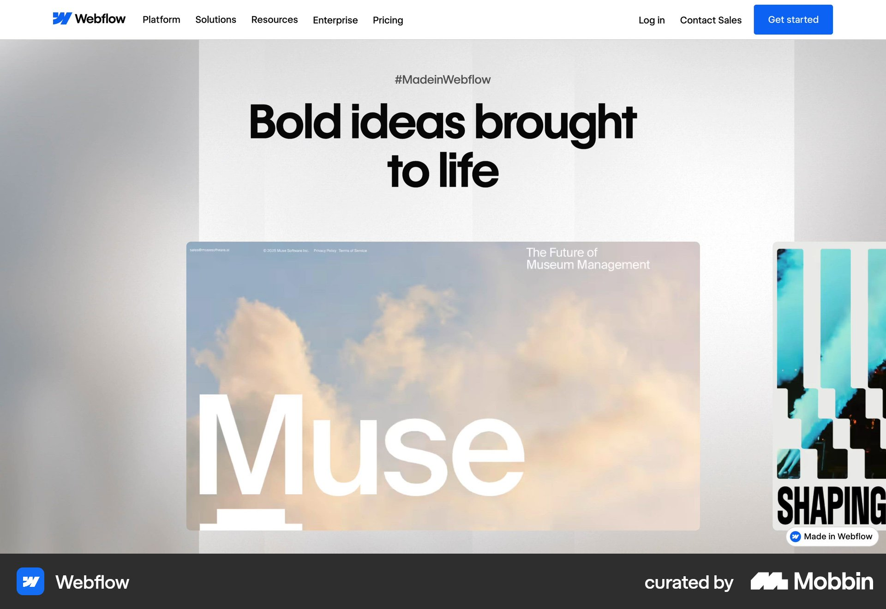
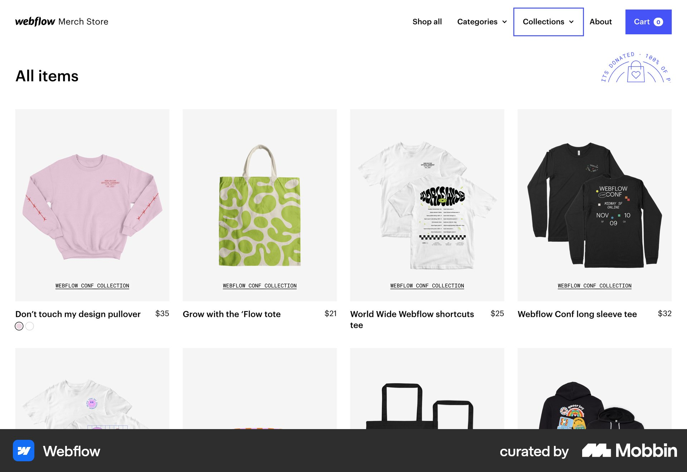
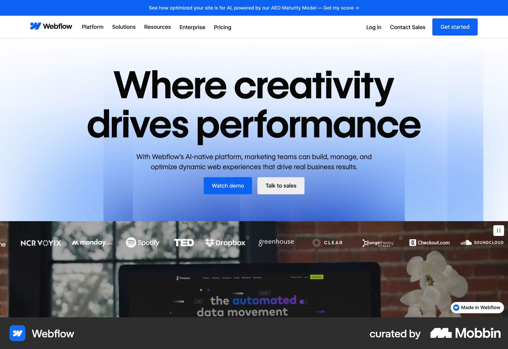
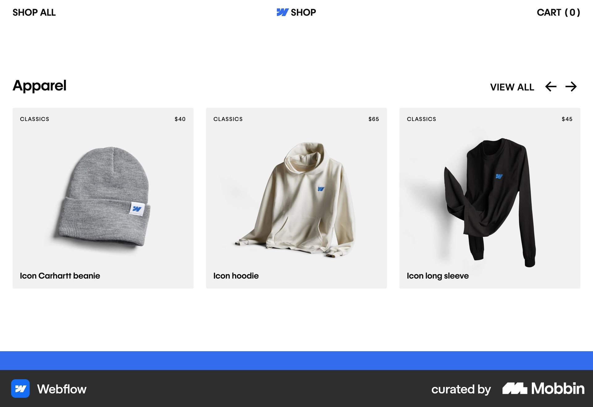

# Webflow

이 문서는 수집한 화면·섹션·흐름의 구현 참고 명세다. 전체 사이트 분석을 뜻하지 않는다.

## 요금제

- 자료 유형: section
- 출처: [Webflow — Mobbin](https://mobbin.com/sites/sections/9420ada1-5228-48b0-9ba1-7455d80f0e66)
- 확인 날짜: 2026-10-11
- 패턴: pricing

### 직접 관찰

- 보라파랑 그라디언트 상단 소개와 플랜 대상 선택. 아래 General/Ecommerce 탭·월연 토글, 다섯 요금제 열. Enterprise만 검정, CMS 인기 배지.

원본 파일: [오프라인 JPEG](../../../assets/references/9420ada1-5228-48b0-9ba1-7455d80f0e66.jpg).

### 구현에 적용

- 위 관찰의 열 구성, 이미지 비중, 제목 위계, 색 대비를 먼저 구현한다.
- 화면에 보이는 입력·선택·필터·이동 요소를 실제 동작으로 연결한다. 정적 이미지로 확인되지 않는 동작은 구현 제안으로 기록한다.
- 해당 패턴의 [구현 플레이북](../../playbooks.md)을 읽고 완료 조건을 적용한다.
- 모바일 구성과 정확한 토큰은 이 자료만으로 확정하지 않는다. 모바일 자료를 추가 검색하고 고해상도 원본에서 측정한다.

## 연보라 세 요금제 열과 기능별 가로 구분선. 가운데 인기 플랜의 파란 구매 버튼.

- 자료 유형: section
- 출처: [Webflow — Mobbin](https://mobbin.com/sites/sections/86a4762c-79ce-4fe5-8aa7-8bdbba561302)
- 확인 날짜: 2026-10-18
- 패턴: pricing

### 직접 관찰

- 연보라 세 요금제 열과 기능별 가로 구분선. 가운데 인기 플랜의 파란 구매 버튼.

원본 파일: [오프라인 JPEG](../../../assets/references/86a4762c-79ce-4fe5-8aa7-8bdbba561302.jpg).

### 구현에 적용

- 위 관찰의 열 구성, 이미지 비중, 제목 위계, 색 대비를 먼저 구현한다.
- 화면에 보이는 입력·선택·필터·이동 요소를 실제 동작으로 연결한다. 정적 이미지로 확인되지 않는 동작은 구현 제안으로 기록한다.
- 해당 패턴의 [구현 플레이북](../../playbooks.md)을 읽고 완료 조건을 적용한다.
- 모바일 구성과 정확한 토큰은 이 자료만으로 확정하지 않는다. 모바일 자료를 추가 검색하고 고해상도 원본에서 측정한다.

## 밝은 회색 배경 중앙 큰 제목. 아래 큰 작업 이미지와 오른쪽 다음 작업 일부가 보이는 가로 전시 구조.

- 자료 유형: section
- 출처: [Webflow — Mobbin](https://mobbin.com/sites/sections/103632e2-e594-4aba-8287-68eedd2cfb44)
- 확인 날짜: 2026-10-18
- 패턴: portfolio

### 직접 관찰

- 밝은 회색 배경 중앙 큰 제목. 아래 큰 작업 이미지와 오른쪽 다음 작업 일부가 보이는 가로 전시 구조.

원본 파일: [오프라인 JPEG](../../../assets/references/103632e2-e594-4aba-8287-68eedd2cfb44.jpg).

### 구현에 적용

- 위 관찰의 열 구성, 이미지 비중, 제목 위계, 색 대비를 먼저 구현한다.
- 화면에 보이는 입력·선택·필터·이동 요소를 실제 동작으로 연결한다. 정적 이미지로 확인되지 않는 동작은 구현 제안으로 기록한다.
- 해당 패턴의 [구현 플레이북](../../playbooks.md)을 읽고 완료 조건을 적용한다.
- 모바일 구성과 정확한 토큰은 이 자료만으로 확정하지 않는다. 모바일 자료를 추가 검색하고 고해상도 원본에서 측정한다.

## 실제 굿즈 스토어. 흰 바탕 네 열 상품 사진·이름·가격, 상단 Collection 드롭다운과 카트.

- 자료 유형: section
- 출처: [Webflow — Mobbin](https://mobbin.com/sites/sections/6400774c-b34b-49db-a9d2-423d6f6dcc01)
- 확인 날짜: 2026-10-18
- 패턴: commerce

### 직접 관찰

- 실제 굿즈 스토어. 흰 바탕 네 열 상품 사진·이름·가격, 상단 Collection 드롭다운과 카트.

원본 파일: [오프라인 JPEG](../../../assets/references/6400774c-b34b-49db-a9d2-423d6f6dcc01.jpg).

### 구현에 적용

- 위 관찰의 열 구성, 이미지 비중, 제목 위계, 색 대비를 먼저 구현한다.
- 화면에 보이는 입력·선택·필터·이동 요소를 실제 동작으로 연결한다. 정적 이미지로 확인되지 않는 동작은 구현 제안으로 기록한다.
- 해당 패턴의 [구현 플레이북](../../playbooks.md)을 읽고 완료 조건을 적용한다.
- 모바일 구성과 정확한 토큰은 이 자료만으로 확정하지 않는다. 모바일 자료를 추가 검색하고 고해상도 원본에서 측정한다.

## 파란 그라디언트 중앙 히어로와 두 CTA, 아래 영상·고객 로고 띠. 열린 메가메뉴는 보이지 않음.

- 자료 유형: section
- 출처: [Webflow — Mobbin](https://mobbin.com/sites/sections/6c07a4e9-a657-487f-9b42-bd22b2afd4fe)
- 확인 날짜: 2026-10-18
- 패턴: saas-landing

### 직접 관찰

- 파란 그라디언트 중앙 히어로와 두 CTA, 아래 영상·고객 로고 띠. 열린 메가메뉴는 보이지 않음.

원본 파일: [오프라인 JPEG](../../../assets/references/6c07a4e9-a657-487f-9b42-bd22b2afd4fe.jpg).

### 구현에 적용

- 위 관찰의 열 구성, 이미지 비중, 제목 위계, 색 대비를 먼저 구현한다.
- 화면에 보이는 입력·선택·필터·이동 요소를 실제 동작으로 연결한다. 정적 이미지로 확인되지 않는 동작은 구현 제안으로 기록한다.
- 해당 패턴의 [구현 플레이북](../../playbooks.md)을 읽고 완료 조건을 적용한다.
- 모바일 구성과 정확한 토큰은 이 자료만으로 확정하지 않는다. 모바일 자료를 추가 검색하고 고해상도 원본에서 측정한다.

## 흰 Apparel 상품 행 세 열. 위 카테고리·카트·View all 및 화살표, 연회색 카드 안 모자와 의

- 자료 유형: section
- 출처: [Webflow — Mobbin](https://mobbin.com/sites/sections/88d774b5-01dd-4080-9c96-1fb14eb6fb16)
- 확인 날짜: 2026-10-18
- 패턴: commerce

### 직접 관찰

- 흰 Apparel 상품 행 세 열. 위 카테고리·카트·View all 및 화살표, 연회색 카드 안 모자와 의류.

원본 파일: [오프라인 JPEG](../../../assets/references/88d774b5-01dd-4080-9c96-1fb14eb6fb16.jpg).

### 구현에 적용

- 위 관찰의 열 구성, 이미지 비중, 제목 위계, 색 대비를 먼저 구현한다.
- 화면에 보이는 입력·선택·필터·이동 요소를 실제 동작으로 연결한다. 정적 이미지로 확인되지 않는 동작은 구현 제안으로 기록한다.
- 해당 패턴의 [구현 플레이북](../../playbooks.md)을 읽고 완료 조건을 적용한다.
- 모바일 구성과 정확한 토큰은 이 자료만으로 확정하지 않는다. 모바일 자료를 추가 검색하고 고해상도 원본에서 측정한다.
