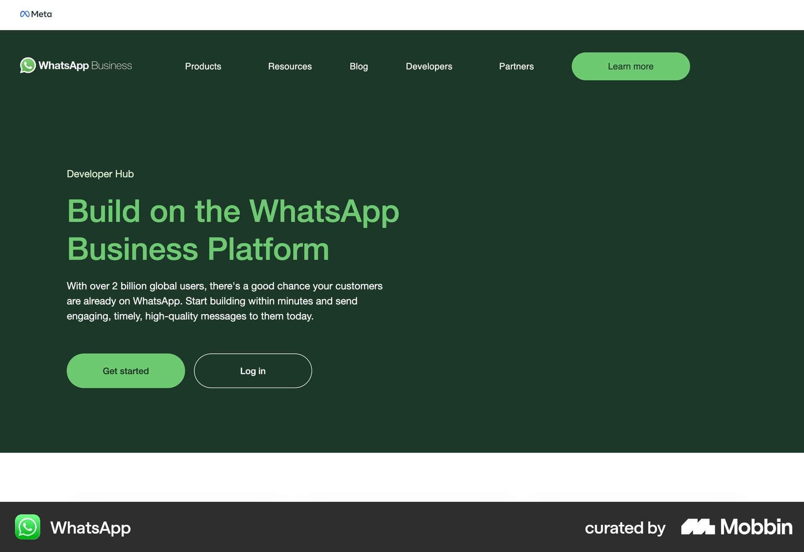
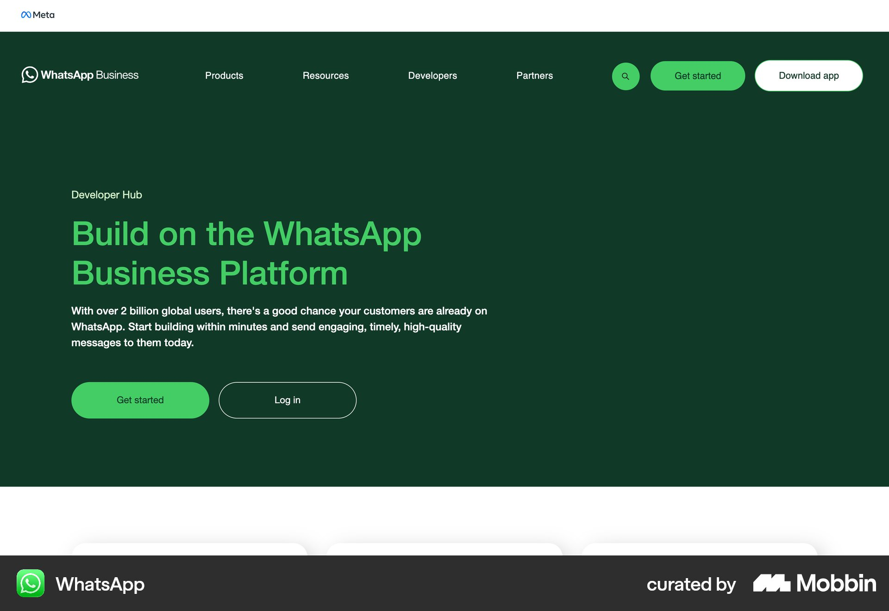

# WhatsApp

이 문서는 수집한 화면·섹션·흐름의 구현 참고 명세다. 전체 사이트 분석을 뜻하지 않는다.

## 개발자 플랫폼 소개

- 자료 유형: section
- 출처: [WhatsApp — Mobbin](https://mobbin.com/sites/sections/76bca6f7-4d81-4187-a91a-733048ffc7b3)
- 확인 날짜: 2026-10-11
- 패턴: developer-landing

### 직접 관찰

- 짙은 초록 Developer Hub. 왼쪽 큰 연초록 제목·흰 설명·초록 시작 및 외곽선 로그인 CTA, 위 제품 내비게이션. 코드 샘플은 보이지 않음.

원본 파일: [오프라인 JPEG](../../../assets/references/76bca6f7-4d81-4187-a91a-733048ffc7b3.jpg).

### 구현에 적용

- 위 관찰의 열 구성, 이미지 비중, 제목 위계, 색 대비를 먼저 구현한다.
- 화면에 보이는 입력·선택·필터·이동 요소를 실제 동작으로 연결한다. 정적 이미지로 확인되지 않는 동작은 구현 제안으로 기록한다.
- 해당 패턴의 [구현 플레이북](../../playbooks.md)을 읽고 완료 조건을 적용한다.
- 모바일 구성과 정확한 토큰은 이 자료만으로 확정하지 않는다. 모바일 자료를 추가 검색하고 고해상도 원본에서 측정한다.

## 개발자 플랫폼 소개

- 자료 유형: section
- 출처: [WhatsApp — Mobbin](https://mobbin.com/sites/sections/3e30cca9-9fd0-492e-9213-7545dda0f777)
- 확인 날짜: 2026-10-11
- 패턴: developer-landing

### 직접 관찰

- WhatsApp 개발자 히어로의 변형. 짙은 초록에 왼쪽 제목·설명·시작/로그인 버튼, 상단 검색·Get started·Download app 메뉴.

원본 파일: [오프라인 JPEG](../../../assets/references/3e30cca9-9fd0-492e-9213-7545dda0f777.jpg).

### 구현에 적용

- 위 관찰의 열 구성, 이미지 비중, 제목 위계, 색 대비를 먼저 구현한다.
- 화면에 보이는 입력·선택·필터·이동 요소를 실제 동작으로 연결한다. 정적 이미지로 확인되지 않는 동작은 구현 제안으로 기록한다.
- 해당 패턴의 [구현 플레이북](../../playbooks.md)을 읽고 완료 조건을 적용한다.
- 모바일 구성과 정확한 토큰은 이 자료만으로 확정하지 않는다. 모바일 자료를 추가 검색하고 고해상도 원본에서 측정한다.
