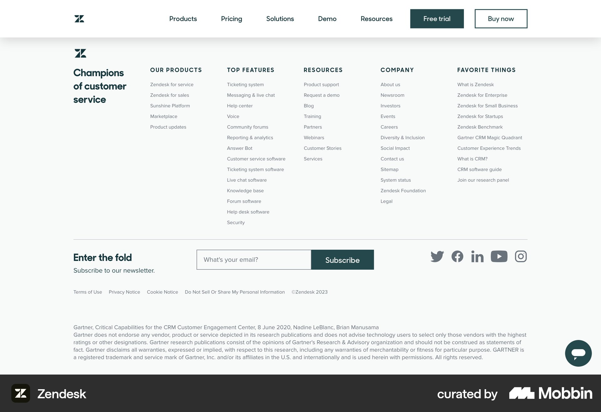
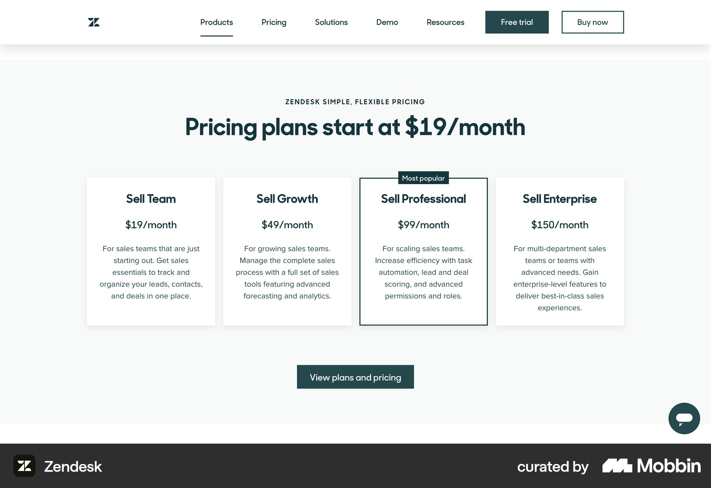

# Zendesk

이 문서는 수집한 화면·섹션·흐름의 구현 참고 명세다. 전체 사이트 분석을 뜻하지 않는다.

## 푸터·뉴스레터

- 자료 유형: section
- 출처: [Zendesk — Mobbin](https://mobbin.com/sites/sections/2e8bfe6a-f94b-4f8a-84f5-7fd518da9598)
- 확인 날짜: 2026-10-11
- 패턴: footer, newsletter

### 직접 관찰

- 왼쪽 브랜드 문구와 다섯 개 촘촘한 링크 열. 가로 구분선 아래 이메일 입력·짙은 청록 구독 버튼·소셜 아이콘, 하단 법적 고지.

원본 파일: [오프라인 JPEG](../../../assets/references/2e8bfe6a-f94b-4f8a-84f5-7fd518da9598.jpg).

### 구현에 적용

- 위 관찰의 열 구성, 이미지 비중, 제목 위계, 색 대비를 먼저 구현한다.
- 화면에 보이는 입력·선택·필터·이동 요소를 실제 동작으로 연결한다. 정적 이미지로 확인되지 않는 동작은 구현 제안으로 기록한다.
- 해당 패턴의 [구현 플레이북](../../playbooks.md)을 읽고 완료 조건을 적용한다.
- 모바일 구성과 정확한 토큰은 이 자료만으로 확정하지 않는다. 모바일 자료를 추가 검색하고 고해상도 원본에서 측정한다.

## 흰 가격 페이지 중앙 청록 제목. 네 흰 플랜 카드 중 세번째 짙은 테두리 강조, 하단 전체 요금 링크.

- 자료 유형: section
- 출처: [Zendesk — Mobbin](https://mobbin.com/sites/sections/db55d7e4-744f-49b9-accb-7f9248ca938c)
- 확인 날짜: 2026-10-18
- 패턴: pricing

### 직접 관찰

- 흰 가격 페이지 중앙 청록 제목. 네 흰 플랜 카드 중 세번째 짙은 테두리 강조, 하단 전체 요금 링크.

원본 파일: [오프라인 JPEG](../../../assets/references/db55d7e4-744f-49b9-accb-7f9248ca938c.jpg).

### 구현에 적용

- 위 관찰의 열 구성, 이미지 비중, 제목 위계, 색 대비를 먼저 구현한다.
- 화면에 보이는 입력·선택·필터·이동 요소를 실제 동작으로 연결한다. 정적 이미지로 확인되지 않는 동작은 구현 제안으로 기록한다.
- 해당 패턴의 [구현 플레이북](../../playbooks.md)을 읽고 완료 조건을 적용한다.
- 모바일 구성과 정확한 토큰은 이 자료만으로 확정하지 않는다. 모바일 자료를 추가 검색하고 고해상도 원본에서 측정한다.
